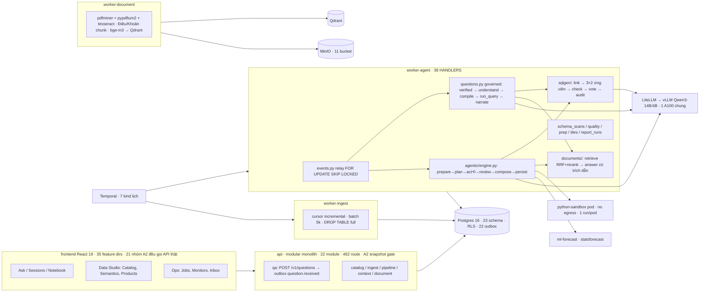

# 00. Đánh giá điều hành, hiện trạng và phản biện

> Ngày 12/11/2026. HEAD `9e503407` (cụm dev local đang chạy đúng SHA này). Đây là Part 1, Part 2 và Part 10 của
> bộ blueprint; các phần còn lại ở [README.md](README.md). Mọi nhận định có bằng chứng `file:dòng` lấy từ năm
> lượt audit mã (`docs/blueprint/evidence/audit-*.md`) hoặc từ số đo chạy thật ngày 12/11 (`evidence/baseline.md`).
> Số không đo được thì ghi là "chưa đo", không ước.

## Part 1 — Executive assessment

### 1.1 Kết luận một đoạn

Data Agent **không phải** là "chatbot nối nhiều công cụ": nó đã có một lớp ngữ cảnh có quản trị (semantic model
có version và chứng nhận, verified query, Data Space, quyền kiểm trước khi sinh, receipt niêm phong) và đường trả
lời có quản trị (governed) trả đúng **20/20** câu đơn giản trên AdventureWorks với 536 token/câu. Nhưng sản phẩm
đang **mở rộng theo bề ngang nhanh hơn chiều sâu**: 23 schema, 184 bảng, 462 endpoint, 35 khu vực màn hình, trong
khi bốn năng lực lõi mà prompt này nêu (Data, Ask, Analytics, Tài liệu) mỗi cái đều có một lỗ hổng cấu trúc đã
kiểm chứng trong mã, và **chưa có dữ liệu thật ngoài AdventureWorks** để chứng minh điều gì. Việc cần làm không
phải thêm agent hay đổi model; là **dừng mở rộng, đóng các lỗ hổng cấu trúc, đo bằng dữ liệu thật**.

### 1.2 Năm nhận định chính

| # | Nhận định | Bằng chứng |
| --- | --- | --- |
| 1 | **Điểm số phụ thuộc semantic model đã duyệt, không phụ thuộc engine.** Khi metric chưa chứng nhận: 3/60 cả hai engine (03/11). Sau khi duyệt: governed 20/20, agentic 17/20 trên cùng 20 câu (12/11) | `evidence/baseline.md`, `docs/v3/eval/ds-aw-agent-eval.md` |
| 2 | **Agent động đắt 42× token và 7× thời gian so với đường governed trên câu đơn giản**, và thua 3 câu vì chính các lỗi mà gate "no_figure" tạo ra (coi toàn số 0 là "không có dữ liệu", từ chối sai kỳ đầy đủ) | agentic 22 626 token / 16,1 s; governed 536 / 2,3 s; `audit-ask.md` §10 |
| 3 | **Dữ liệu nạp vào bị ghi đè tại chỗ** (`DROP TABLE` khi nạp full và khi commit upload) nên receipt ghim `dataset_version` trỏ tới dữ liệu không còn; "point-in-time" chỉ là danh nghĩa | `routines/workspace.sql:54`, `worker_ingest/worker.py:632`, `uploads.py:255`; `audit-data.md` §6 |
| 4 | **Bảng trong tài liệu bị dẹt thành chữ** (`"a | b"`), PDF không nhận bảng; truy hồi tiếng Việt không dấu đạt recall@1 **0,10**; và baseline truy hồi đã ghi (RES-12) thực chất là **nửa từ khoá** vì TEI không chạy trên cụm local nhưng báo cáo vẫn ghi `dense: true` | `extractors.py:264-273`, `evidence/baseline.md` (156 lần "dense unavailable") |
| 5 | **Phân tích = SQL + mô tả tất định + LLM kể**; các primitive anomaly/funnel/report_outline là mã chết, monitor không bao giờ chạy theo lịch, sandbox Python tính được nhưng câu trả lời agentic **không có receipt** để tái lập | `skill_runs.py:148`, `schedules/targets.py`, `agentic/engine.py:1161`; `audit-analytics.md` §1, §5, §8 |

### 1.3 Điều phải thay đổi (quyết định)

1. **Định vị lại thành "Governed Analytics Agent"**: đường governed là mặc định, agent động chỉ nhận câu nhiều bước
   và câu lai số + tài liệu, chạy trong một plan DAG kiểm tĩnh, có ngân sách. Không multi-agent swarm. MVP ở mức
   **L2 vững + Proto-L3 có giám sát** (xem [STRATEGY.md](STRATEGY.md) §4).
2. **Đóng băng bề ngang** cho đến khi P0 đạt cổng: không thêm schema, màn, connector enum, agent kind mới. Danh
   sách Remove/Defer ở [STRATEGY.md](STRATEGY.md) §6.
3. **Năm lỗ hổng cấu trúc đóng trước mọi tính năng**: (a) bảng nạp có version, không `DROP`; (b) mã nhãn tin cậy
   lưu trên câu trả lời + receipt cho mọi đường; (c) bảng tài liệu là cấu trúc có ô và vị trí (Docling); (d) chỉ mục
   từ vựng bỏ dấu; (e) DQ `blocked` chặn đường governed và báo cáo, không chỉ ghi lưu ý.
4. **Dữ liệu thật là cổng**: thêm hai Data Space từ NYC TLC trip records (thay NYC 311 ngày 16/11: cổng trả 403) và SEC EDGAR (có giấy phép rõ, có checksum), bộ vàng
   ≥ 150 case giải mù hai người; ngưỡng online chỉ được chốt từ lượt chạy thật (hiện tất cả là `provisional`).
5. **Đo trước khi mua**: ba PoC bắt buộc trước khi tích hợp (Docling vs pipeline hiện tại trên 30 tài liệu; DuckDB
   trong sandbox vs JSON 10k dòng; rule-audit SQL khám phá trên bộ DS-AW) — [OPEN_SOURCE_RESEARCH.md](OPEN_SOURCE_RESEARCH.md) §4.

## Part 2 — Kiến trúc hiện trạng và nguyên nhân gốc

### 2.1 Hình hiện trạng (đo trên mã)

Đã triển khai mà **không ai dùng**: Kafka (chỉ là một `SourceKind`), ClickHouse (chỉ Langfuse), Langfuse (không có
span nào gửi), Prometheus (chỉ scrape chính nó). Không có TEI trên cụm local (nửa dense/rerank tắt).

### 2.2 Vấn đề theo domain, mức độ, bằng chứng, nguyên nhân

Mức: **S1** sai số hoặc rò quyền; **S2** vi phạm bất biến sản phẩm / không tái lập; **S3** thiếu năng lực; **S4** nợ
vận hành.

#### DATA (`evidence/audit-data.md`)

| ID | Vấn đề | Mức | Bằng chứng | Nguyên nhân gốc |
| --- | --- | --- | --- | --- |
| D-1 | Nạp full và commit upload `DROP TABLE` tại chỗ; `dataset_version` tăng nhưng dữ liệu cũ mất; receipt ghim version "ma" | S2 | `routines/workspace.sql:54`, `worker.py:632`, `uploads.py:255,360` | Thiết kế workspace table = một bảng/ dataset; không có bảng theo version + view |
| D-2 | Bước prep do agent đề xuất ghi thẳng vào pipeline `active` (AUD-04); PATCH steps If-Match tuỳ chọn (AUD-09) | S1 | `prep.py:262-285`, `pipeline/routes.py:540-547` | Thiếu trạng thái "bản nháp" cho steps; OCC không bắt buộc |
| D-3 | `quality_state=blocked` không chặn đường governed, báo cáo, data product; chỉ thành chuỗi lưu ý ở agentic | S1 | `semantic/loader.py:104` không đọc quality_state; `signals.py:57-64` | DQ được thiết kế như "thông tin", không phải "cổng" |
| D-4 | 4/8 engine "queryable" (oracle, snowflake, bigquery, databricks) và REST/kafka/object_store/sftp/sharepoint chỉ là enum; không có registry connector | S3 | `catalog/schemas.py:19-35`, `source_drivers:337`, `rest_tries.py` | UI đi trước driver; dispatch `if kind ==` ở 4 chỗ |
| D-5 | Drift trên engine ngoài Postgres suy kiểu từ lô đầu; timestamp/json/uuid thành `text`; `rows_written` bỏ qua DLQ | S2 | `worker.py:37-43,186-203,650-653` | Không đọc kiểu từ catalog nguồn cho mọi driver |
| D-6 | Không có lineage cột/SQL; job nạp không ghi `lineage_edge`; edge source→dataset dựng lúc đọc | S3 | `sql_guard/__init__.py:174` chỉ `tables_of`; `pipeline/routes.py:1028` | sqlglot có nhưng chưa dùng `lineage` |
| D-7 | Profiling thiếu histogram/quantile/độ dài/pattern; `pattern_hint` không ai ghi; PII evidence không lưu | S3 | `schema_scans.py:556-631`, DDL `column_profile` | RES-23/24 dở |
| D-8 | Không có DQ incident, suite, luật tự sinh từ profile, kiểm trùng dòng/outlier; không có dataset contract | S3 | `quality.py` 7 kind | RES-26/28 todo |
| D-9 | Entity resolution chỉ có schema (`acquire.entity_link`), không matcher, không consumer `consolidation.started`; reference entity đặc thù ngân hàng VN | S3 | `acquire/routes.py:2254`, grep | Di sản V2 chưa gỡ hoặc chưa làm |
| D-10 | Bucket `da-ingest`, `da-raw-docs` không object-lock; xoá upload xoá cả bản gốc; `da_materialize_upsert` chỉ có trong migration v3_0035, không có trong generator | S2 | `minio-init.yaml:20,77-96`, `ingest/routes.py:1288` | Bất biến "raw bất biến" áp cho crawl, chưa áp cho upload/doc |

#### ASK (`evidence/audit-ask.md`)

| ID | Vấn đề | Mức | Bằng chứng | Nguyên nhân gốc |
| --- | --- | --- | --- | --- |
| A-1 | Nhãn tin cậy là **chuỗi tiếng Việt** gắn trên từng figure; mã VERIFIED/GOVERNED/EXPLORATORY/INSUFFICIENT chỉ tồn tại ở frontend; `INSUFFICIENT` không bao giờ được server đặt; `DOCUMENTS` không khai trong `trust.ts` | S2 | `workspace.TRUST_LABEL`, `questions.py:2175`, `frontend/.../dataAnswer.ts:66-125` | Nhãn sinh ra ở ba chỗ, không có cột trên `qa.answer` (AUD-05) |
| A-2 | SQL khám phá vẫn thắng với bảng sai ("Doanh thu 2013" → 4 057 065 là một lát của tổng); audit chỉ bằng LLM; đường governed `answer_by_sql` **không có audit** | S1 | eval 03/11 và 12/11; `sqlgen/answer.py:155`, `tools/query.py:_audit` | Không có kiểm tất định "cột đo ∈ measure của metric đã catalog" |
| A-3 | `ask_user` bỏ qua `clarify_policy` (vòng/lựa chọn); API không bao giờ gửi `audience` | S2 | `tools/__init__.py:29`, `engine.py:495` | Policy gắn ở một nhánh (`mode=ask`), không ở mọi đường ra Clarify |
| A-4 | Không có ngân sách token/thời gian mỗi lượt (chỉ đếm bước); 14 step run × 600 s specialist | S2 | `engine.py` hằng MAX_*; AGC-04 todo | Ngân sách ghi ở `turn_trace`, không chặn |
| A-5 | Trace ghi một lần cuối lượt; `/steps` rỗng khi đang chạy, mất khi pod chết | S2 | `turn_trace._write:428` | AGC-05 |
| A-6 | Đa lượt: agentic chỉ mang 5 lượt dạng văn xuôi, không kế thừa slot (metric/kỳ/lọc/nguồn); truy hồi tài liệu dùng nguyên văn câu hỏi (RG-07) | S3 | `engine._history:143`, `questions.py:2024` | Hai đường có hai cơ chế ngữ cảnh khác nhau |
| A-7 | Toàn số 0 bị coi là "không có dữ liệu" → replan → handover; 2/3 câu agentic sai ngày 12/11 do đây | S1 | `present_gate.no_figure:31`; `evidence/baseline.md` | Gate không phân biệt NULL với 0 và không đọc coverage |
| A-8 | Semantic thiếu "chiều bắt buộc", quy tắc dấu/số dư theo loại tài khoản (AGC-12); mô tả là văn xuôi planner có thể bỏ qua | S2 | `semantic/compiler.py`, `ds-aw.yaml` | Quy tắc đọc ở mô tả thay vì ở model |
| A-9 | Danh tính thực thi = credential dịch vụ của nguồn; người hỏi chỉ được áp qua viết lại policy; SQL Server không có READ ONLY tx | S2 | `query/executor.py:244-245,517` | Chưa có SET ROLE / per-role credential |
| A-10 | Verified query chỉ khớp nguyên văn; agentic không niêm phong receipt (`product_scope=not_applicable`) | S2 | `sqlgen/verified.py:67`, `engine.persist` | Receipt gắn vào đường governed cũ |

#### ANALYTICS (`evidence/audit-analytics.md`)

| ID | Vấn đề | Mức | Bằng chứng | Nguyên nhân gốc |
| --- | --- | --- | --- | --- |
| N-1 | Monitor không bao giờ được đánh giá theo lịch; không mã nào ghi `monitor.alert` ngoài seed | S3 | `schedules/targets.py` chỉ `ReportSchedule`; seed `v3-screen-audit-seed.sql:203` | Màn có trước worker |
| N-2 | Câu trả lời agentic không receipt, không replay; figure từ sandbox trỏ về run đầu vào, không trỏ về code+inputs | S2 | `engine.py:1161-1300`, `questions.py:2531` | Receipt thiết kế cho đường cũ |
| N-3 | Mã sandbox chỉ kiểm an toàn, không kiểm nghĩa (đơn vị, tính cộng được, share trên measure không cộng) | S1 | `tools/analyze.py:80-92`, `semantic/analysis.additive_measures` không được gọi | Thiếu lớp "semantic check" cho output sandbox |
| N-4 | Validator biểu đồ AN-03 không tồn tại (measure hằng, lệch grain, share trên non-additive, cột trùng nghĩa) | S1 | `blocks.py:46-53,86` chỉ kiểm vai cột | todo |
| N-5 | Trend/EDA chỉ ở fast path một metric; agent phải tự viết pandas để tính độ dốc/chuỗi/outlier | S3 | `insights.py:171,265,289` | Chưa phơi thành tool tất định |
| N-6 | `anomaly`, `funnel`, `report_outline` là mã chết; `skill_runs` chỉ chạy `decompose` | S3 | `skill_runs.py:148` | Skill registry chưa nối |
| N-7 | Alert → điều tra là workspace trống; không auto `ExplainChange` | S3 | `alerts.ts:134-144` | Thiếu `created_from=alert` |
| N-8 | Khối giả thuyết / "Nên xem tiếp" chạy được: chưa có; follow-ups là chữ tự do | S3 | `prompts.py:161-164` | AN-06 todo |
| N-9 | `causal_claim_rate` chưa bao giờ đo trên văn bản narrator thật; 12 case why | S2 | `scorers/causal.py` chấm output skill | Eval chấm hàm, không chấm model |
| N-10 | Report PDF mặc định nhưng không render; tile chỉ lưu hình dạng; không DuckDB/Arrow nên mỗi phân tích ship 10k dòng JSON | S3/S4 | `report_runs.py:20`, `tiles.py`, `code_sandbox/client.py` | — |

#### DOCUMENT (`evidence/audit-docs.md`)

| ID | Vấn đề | Mức | Bằng chứng | Nguyên nhân gốc |
| --- | --- | --- | --- | --- |
| U-1 | Bảng DOCX/HTML dẹt thành `"a \| b"`; PDF không nhận bảng; không header binding, không vị trí ô, không bảng nhiều trang (RG-05) | S1 | `extractors.py:264-273,403-420` | pdfminer chỉ có text box; vi phạm bất biến 3 |
| U-2 | Không bỏ header/footer/số trang/mục lục; đa cột chỉ nhờ mặc định pdfminer | S2 | grep "footer" = 0 | RES-15 |
| U-3 | Tài liệu không phải văn bản pháp quy rơi về gói đoạn theo trang; cấp tiêu đề nhận ra nhưng chunker không dùng; không parent/child; không overlap | S2 | `processing.py:383,517-519` | Chunker đặc thù Điều/Khoản |
| U-4 | Không có chỉ mục bỏ dấu; không dấu recall@1 **0,10**; đa ngôn ngữ 0/3 | S1 | `retrieve.py:72-73`; `evidence/baseline.md` | FTS `'simple'` không unaccent |
| U-5 | Nhận dạng loại theo **đuôi file**; không XLSX/PPTX/TXT/MD; bucket raw không lock | S3 | `document/routes.py:96-114`, `minio-init.yaml:56` | — |
| U-6 | Chỉ sinh issue `low_ocr` trong 6 loại; không version parser; không bbox theo chunk trong Postgres | S2 | `handler.py:384-394`, DDL `document_page` | Lớp element chỉ nằm trong JSON MinIO |
| U-7 | Trích trường (KB-07) không bao giờ nạp vào `target_dataset_id`; không đếm/tổng toàn kho có coverage (RG-08); không link tài liệu ↔ metric/dataset | S3 | `extraction.py`, `api:1500` | — |
| U-8 | Không có hợp đồng đầu ra cho đội KB ngoài: `document.indexed` chỉ mang id; shape layout JSON đánh dấu PROPOSAL | S3 | `handler.py:292-306`, `documents.ts:368` | — |
| U-9 | Chưa đo OCR, bảng, extraction F1; kho test có 1 PDF, 0 scan; truy hồi chưa vào gate | S2 | `thresholds.json` không có retrieval | — |
| U-10 | Báo cáo eval truy hồi ghi `dense: true` dù dense thất bại 156/156 | S2 | `retrieval_eval.py` halves; `evidence/baseline.md` | Cờ halves là cấu hình, không phải kết quả |

#### PLATFORM (`evidence/audit-platform.md`)

| ID | Vấn đề | Mức | Bằng chứng |
| --- | --- | --- | --- |
| P-1 | Backup chỉ `dataagent`; audit DB, Keycloak, Temporal, MinIO, Qdrant, OpenBao không backup; lỗi bị nuốt `|| true`; không có restore drill | S4 | `job/postgres-backup.yaml:22,75` |
| P-2 | Không HA: mọi Deployment replicas=1, stateful đơn bản, không PDB, OpenBao unseal tay | S4 | `deploy/k8s/production/**` |
| P-3 | Không xuất metric/trace; Prometheus tự scrape; Langfuse+ClickHouse nhàn rỗi | S4 | `prometheus.yml`, `kernel/tracing.py` |
| P-4 | Outbox relay không có attempts/dead-letter; handler hỏng chặn cả lô; 3 sự kiện `*_requested` không ai xử lý (`event_bulletin`, `knowledge_run`, `exec.publication`) | S2 | `main.py:273-278`; `calendars.py:548`, `routes_knowledge.py:934`, `exec/routes.py:1065` |
| P-5 | Ngưỡng online toàn `provisional`; chưa có baseline model thật trong gate; `LLM_PRICES` = 0 nên `max_cost_per_run` không bao giờ nổ | S2 | `thresholds.json`, `turn_trace.py:154-156` |
| P-6 | Idempotency/rate-limit fail-open khi không có Redis; `redis` không pin; image `litellm:main-stable`, `pgbouncer:latest` | S4 | `idempotency.py:1-13`, manifests |
| P-7 | Cách ly tenant chỉ test theo tính năng; chưa có sweep "org A đọc org B" theo schema/vai | S2 | `tests/integration/migrate/` |

### 2.3 Nguyên nhân gốc xuyên suốt

1. **Tài liệu thiết kế là nguồn sự thật của bề ngang** (A2 snapshot 461 endpoint, tab 3/3b 184 bảng) nên mã phải
   "có" mọi thứ thiết kế mô tả, kể cả thứ chưa có worker (3 sự kiện mồ côi, exec vault, knowledge page composer,
   entity link). Hệ quả: nhiều màn 202 rồi im.
2. **Hai đường trả lời, hai bộ cơ chế** (governed và agentic) cho nhãn tin cậy, receipt, ngữ cảnh đa lượt, audit SQL
   → mỗi sửa phải làm hai lần, và một trong hai luôn thiếu.
3. **Eval chấm hàm, không chấm hệ thống**: offline gate đo compiler và skill tất định (đúng, nhưng không nói gì về
   câu trả lời), online gate chưa bao giờ chạy; `agent-eval` chỉ có 61 câu AdventureWorks, đáp án chưa giải mù.
4. **Bất biến có trong tài liệu, chưa có trong mã ở ba điểm**: raw bất biến (D-1, D-10), structured không đi
   chunk (U-1), LLM đề xuất – người quyết (D-2). Mỗi điểm đều có một ngoại lệ "tạm" đã thành mặc định.
5. **Hạ tầng đi trước nhu cầu**: Kafka, ClickHouse, Langfuse, 4 connector enum, Temporal cho 7 loại lịch nhưng
   monitor không chạy. Chi phí vận hành tăng, bằng chứng chất lượng không tăng.

### 2.4 Cái đang đúng và phải giữ

- Kiến trúc khối (ADR-28): api monolith + 4 worker theo schema, outbox trong cùng giao dịch, RLS theo `scoped_session`,
  OpenBao `secret_ref`, A2 gate ở import. Đây là nền đúng cho on-prem; không rewrite.
- Semantic compiler: fan/chasm-safe, additivity, fiscal, compare_to, share/cumulative — đã đối chiếu với SQL tay
  trên DS-AW (`test_adventureworks_reconciliation.py`).
- Quyền kiểm trước khi sinh (`can_ask_data_space`, loader lọc theo policy), SQL guard chỉ SELECT, sandbox pod không
  egress, receipt niêm phong trên đường governed, số trong câu trả lời phải là thẻ `{{F<n>}}`.
- Kỷ luật eval đã có khung: tier offline/online, case JSONL có id, blind sheet, `make agent-eval` chạy được.

## Part 10 — Phản biện và điều kiện đổi phương án

> Viết sau khi toàn bộ blueprint đã xong; xem [README.md](README.md) để biết phần nào quyết điều gì.

### 10.1 Giả định có thể sai

| Giả định | Nếu sai thì | Cách phát hiện sớm |
| --- | --- | --- |
| Đường governed đủ phủ ≥ 60 % câu hỏi doanh nghiệp sau khi có 20–30 metric duyệt | Agent động thành đường chính → chi phí 40× và sai số khám phá quyết định sản phẩm | Đo tỷ lệ VERIFIED+GOVERNED trên bộ vàng TLC/SEC ở tuần 6; dưới 50 % thì đầu tư schema-linking trước |
| Docling bắt bảng tiếng Việt đủ tốt (cell F1 ≥ 0,85 PDF text) | Phải tự viết trích bảng theo đường kẻ hoặc giữ pipeline hiện tại + TableFormer riêng | PoC-1 tuần 2–3 (bake-off 30 tài liệu) |
| Qwen3-14B đủ cho planner/SQL khi có ngữ cảnh tốt | Mọi cải tiến ngữ cảnh lợi ít; cần GPU thứ hai hoặc model API theo policy | Chạy lại bộ vàng với model đối chứng (bất kỳ OpenAI-compatible) ở tuần 8; chênh > 10 điểm thì mở D1 |
| Khách mục tiêu cần on-prem thật và chấp nhận pilot trả phí | Elton/Wren self-host chiếm phân khúc; lợi thế còn là tài liệu tiếng Việt + governance | D3 chưa chốt; không có design partner ở tuần 10 thì dừng mở rộng connector |
| Một người/2–4 kỹ sư làm được P0 trong 16 tuần | Trễ; cắt theo thứ tự §10.4 | Rà thứ Sáu hằng tuần theo quy tắc 04 §4 |

### 10.2 Điểm dễ thất bại

1. **Migration bảng theo version** (D-1): đụng mọi reader của `workspace.*`, pipeline CTE, tile, receipt. Làm sai thì
   mọi câu trả lời cũ không replay. Giảm rủi ro: view tên cũ trỏ version hiện hành; replay đọc theo version.
2. **Hợp nhất hai đường** trả lời: nếu gộp nhãn/receipt mà không gộp state, sẽ sinh đường thứ ba. Giảm rủi ro: một
   `AnswerEnvelope` duy nhất (CONTRACTS §2) mà cả hai đường phải điền; test hợp đồng cho cả hai.
3. **Bộ vàng SEC**: khái niệm XBRL (us-gaap:Revenues vs RevenueFromContractWithCustomerExcludingAssessedTax)
   khiến "doanh thu" mơ hồ; nếu đáp án vàng không nêu rõ tag thì mọi engine "sai". Giảm rủi ro: mỗi case ghi tag +
   frame + accession.
4. **Docling trong image worker-document** (+2–3 GB torch CPU): build chậm, pod 2 GB không đủ. Giảm rủi ro: giới hạn
   bộ nhớ 4 GB, model cache trên PVC, bake-off trước.

### 10.3 Thứ đang quá phức tạp

Exec vault / thesis / publication (schema `exec`, `features/vault`), knowledge page composer (8 bảng, 16 route, không
worker), consolidation/entity-link (`acquire`), forecast ledger + formula Monte Carlo, Kafka/ClickHouse/Langfuse trong
deploy, 7 loại lịch Temporal cho 1 workflow, 11 bucket MinIO, 462 endpoint cho 35 khu vực màn. Chi tiết và quyết định
ở [STRATEGY.md](STRATEGY.md) §6.

### 10.4 Cắt thêm 30 % mà vẫn giữ giá trị MVP

Có. Thứ tự cắt (giữ từ trên xuống): (1) Data versioned + DQ gate; (2) AnswerEnvelope + receipt mọi đường; (3) bộ vàng
TLC + gate thật; (4) bảng tài liệu có cấu trúc + unaccent; (5) insights tool + chart validator + sandbox receipt;
(6) outbox DLQ + backup đủ + metrics. **Cắt được**: SEC EDGAR (giữ TLC làm dữ liệu thật duy nhất ở MVP), monitor
runtime, lineage sqlglot, connector REST, deep-analysis report mode, parent/child chunk. MVP sau khi cắt vẫn chứng
minh được: hỏi đúng có nhãn và bằng chứng trên dữ liệu thật, tài liệu có bảng trích đúng ô, phân tích tái lập.

### 10.5 Thành phần có chi phí bảo trì cao

Semantic compiler tự viết (mỗi dialect mới = công sức), hai pack ngôn ngữ regex (vi/en), prompt tiếng Việt cứng trong
harness, sandbox local fallback (`AGENT_PYTHON_SANDBOX=local`), generator DDL/ORM từ tab 3/3b (lệch với migration tay
như `da_materialize_upsert`), Docling model weights (cache, phiên bản).

### 10.6 Ba thí nghiệm quan trọng nhất

| # | Thí nghiệm | Giả thuyết | Đạt khi | Thời điểm |
| --- | --- | --- | --- | --- |
| E1 | Bộ vàng NYC TLC (≥ 60 câu structured + 20 multi-turn) chạy trên governed-first với 15 metric duyệt | Governed-first đạt ≥ 85 % đúng giá trị, hỏi lại đúng lúc ≥ 80 % | Hai số trên, `unsupported_number_rate` = 0 | Tuần 6 |
| E2 | Bake-off Docling vs hiện tại vs Unstructured trên 30 tài liệu (10 pháp quy, 8 scan, 6 tài chính, 3 DOCX, 3 lệch) | Docling cell F1 ≥ 0,85 (PDF text), ≥ 0,70 (scan); CER tiếng Việt không tệ hơn Tesseract | Theo ngưỡng; ≤ 3 s/trang CPU | Tuần 3 |
| E3 | Rule-audit SQL khám phá (cột đo ∈ measure của metric catalog; filter câu hỏi ∈ SQL) trên 61 câu DS-AW + 40 câu TLC | Giảm "sai bảng" từ 2/20 về 0 mà không tăng từ chối sai > 5 % | Hai số trên | Tuần 4 |

### 10.7 Điều kiện phải đổi phương án

- E1 < 70 % sau khi đã duyệt metric → vấn đề ở model/schema-linking, không ở governance: mở D1 (model lớn hơn) và
  chuyển trọng tâm sang Option C có giới hạn cho đường khám phá.
- E2 thất bại cả Docling lẫn Unstructured trên scan tiếng Việt → chấp nhận "bảng chỉ từ PDF text/DOCX" ở MVP và đưa
  scan vào P2 với fine-tune Tesseract.
- Không có design partner ở tuần 10 → giữ NYC TLC + AdventureWorks làm bằng chứng, không mở connector mới, chuyển
  nguồn lực sang Analyst Workspace tối thiểu để demo được.
- Nếu chi phí agent động không giảm dưới 5× governed sau RES-05 + ngân sách → agent động chỉ bật cho vai analyst
  và deep analysis; Ask mặc định hoàn toàn governed.
