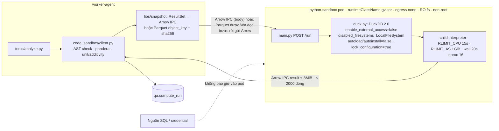

# ANALYTICS_SPEC — Analytics Engine (Part 6)

> Ngày 12/11/2026. Hiện trạng lấy từ [evidence/audit-analytics.md](evidence/audit-analytics.md) (`WA` =
> `backend/services/worker_agent`); quyết định OSS từ [OPEN_SOURCE_RESEARCH.md](OPEN_SOURCE_RESEARCH.md); tên bảng, module,
> mã lỗi theo [ARCHITECTURE.md](ARCHITECTURE.md) §9. Tính năng phủ: **F-09** (analytics tất định tối thiểu), **F-12**
> (sandbox hardening), **F-20** (monitor runtime, P1) và phần `DERIVED` của **F-03**. Mọi ngưỡng ở mục E là mục tiêu,
> chưa đo.

## 0. Nguyên tắc

1. **LLM không tính số.** Mọi con số trong câu trả lời là một `Figure` có nguồn: `query_run` (SQL), `compute_run` (sandbox
   hoặc insights tool, có `expr` hoặc `code_sha256`), `table_cell` (bảng tài liệu). Reporter chỉ viết chữ quanh thẻ
   `{{F<n>}}`; `verify.fill` xoá câu có số lạ (hiện có, `WA/agentic/verify.py`, `answer/narrator.py:24-30`).
2. **Tám bước tách rời**, mỗi bước một chủ và một kiểm (§1). Bước 4 (tính) không bao giờ là LLM; bước 7 (nhận định) là
   LLM nhưng chỉ chọn và xếp facts đã có nhãn.
3. **Tất định trước, sandbox sau, LLM cuối.** Một phép tính chỉ vào sandbox khi compiler và insights tool không có
   primitive cho nó; mã sandbox vẫn phải qua kiểm nghĩa (đơn vị, tính cộng được) trước khi thành `Figure`.
4. **Bốn loại phát biểu có nhãn riêng**: sự kiện (fact), suy luận thống kê (inference), giả thuyết (hypothesis), khuyến nghị
   (recommendation). Không trộn; không nêu nguyên nhân ngoài khối giả thuyết (`causal_claim_rate = 0` đo trên văn bản thật).
5. **Tái lập được**: mọi artifact (chart, tile, báo cáo, câu trả lời DERIVED) trỏ tới `query_run_id` + `dataset_version`
   (+ `snapshot_id`) + `compute_run_id`; replay tính lại và so `output_sha256`.

## 1. Kiến trúc thực thi phân tích

```mermaid
flowchart LR
  Q[Câu hỏi / mục tiêu / sự kiện monitor] --> I[1 Interpretation<br/>understand/ + output contract<br/>rule → LLM reader]
  I --> P[2 Analysis planning<br/>router.py: governed | PlanIR ≤ 8 node<br/>validate tĩnh · budget]
  P --> R[3 Data retrieval<br/>compiler → run_query RO<br/>snapshot Parquet · table_query]
  R --> C[4 Computation<br/>compiler compare/share/cumulative<br/>insights tool · decomposition<br/>sandbox DuckDB/pandas → compute_run]
  C --> V[5 Validation<br/>chart_check · unit/additivity<br/>pandera schema · reconcile · present_gate]
  V --> Z[6 Visualization<br/>CHART_ROLES fit · chart_check pass<br/>blocks.materialize từ dataset]
  V --> N[7 Insight generation<br/>reporter: text trên F<n><br/>insights/hypothesis/recommendation blocks]
  Z & N --> E[8 Explanation & provenance<br/>envelope.py · receipts.py<br/>trust_code = min · lineage]
  E --> OUT[(qa.answer + answer_receipt + compute_run)]
```

| Bước | Chủ (module) | Vào | Ra | Kiểm | Lỗi |
| --- | --- | --- | --- | --- | --- |
| 1 Interpretation | `understand/resolver.py`, `llm_reader`, agentic `plan` | câu hỏi, lịch sử, catalog đã lọc quyền | `ResolvedRequest` + output contract (cột, kiểu, đơn vị, hình dạng) | 1 ứng viên/slot; nếu không → CLARIFY | `NEEDS_CLARIFICATION`, `UNRESOLVED_ENTITY` |
| 2 Planning | `router.py`, `agentic/plan.py`, `agentic/budget.py` | ResolvedRequest, audience, budget | đường governed hoặc `PlanIR` | DAG không chu trình, kiểu cổng, capability ∈ registry, chi phí ước lượng ≤ budget | `PLANNER_ERROR`, `BUDGET_EXCEEDED` |
| 3 Retrieval | `semantic/compiler.py`, `query/executor.py`, `libs/snapshot`, `documents/table_query.py` | SQL/dataset_version | `ResultSet(id, schema, rows ≤ 10 000, result_sha256, dataset_versions)` | `quality_gate`, RO, timeout, row cap | `QUALITY_BLOCKED`, `NO_DATA`, `TOOL_UNAVAILABLE` |
| 4 Computation | compiler (compare_to, share, cumulative), `tools/insights.py`, `skills/decomposition.py`, `tools/analyze.py` → sandbox | ResultSet / snapshot | `Figure[]` có `expr` hoặc `compute_run_id` | tính cộng được, đơn vị, số dòng | `CONTRACT_MISMATCH` |
| 5 Validation | `answer/chart_check.py`, `code_sandbox/client.py` (pandera), `documents/reconcile.py`, `agentic/present_gate.py` | Figures, datasets, chart spec | pass / lỗi có mã | theo bảng §3.2 | `CONTRACT_MISMATCH`, `SOURCE_CONFLICT` |
| 6 Visualization | `agentic/blocks.py`, `answer/chart_intent.py` | dataset + intent | block `chart` / `table` / `kpi` | `chart_check` phải pass | — |
| 7 Insight | reporter (`agentic/prompts.py`), `answer/narrator.py` | facts đã gắn nhãn | `markdown`, `insights`, `hypothesis`, `recommendation` blocks | `verify.fill`, causal regex ở runtime | — |
| 8 Provenance | `answer/envelope.py`, `receipts.py`, `replay.py` | mọi thứ trên | `AnswerEnvelope`, `answer_receipt`, `compute_run` | replay tái lập sha | — |

Hiện tại các bước 3–4–7 tồn tại nhưng **không tách**: đường agentic ghi `qa.Answer` thẳng từ `persist` (`engine.py:1161-1300`),
không receipt; insights chỉ ở fast path một metric (`answer/insights.py:171`); sandbox tạo `Dataset(trust="derived")` mà
không có `compute_run` (`tools/analyze.py:80-92`).

## 2. Chọn engine cho từng loại phân tích

| Loại | Engine (bắt buộc) | Hiện có | Việc |
| --- | --- | --- | --- |
| Basic aggregation, lọc, nhóm, xếp hạng | **SQL compiler** (governed) | có, tất định (`compile_metric`, `run_query`) | giữ |
| Comparative (compare_to, PoP, YoY, so mục tiêu/ngưỡng) | **SQL compiler** (`semantic/compare.py`) + derived figure (`answer/comparison.py`) | có | phơi `compare_to` cho agentic `query_metric` (đã có `tools/query.py:62,187`); không viết pandas cho PoP |
| Share, luỹ kế | **SQL compiler** (`semantic/analysis.py`), từ chối trên measure không cộng được | có (`analysis.py:19-21`) | giữ; chart_check dùng cùng `additive_measures` |
| Trend (độ dốc, chuỗi tăng/giảm, điểm gãy), concentration, phân bố, outlier MAD | **insights tool** tất định (`tools/insights.py` bọc `answer/insights.py` + `skills/anomaly.py`) | có ở fast path; chết ở agentic (`insights.py:265,289`; `skills/anomaly.py` chỉ test gọi) | AL-02 |
| Root-cause / driver decomposition (cộng, tỷ lệ A/B·k, rate/mix) | **skill `decomposition`** tất định, reconcile về tổng | có (`skills/decomposition.py`, `tools/explain.py`) | nối `created_from=alert`; `causal_claim_rate` đo trên text |
| Anomaly detection trong monitor | **luật/thống kê** (`monitor_backtests.py`: threshold, change_vs_previous, MAD z) | chỉ backtest | AL-10 (P1) |
| Forecasting | **ml_forecast** (statsforecast: naive, seasonal_naive, AutoETS, AutoTheta, AutoARIMA; MASE gate; conformal) | có, có duyệt phiên bản (`libs/forecast_fit/backtest.py:42-46`) | nhãn **`EXPLORATORY` + cờ `experimental`** trên mọi dự báo; không phơi what-if ở Ask (giữ "mở studio") |
| Join/transform đa dataset, window phức tạp, pivot, percentile | **DuckDB trong sandbox** trên Arrow/Parquet | không (JSON 10k dòng + pandas) | AL-04/05 |
| Thống kê suy luận (tương quan, t-test, hồi quy đơn) | **sandbox Python** với allowlist `statistics`, `numpy`; kết quả là `inference` block có p-value/CI; **không** là fact | pandas/numpy allowlist có (`code_sandbox/local.py:33-44`) | AL-06: thêm `scipy.stats` vào allowlist chỉ `pearsonr, spearmanr, ttest_ind, mannwhitneyu`; cấm `linregress` trên < 8 điểm |
| Cohort, funnel | sandbox DuckDB (SQL window) hoặc skill `funnel` khi được nối | `skills/funnel.py` chết | P2; không mở ở MVP |
| Narrative, nhận định, gợi ý | **LLM** chỉ chữ trên facts | có | khối giả thuyết + khuyến nghị (AL-08) |

Không dùng LLM cho: PoP, share, slope, top-k, so ngưỡng, đổi đơn vị, làm tròn, cộng dồn. Kiểm bằng `grep` trong eval:
mọi số trong `answer.text` phải khớp một `{{F<n>}}` (đã có `unsupported_number_rate`).

## 3. F-09 · Analytics tất định tối thiểu

### A. Định nghĩa

- **Mục đích**: agent và đường governed dùng cùng một bộ primitive tất định; biểu đồ sai bị chặn trước khi hiện; mọi
  số dẫn xuất có `expr` hoặc `compute_run`.
- **User story**: analyst hỏi "doanh thu theo tháng 2013 có xu hướng gì, nhóm nào bất thường" → nhận chart line đã qua
  validator, khối Nhận định với độ dốc, chuỗi tăng, outlier MAD (mỗi số có `expr`), khối Giả thuyết có nút Kiểm tra.
- **Business value**: thay LLM tự viết pandas cho slope/streak (sai và không tái lập) bằng mã kiểm được; chặn chart "share
  trên COUNT DISTINCT", "measure hằng số".
- **Input/Output**: `ResultSet` → `Figure[]` + `InsightBlock`; `ChartSpec + dataset` → pass | `ChartIssue[]`.
- **Scope**: insights tool, chart_check, hypothesis/recommendation block, compute_run receipt, DuckDB trong sandbox.
  **Non-scope**: cohort/funnel, what-if, dashboard builder (AN-11), deep analysis report (RES-08).

### B. Thiết kế kỹ thuật

#### B.1 Insights tool (`WA/agentic/tools/insights.py`)

Đăng ký như tool `insights` trong registry (`agentic/tools/__init__.py`), card chuyên gia NUMBERS được phép gọi.

```python
class InsightsArgs(BaseModel):
    dataset_id: str                      # dataset trên Workspace (từ query_metric/explore_sql/analyze)
    measure: str                         # cột đo
    group_by: str | None = None          # 1 chiều (kiểu phân loại hoặc thời gian)
    kinds: list[Literal["trend","streak","break","concentration","distribution","outlier"]] = ["trend","outlier","concentration"]

async def run(ctx: ToolContext, args: InsightsArgs) -> ToolResult:
    ds = ctx.workspace.dataset(args.dataset_id)              # rows ≤ 10 000, schema có unit/additivity
    if ds is None: return ToolResult.failure("agent", "dataset không tồn tại")
    col = ds.column(args.measure)
    additive = col.name in additive_measures(ctx.semantic, ds.measures)   # semantic/analysis.py
    series = ds.single_cut(args.group_by)                    # insights.py:171 yêu cầu đúng 1 chiều
    if series is None: return ToolResult.failure("agent", "cần đúng một chiều")
    figs: list[Figure] = []
    if "trend" in args.kinds and series.is_time and len(series) >= MIN_FOR_TREND:   # = 4
        slope, expr = _trend(series)                         # answer/insights.py:265 (least squares)
        figs.append(Figure(value=slope, unit=f"{col.unit}/kỳ", expr=expr, source=ComputeRef(kind="insights", inputs=[ds.query_run_id])))
    if "streak" in args.kinds: figs += _streak(series)       # insights.py:289
    if "concentration" in args.kinds and additive and len(series) >= 4: figs += _concentration(series)   # insights.py:12-21
    if "outlier" in args.kinds: figs += anomaly.mad_outliers(series, z=OUTLIER_Z)   # skills/anomaly.py, OUTLIER_Z=3.5
    if "distribution" in args.kinds: figs += _shape(series)  # break-vs-even, insights.py:52-54
    run = await ctx.compute_runs.record(step_id=ctx.step_id, runtime="insights", code_sha256=INSIGHTS_VERSION_SHA,
                                        input_refs=[{"result_set_id": ds.query_run_id, "sha256": ds.result_sha256}],
                                        output=figs)          # qa.compute_run; output_sha256 = sha(json figs)
    for f in figs: f.source.compute_run_id = run.id; f.trust = "DERIVED" if ds.trust in ("certified","GOVERNED") else "EXPLORATORY"
    return ToolResult.ok(figures=figs, block=InsightBlock(figures=figs, sentences=_sentences(figs)))   # câu tất định theo mẫu, không LLM
```

Quy tắc: `_sentences` là mẫu cố định ("Nhóm cao nhất gấp {{F3}} lần nhóm thấp nhất"); reporter có thể viết lại câu nhưng
số vẫn là thẻ. Figure từ insights tool mang `expr` (ví dụ `slope = cov(t,y)/var(t)` với t, y là tham chiếu dòng) để
`replay.py` tính lại (`replay.py:1-17` đã làm cho fast path).

#### B.2 Chart validator (`WA/answer/chart_check.py`)

Gọi ở hai chỗ: `agentic/blocks.materialize` (trước khi block `chart` vào composition) và `answer/narrate.chart_spec_of`
(fast path); cũng là bước kiểm khi thêm tile vào dashboard (`api/modules/workspace`).

```python
@dataclass
class ChartIssue:
    code: Literal["CONSTANT_MEASURE","DUPLICATE_COLUMNS","GRAIN_MISMATCH","NON_ADDITIVE_SHARE","NON_ADDITIVE_SUM",
                  "HIDDEN_AXIS","PIE_NEGATIVE","TOO_MANY_CATEGORIES","AMBIGUOUS_LABEL","NO_TIME_ORDER"]
    severity: Literal["block","warn"]
    detail: str
    proposal: dict | None = None        # metric_change / semantic fix → Review Inbox, không tự áp

MAX_PIE = 8; MAX_BAR = 40

def check(spec: ChartSpec, ds: Dataset, sem: SemanticInfo) -> list[ChartIssue]:
    issues = []
    for m in spec.measures:
        col = ds.column(m)
        if col.nunique(ignore_null=True) <= 1 and len(ds) > 1:
            issues.append(ChartIssue("CONSTANT_MEASURE", "block", f"{m} không đổi theo {spec.x}"))
    names = [ds.column(c).normalized_label for c in spec.columns()]
    if len(set(names)) < len(names):
        issues.append(ChartIssue("DUPLICATE_COLUMNS", "block", "hai cột cùng nghĩa"))
    if spec.x_kind == "time" and ds.time_grain(spec.x) != sem.requested_grain:
        issues.append(ChartIssue("GRAIN_MISMATCH", "block", f"dữ liệu {ds.time_grain(spec.x)}, hỏi {sem.requested_grain}"))
    if spec.type in ("pie",) or spec.stack == "percent":
        for m in spec.measures:
            if m not in additive_measures(sem, ds.measures):
                issues.append(ChartIssue("NON_ADDITIVE_SHARE", "block", f"tỷ trọng trên {m} ({sem.additivity(m)})",
                                         proposal={"kind":"metric_change","field":"additivity","measure":m}))
    if spec.type == "pie" and any(v < 0 for v in ds.values(spec.measures[0])):
        issues.append(ChartIssue("PIE_NEGATIVE", "block", "giá trị âm trong pie"))
    if spec.type == "pie" and ds.nunique(spec.x) > MAX_PIE: issues.append(ChartIssue("TOO_MANY_CATEGORIES","warn",...))
    if spec.type in ("bar","line") and ds.nunique(spec.x) > MAX_BAR: issues.append(ChartIssue("TOO_MANY_CATEGORIES","block",...))
    if not spec.axis_labels_visible(): issues.append(ChartIssue("HIDDEN_AXIS", "warn", "nhãn trục bị ẩn"))
    if spec.x_kind == "time" and not ds.sorted_by(spec.x): issues.append(ChartIssue("NO_TIME_ORDER","block","chuỗi thời gian chưa sắp"))
    return issues
```

- `block` → block chart bị thay bằng `table` + `callout` nêu lý do; `warn` → chart hiện kèm chú thích.
- Issue có `proposal` → ghi `inbox` đề xuất `metric_change` (đường có sẵn `worker_agent/metric_changes.py`, R1-07) với
  trạng thái `proposed`; **không** sửa semantic. Hiện tại chỉ kiểm vai cột (`agentic/blocks.py:46-53,86`).

#### B.3 Khối phát biểu (block types)

| Block | Nội dung | Nhãn | Ràng buộc |
| --- | --- | --- | --- |
| `kpi`, `table`, `chart` | fact từ dataset | nhãn của dataset | số chỉ từ `blocks.materialize` |
| `insights` | câu tất định + figure có `expr` | `DERIVED` | từ `tools/insights.py` hoặc `answer/insights.py` |
| `inference` (mới) | kết quả thống kê suy luận: thống kê, p-value, CI, n, phương pháp | `DERIVED`, cờ `inference` | chỉ từ sandbox với allowlist §2; câu mẫu "tương quan ≠ nhân quả" bắt buộc |
| `hypothesis` (mới) | ≤ 3 giả thuyết, mỗi cái: câu, `verification_query` (ResolvedRequest hoặc PlanIR 1–2 node), nút **Kiểm tra** | nhãn riêng "Giả thuyết" | chỗ duy nhất được nêu nguyên nhân; chưa chạy thì không có số |
| `recommendation` (mới) | hành động đề xuất, điều kiện, chỉ số theo dõi | nhãn "Khuyến nghị" (advisory) | không chứa số mới; chỉ tham chiếu F<n> |
| `callout` | cảnh báo chất lượng, độ tươi, chart bị chặn | — | từ `signals.py`, `chart_check` |

Reporter prompt (`agentic/prompts.py`) thêm: "nguyên nhân chỉ ở `hypothesis`; `inference` chỉ khi có block inference từ
công cụ"; judge runtime chạy regex causal của `model/eval/scorers/causal.py:31-36` trên `markdown`/`insights` **trước
persist** → câu vi phạm bị xoá như `verify.fill`.

#### B.4 `qa.compute_run` và replay

Ghi cho mọi phép tính ngoài compiler: insights tool, decomposition skill, sandbox.

```text
qa.compute_run(id, org_id, answer_id, step_id, runtime ∈ {insights, decomposition, duckdb, pandas},
               code_sha256, code_object_key (MinIO da-results/compute/<id>.py|.sql, null với insights),
               input_refs jsonb [{result_set_id|snapshot_id, sha256}], lib_versions jsonb {duckdb, pandas, numpy, pandera},
               output_sha256, duration_ms, created_at)
```

- `Figure.source = {kind: compute_run, compute_run_id, expr?}`; receipt (`receipts.py`) liệt kê compute_run như
  `source_kind=compute_run` (đã có `expr_sha256` cho fast path, `questions.py:2585-2598`).
- `replay.py` mở rộng: `runtime=insights|decomposition` → gọi lại hàm với cùng input (so `expr`); `duckdb|pandas` → chạy lại
  code từ `code_object_key` trong sandbox trên cùng `input_refs` (snapshot Parquet theo sha) → so `output_sha256`. Lệch →
  `replay_status=diverged` trên receipt. Agentic `persist` phải gọi `receipts.seal` (F-03) để receipt tồn tại.

#### B.5 Trạng thái

`compute_run`: `running → ok | failed(code)`; replay: `pending → match | diverged | unavailable` (snapshot hết retention).

#### B.6 Retry / timeout / idempotency

Insights tool: thuần, không retry. Sandbox: 1 lần thử lại chỉ khi lỗi `TOOL_UNAVAILABLE` (pod bận, `BoundedSemaphore(1)`
`python_sandbox/main.py:24-26`); idempotency key = `sha(code + input_refs)`; cùng key trong một lượt → dùng lại compute_run.

#### B.7 Bảo mật

Xem F-12. Insights tool không nhận code; chỉ nhận id dataset trong Workspace của lượt (quyền đã kiểm khi dataset tạo).

#### B.8 Log / trace / metric

`agent_step` ghi `tool=insights|analyze`, `compute_run_id`; metric Prometheus `compute_run_duration_seconds{runtime}`,
`chart_check_issues_total{code,severity}`, `causal_claims_removed_total`.

### C. OSS

| Thành phần | Dùng | Phiên bản / giấy phép (evidence/oss-data.md) | Adapter |
| --- | --- | --- | --- |
| DuckDB | tính trong sandbox, đọc Parquet snapshot | 2.0.0 LTS (hỗ trợ ≥ 10/2027), MIT, Python ≥ 3.11 | `libs/code_sandbox/duck.py` |
| pyarrow | Arrow IPC vào/ra sandbox, Parquet | 26.0.1, Apache-2.0 (đã pin) | `libs/snapshot` |
| pandera | schema kiểm output sandbox | MIT | `code_sandbox/client.py` |
| statsforecast | đã dùng ở ml_forecast | 2.1.1 (đã pin) | — |

PoC-2 (OPEN_SOURCE_RESEARCH §4): 20 phân tích DS-AW; ≥ 2× nhanh, payload giảm ≥ 5×, escape 0/10 — điều kiện trước AL-04.

### D. Kiểm thử

| Loại | File | Nội dung |
| --- | --- | --- |
| Unit | `tests/unit/worker_agent/test_insights_tool.py` | mỗi kind ra figure có `expr`; non-additive không có concentration; < 4 điểm không có trend |
| Unit | `tests/unit/worker_agent/test_chart_check.py` | 10 mã issue, mỗi mã ≥ 2 case; block thay bằng table; proposal đúng shape |
| Unit | `tests/unit/worker_agent/test_blocks_hypothesis.py` | hypothesis có verification_query hợp lệ; recommendation không số mới |
| Integration | `tests/integration/worker_agent/test_compute_runs.py` | compute_run ghi, receipt liệt kê, replay match; đổi input → diverged |
| Integration | `tests/integration/worker_agent/test_adventureworks_analysis.py` (mở rộng) | insights trên DS-AW khớp SQL tay |
| Eval | `model/eval/cases/charts.jsonl` (AN-13, ≥ 40 case bẫy) + scorer `scorers/chart.py` | validator bắt 100 % bẫy |
| Eval | `causal_claim_rate` chạy trên **văn bản answer thật** của `make agent-eval` (export `answer.text` + blocks) | = 0 |

### E. Definition of Done

- Trên bộ `charts.jsonl` cố định (≥ 40 bẫy: share trên COUNT DISTINCT, measure hằng, pie âm, grain lệch, cột trùng, nhãn
  ẩn), `chart_check` chặn **100 %** case `expect=block`, cho qua **100 %** case `expect=pass`.
- `causal_claim_rate` đo trên văn bản `markdown` + `insights` của 61 câu DS-AW và 25 case analytical DS-311 = **0**;
  mọi câu nguyên nhân chỉ trong `hypothesis`.
- Mọi câu trả lời có figure `DERIVED` có `compute_run` và receipt; replay 20 câu DERIVED trên cùng snapshot → `match`
  **100 %**.
- Agentic không còn tự viết pandas cho trend/outlier/concentration: trong 61 câu DS-AW, số lần gọi `analyze` cho ba việc
  này = 0 (đếm trên `agent_step`).

## 4. F-12 · Sandbox v2

### A. Định nghĩa

- **Mục đích**: biên thực thi mã do model viết đủ chắc để chạy trên cụm khách; dữ liệu vào bằng Arrow/Parquet, không
  JSON; SQL không chạy trong container; output qua kiểm nghĩa.
- **Scope**: `libs/code_sandbox/duck.py`, `client.py`, pod `python-sandbox` (gVisor), kiểm output. **Non-scope**: sandbox
  cho người dùng tự viết notebook (IA-02).

### B. Thiết kế



Biên dữ liệu (lấy từ pandas-ai: SQL ở host, kết quả file vào container — evidence/oss-agents.md §4):

1. `tools/analyze.py` chỉ nhận `dataset_id[]` của Workspace hoặc `snapshot_id`; worker-agent đọc Parquet từ MinIO
   (`libs/snapshot.read → pyarrow.Table`) hoặc ResultSet → Arrow IPC; gửi body `multipart` {code, tables[] Arrow IPC}.
   Không còn `{columns, rows}` JSON (hiện `analyze.py` ship toàn bộ dataset JSON, cap chỉ 20 MiB body).
2. Trong pod, `duck.py`:

```python
def open_locked(mem="768MB", threads=2) -> duckdb.DuckDBPyConnection:
    con = duckdb.connect(":memory:")
    for sql in (f"SET memory_limit='{mem}'", f"SET threads={threads}", "SET max_temp_directory_size='0B'",
                "SET enable_external_access=false", "SET disabled_filesystems='LocalFileSystem'",
                "SET autoload_known_extensions=false", "SET autoinstall_known_extensions=false",
                "SET allow_community_extensions=false", "SET lock_configuration=true"):
        con.execute(sql)
    return con
# tables đăng ký bằng con.register(name, arrow_table) — replacement scan, read-only
```

   Mã model có thể là SQL (`duckdb.sql(...)` trên tên bảng đã đăng ký) hoặc pandas (`df = con.table("t").df()`); AST
   allowlist hiện có (`code_sandbox/local.py:33-44`) thêm `duckdb` (chỉ `sql`, `table`, `execute` trên `con` đã mở; cấm
   `connect`, `ATTACH`, `INSTALL`, `LOAD`, `COPY`, `EXPORT`, `read_*`), tuỳ chọn `scipy.stats` (4 hàm §2).
3. Giới hạn (Piston defaults + hiện có): CPU 15 s, wall 20 s, RSS 1 GiB, `RLIMIT_NPROC 16`, output ≤ 2 000 dòng / 8 MiB,
   stdout 4 000 ký tự; một run/pod; `BoundedSemaphore(1)` giữ; worker xếp hàng tối đa 30 s rồi `TOOL_UNAVAILABLE`.
4. Pod: `runtimeClassName: gvisor` (Ansible role `k8s_gvisor` cài `runsc` + shim, RuntimeClass `gvisor`); giữ
   `automountServiceAccountToken:false`, `readOnlyRootFilesystem`, `seccomp RuntimeDefault`, NetworkPolicy `egress: []`
   (`deploy/k8s/dev/service/python-sandbox.yaml:11-72`, `networkpolicy-service.yaml:24-49`). Xoá nhánh
   `AGENT_PYTHON_SANDBOX=local` (STRATEGY §6).
5. Kiểm nghĩa output ở `client.py` sau khi nhận Arrow:
   - **Schema**: pandera `DataFrameSchema` sinh từ output contract của bước (`agentic/present_gate.after_drafts` đã có
     contract cột) → sai cột/kiểu → `CONTRACT_MISMATCH`, một lần sửa.
   - **Đơn vị**: mỗi cột output phải khai `unit` (model điền trong `result_meta`); cột tính từ hai input khác đơn vị mà
     không phải tỷ lệ → từ chối (`UNIT_MISMATCH` là detail của `CONTRACT_MISMATCH`).
   - **Tính cộng được**: nếu output là `sum`/`share` của một measure (nhận ra qua `result_meta.derived_from` + tên hàm
     trong AST) và measure đó ∉ `additive_measures` → từ chối với lý do; model phải đổi sang đếm/trung bình đúng.
   - Mọi số lẻ (scalar) đi qua `_shaped` như hiện tại (`client.py:24-54`).
6. `compute_run` ghi `code_object_key` (mã lưu MinIO `da-results`), `input_refs` sha từ Arrow (`sha256(ipc_bytes)`) hoặc
   snapshot sha, `lib_versions` đọc từ pod (`duckdb.__version__`…).

Trạng thái / lỗi: `ok`, `CONTRACT_MISMATCH` (sửa 1 lần), `TOOL_UNAVAILABLE` (thử lại 1), `BUDGET_EXCEEDED` (CPU/wall),
`FORBIDDEN` (AST từ chối, không thử lại, ghi `audit`).

### C. OSS

gVisor (Apache-2.0, release hàng tuần, RuntimeClass cho containerd của k3s; systrap chạy trong VM); DuckDB 2.0 LTS (MIT);
pandera (MIT); pyarrow 26 (Apache-2.0). Rủi ro: syscall-heavy pandas chậm hơn dưới gVisor; pyarrow mmap — PoC-2 phải đo.

### D. Kiểm thử

| File | Nội dung |
| --- | --- |
| `tests/unit/worker_agent/test_sandbox_ast.py` | từ chối `duckdb.connect`, `ATTACH`, `INSTALL`, `read_csv('/etc/passwd')`, `__import__`, `open`, socket; cho phép `con.sql` |
| `tests/unit/worker_agent/test_sandbox_semantic.py` | share trên non-additive bị từ chối; unit mismatch; pandera contract |
| `tests/integration/worker_agent/test_sandbox_service.py` | pod thật (testcontainers hoặc cụm dev): 10 escape test (file, net, env, ext, fork bomb, RAM 2 GiB, CPU vòng lặp, `/proc`, `SET threads` sau lock, `COPY TO`) → 0 lọt |
| `tests/e2e/test_sandbox_gvisor.py` | pod chạy `runsc` (kiểm `dmesg` sentinel của gVisor) |
| `make bench-sandbox` | PoC-2: 20 phân tích, thời gian/RSS/payload |

### E. DoD

- 10/10 escape test bị chặn trên cụm dev với RuntimeClass gvisor; không nhánh `local`.
- 20 phân tích PoC-2: thời gian end-to-end ≤ 0,5× hiện tại, payload ≤ 0,2×.
- 100 % output sandbox có `compute_run`; output vi phạm additivity/unit bị từ chối (bộ 10 case `test_sandbox_semantic`).

## 5. F-03 (phần DERIVED) · Nhãn và receipt cho phép tính

- `trust_code` của figure dẫn xuất = `DERIVED` nếu **mọi** input có nhãn ∈ {VERIFIED, GOVERNED} và phép tính có
  `compute_run`; nếu bất kỳ input là EXPLORATORY/DOCUMENT → lấy nhãn yếu nhất của input (không "nâng" nhờ tính toán).
- Receipt (`receipts.py.seal`) liệt kê: `query_runs[]`, `compute_runs[]`, `table_cells[]`, `dataset_versions[]`,
  `snapshot_ids[]`; agentic `persist` **phải** gọi seal (hiện không: `engine.py:1161-1300`).
- Dự báo: figure từ `tools/forecast.py` luôn `EXPLORATORY` + `flags: ["experimental", "forecast"]`, kèm `model_version_id`
  và khoảng tin cậy là hai figure riêng.

## 6. F-20 · Monitor runtime và điều tra từ alert (P1)

### A. Định nghĩa

Monitor được đánh giá theo lịch thật; alert tạo ra có ngữ cảnh và một kế hoạch điều tra đã dựng sẵn; không hành động ghi.

### B. Thiết kế

1. **Lịch**: thêm kind `monitor` vào `schedules/targets.py` (hiện chỉ `ReportSchedule`, L140/L353) → Temporal
   `FireSchedule` → handler `monitor_runs.evaluate(monitor_id)` trong worker-agent.
2. **Đánh giá** (tất định, dùng lại judge của `monitor_backtests.py`): `threshold` (`answer/thresholds.py`),
   `change_vs_previous` (% so kỳ trước), `mad_outlier` (`skills/anomaly.py`, z ≥ 3,5 trên ≥ 8 kỳ); `seasonal_anomaly`
   vẫn `unsupported`. Số lấy từ compiler trên `dataset_version` hiện hành; cổng `quality_gate` trước; dữ liệu `blocked`
   → không alert, ghi `skipped(QUALITY_BLOCKED)`.
3. **Alert** (`monitor.alert`): `figures[]` (số hiện tại, ngưỡng/kỳ trước, chênh) có `query_run_id`; dedup theo
   `(monitor_id, member, period)`; cooldown theo rule; gom nhóm theo monitor trong một lượt.
4. **Điều tra**: `POST /v1/workspaces` với `created_from={kind: alert, alert_id}` (hiện client chỉ gửi title/description,
   `lib/v1/alerts.ts:134-144`) → server seed `PlanIR` 2 node: `SQL_QUERY(metric, period, compare_to=previous_period,
   dims=allowed)` → `COMPUTE(decomposition)`; người dùng bấm chạy (không tự chạy: L4 giới hạn, 01 §2.3).
5. **Bất biến 11**: LLM chỉ được gọi để viết đoạn giải thích sau khi luật đã quyết có alert; không gọi khi không alert.

### C/D/E

Không OSS mới. Test: `tests/integration/worker_agent/test_monitor_runs.py` (threshold, change, MAD; dedup; blocked →
skipped), `test_alert_investigation.py` (workspace seed đúng PlanIR). DoD: trên DS-AW với 3 monitor seed, lịch chạy tạo
đúng alert theo kịch bản; > 1 alert/sự kiện gốc = lỗi (00 §10); alert có ≥ 1 figure với `query_run_id`.

## 7. Dashboard, tile, báo cáo, artifact tái lập

| Artifact | MVP giữ | Thay đổi | Tái lập bằng |
| --- | --- | --- | --- |
| Tile (`WA/tiles.py`) | sql/table/question/chart | `tile_snapshot` lưu **giá trị** (rows ≤ 200) + `dataset_versions` + `result_sha256`, không chỉ shape; chart tile qua `chart_check` | re-run SQL trên version ghi; so sha |
| Dashboard | ghim tile, lịch làm mới | không builder agent (AN-11 R2) | tập tile |
| Report run (`WA/report_runs.py`) | **xlsx + html** | **Không render PDF ở MVP**: `_pdf()` mặc định (`monitor/schemas.py:142`) đổi thành `html`; PDF cần headless browser trong image worker (+300 MB) và font tiếng Việt — lùi P2 với WeasyPrint (BSD) sau khi html ổn | mỗi phần ghi `query_run_id` + `dataset_version` |
| Ask chart | block `chart` | block mang `dataset_ref{query_run_id|compute_run_id}` | replay receipt |
| Notebook (IA-02) | — | R2 | — |

Đủ tái lập = `query_run` (SQL sha, result sha) + `dataset_version`/`snapshot_id` (dữ liệu còn, F-01) + `compute_run`
(code sha, input sha, lib versions). Thiếu bất kỳ cái nào → artifact mang cờ `not_reproducible`.

## 8. Hợp đồng dữ liệu liên quan (tham chiếu CONTRACTS)

- `Figure{id, value, unit, trust_code, source{kind: query_run|compute_run|table_cell, id, expr?}, flags[]}`
- `ChartSpec{type, x, x_kind, measures[], stack?, intent}` + `ChartIssue[]`
- `ComputeRequest{code, tables[{name, arrow_ipc|snapshot_id}], result_meta{unit, derived_from}, limits}` → `ComputeResult{arrow_ipc, scalars, stdout, lib_versions}`
- Block mới: `inference`, `hypothesis{text, verification_query, status}`, `recommendation{text, refs[]}`

## 9. Danh sách task

Cột: ID · Ưu tiên · Mô tả · Thay đổi · Công nghệ · Phụ thuộc · Vai · Cỡ · Nghiệm thu · Test · Deliverable · Rollback.

| ID | P | Mô tả | Thay đổi | Công nghệ | Phụ thuộc | Vai | Cỡ | Nghiệm thu | Test | Deliverable | Rollback |
| --- | --- | --- | --- | --- | --- | --- | --- | --- | --- | --- | --- |
| AL-01 | P0 | Bảng `qa.compute_run` + ORM + migration; `receipts.py` liệt kê compute_run; `replay.py` runtime insights/decomposition | `backend/schema` definitions, `v3_0036+`, `WA/receipts.py`, `WA/replay.py` | SQLAlchemy | F-03 (envelope) | BE | M | compute_run ghi và replay match trên 5 câu fast path | `test_compute_runs.py` | migration + code | migration down; cột nullable |
| AL-02 | P0 | Insights tool cho agentic bọc `answer/insights.py` + `skills/anomaly.py`; figure có `expr`; câu mẫu tất định | `WA/agentic/tools/insights.py`, registry, card NUMBERS | — | AL-01 | AI/BE | M | 6 kind ra figure đúng trên DS-AW; `analyze` không còn dùng cho trend/outlier | `test_insights_tool.py` | tool | gỡ khỏi registry |
| AL-03 | P0 | `chart_check.py` + nối vào `blocks.materialize`, `chart_spec_of`, thêm tile; proposal vào Review Inbox | `WA/answer/chart_check.py`, `agentic/blocks.py`, `api/modules/workspace` | — | — | BE | M | 10 mã issue; block → table+callout | `test_chart_check.py`, `charts.jsonl` | validator | cờ `CHART_CHECK=off` |
| AL-04 | P0 | `libs/snapshot` Arrow IPC/Parquet reader; `tools/analyze.py` gửi Arrow thay JSON | `backend/libs/snapshot/`, `WA/agentic/tools/analyze.py`, `code_sandbox/client.py` | pyarrow 26 | F-01 (snapshot) | BE | M | payload ≤ 0,2× | `test_sandbox_transport.py`, bench | transport | giữ JSON path sau cờ 1 release |
| AL-05 | P0 | `duck.py` khoá cấu hình; allowlist `duckdb` trong AST; pod image thêm duckdb 2.0 | `backend/libs/code_sandbox/duck.py`, `local.py`, `services/python_sandbox/` | DuckDB 2.0 LTS | AL-04, PoC-2 | BE | M | 10 escape 0 lọt; ≥ 2× nhanh | `test_sandbox_ast.py`, `test_sandbox_service.py` | sandbox v2 | image cũ |
| AL-06 | P0 | Kiểm nghĩa output: pandera contract, đơn vị, additivity; `inference` block + allowlist `scipy.stats` 4 hàm | `code_sandbox/client.py`, `agentic/blocks.py`, prompts | pandera | AL-05 | AI/BE | M | 10 case semantic bị chặn đúng | `test_sandbox_semantic.py` | — | tắt scipy |
| AL-07 | P0 | gVisor RuntimeClass: role Ansible, manifest, test e2e | `deploy/ansible/roles/k8s_gvisor/`, `deploy/k8s/*/runtimeclass-gvisor.yaml`, `python-sandbox.yaml` | gVisor | — | Ops | S | pod chạy runsc | `test_sandbox_gvisor.py` | manifest | bỏ `runtimeClassName` |
| AL-08 | P0 | Block `hypothesis` (verification_query, nút Kiểm tra) và `recommendation`; reporter prompt; causal regex runtime trước persist | `agentic/blocks.py`, `prompts.py`, `engine.py` compose, FE `ComposedBlocks.tsx` | — | AL-02 | AI/FE | M | `causal_claim_rate`=0 trên text thật; Kiểm tra chạy ra answer con | `test_blocks_hypothesis.py`, eval | blocks | ẩn block ở FE |
| AL-09 | P0 | Eval: `charts.jsonl` ≥ 40 bẫy + `scorers/chart.py`; export text answer từ `agent-eval` vào scorer causal | `model/eval/cases/charts.jsonl`, `model/eval/scorers/chart.py`, `WA/agentic/evaluate.py` | — | AL-03 | QA | M | gate đọc hai metric | eval run | case + scorer | — |
| AL-10 | P1 | Monitor runtime: kind `monitor` ở Temporal targets, `monitor_runs.py` với judge backtest, dedup/cooldown, quality_gate | `WA/schedules/targets.py`, `WA/monitor_runs.py` | Temporal | F-02 | BE | M | 3 monitor seed tạo alert đúng kịch bản | `test_monitor_runs.py` | handler | gỡ kind |
| AL-11 | P1 | Alert → workspace `created_from=alert` + PlanIR seed (SQL_QUERY + COMPUTE decomposition) | `api/modules/workspace`, `WA/agentic/plan.py`, FE `AlertPage.tsx` | — | AL-10 | BE/FE | S | workspace mở có plan 2 node | `test_alert_investigation.py` | — | — |
| AL-12 | P1 | Tile snapshot lưu giá trị + dataset_versions + sha; chart tile qua chart_check | `WA/tiles.py`, `api/modules/workspace` | — | AL-03, F-01 | BE | S | tile replay so sha | `test_tiles.py` | — | — |
| AL-13 | P1 | Report: mặc định `html` (+xlsx); bỏ `_pdf()` default; mỗi phần ghi query_run + dataset_version | `WA/report_runs.py`, `api/modules/monitor/schemas.py:142` | — | — | BE | S | report chạy ra html đúng | `test_report_runs.py` | — | — |
| AL-14 | P1 | Nối `skills/anomaly.py` vào `skill_runs` (bỏ `unrunnable` cho `anomaly`); xoá/đánh dấu dead `funnel`, `report_outline` | `WA/skill_runs.py:148` | — | AL-02 | BE | S | skill run anomaly chạy | `test_skill_runs.py` | — | — |
| AL-15 | P1 | Metrics Prometheus cho compute/chart/causal; trace bước `tool=insights|analyze` | `WA/turn_trace.py`, metrics module | prometheus_client | F-11 | BE | S | metric xuất hiện | — | — | — |
| AL-16 | P2 | Forecast figure luôn EXPLORATORY+experimental; what-if giữ ở studio | `WA/agentic/tools/forecast.py` | — | — | AI | S | flag có trên mọi forecast figure | `test_forecast_metric_tool.py` | — | — |

Thứ tự: AL-01 → AL-02/AL-03 song song → AL-04 → AL-05 → AL-06 → AL-07 (Ops song song từ đầu) → AL-08 → AL-09; P1 sau cổng P0.

## 10. Đề xuất thêm vào ARCHITECTURE §9

- Block types mới: `inference`, `hypothesis`, `recommendation` (§3.B.3) — thêm vào §9.5 hoặc CONTRACTS.
- `ChartIssue.code` enum (§3.B.2) và `qa.compute_run.runtime ∈ {insights, decomposition, duckdb, pandas}`.
- Kind lịch Temporal `monitor`; bảng `monitor.alert.figures jsonb`.
- `tile_snapshot.rows`, `tile_snapshot.dataset_versions`, `tile_snapshot.result_sha256`.
- Detail `UNIT_MISMATCH` của `CONTRACT_MISMATCH` (không phải mã mới).
