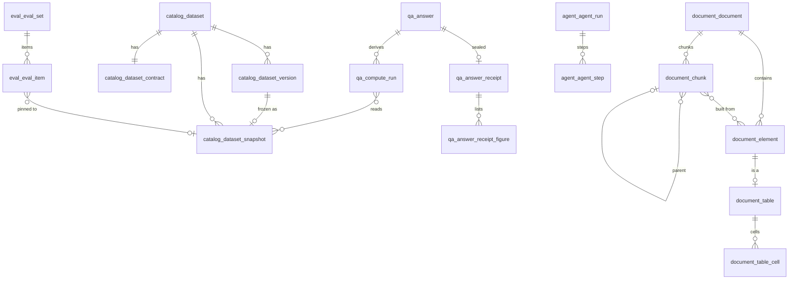

# API_AND_SCHEMA_CONTRACTS — API, sự kiện, mô hình dữ liệu (Part 6 / Part 9)

> Ngày 12/11/2026, đối chiếu mã ở HEAD `9e503407`. Đây là **nguồn chuẩn** cho mọi tên bảng, cột, sự kiện, endpoint,
> mã lỗi và interface Python mà [ARCHITECTURE.md](ARCHITECTURE.md) §3 và §9 liệt kê. Các `*_SPEC.md` tham chiếu vào
> đây, không định nghĩa lại. Hình dạng "hiện có" được ghi kèm `file:dòng`; phần "mới" là hợp đồng phải làm.
> Quy ước đặt tên theo `CLAUDE.md` §3 (snake_case bảng/cột, kebab-case sự kiện và k8s).

## 1. Quy ước chung

### 1.1 Phiên bản hợp đồng

- Mọi JSON Schema ở §3 có `$id` dạng `https://dataagent.local/contracts/v1/<Name>.json` và trường `contract_version`
  (chuỗi `"1"`); đổi hình dạng không tương thích thì tăng số và giữ bản cũ một release (§8).
- OpenAPI sinh từ app (`make api-types`), so với A2 bằng `python -m services.api.catalogue.check`; endpoint mới phải
  có mặt ở **ba chỗ trong cùng PR**: tab 4 A2 (bản thiết kế), `backend/services/api/catalogue/a2_endpoints.json`
  (khoá `endpoints[]`: `group`, `method`, `path`, `summary`, `use_cases`, `capability`), và route gọi
  `catalogue.endpoint(method, path, operation_id=...)` (`catalogue/__init__.py:1-10`). Thân yêu cầu theo A3
  (`a3_contract.json`, sinh bởi `build_a3.py` từ `catalogue/source/tab4.md`). Route không có trong A2 **fail lúc
  import**.

### 1.2 Lỗi: problem+json

Thân lỗi là `ProblemBody` (`kernel/problems.py`): `{type, title, status, detail, instance, code, trace_id,
errors?[]}`. Mã nghiệp vụ dùng `ErrorCode` (`libs/contracts/v1/errors.py:23-39`), HTTP theo `HTTP_STATUS` (:60-75);
không bao giờ 422 cho lỗi nghiệp vụ (422 là của FastAPI). Lỗi CSDL: 23514 → 422 `business_rule_violated`, 23505 →
409 `conflict`, 42501 → 403 `forbidden`, 23503/23502 → 422 `validation_failed` (`docs/v3/06-api-v1.md` §4).

### 1.3 Idempotency, ETag, phân trang, hạn mức

- `Idempotency-Key` bắt buộc hỗ trợ trên mọi POST `/v1` (`kernel/idempotency.py`): khoá ghi `integration.idempotency_key`
  trước handler; trùng khi đang chạy → 409; phản hồi đầu giữ 24 h Redis; khác thân → 422 `idempotency_mismatch`.
  **Mới (F-11, PL-08, đã làm):** thiếu `REDIS_URL` hoặc Redis không trả lời → **fail-closed**: 503 `source_unavailable`
  (mã 503 sẵn có của kernel cho Redis, không thêm mã mới) kèm `Retry-After`, trước khi ghi; rate limit chặn lời gọi ghi,
  cho lời gọi đọc đi qua. `API_REDIS_FAIL_OPEN=true` giữ hành vi cũ cho máy không có Redis.
- ETag trên mọi GET JSON; `If-Match` kiểm ở kernel (`kernel/etag.py:1-16`). **Mới (F-30, AUD-09): bắt buộc** `If-Match`
  (412 nếu thiếu) cho PATCH/PUT của: `/v1/metrics/{id}`, `/v1/metric-versions/{id}`, `/v1/data-products/{id}`,
  `/v1/datasets/{id}`, `/v1/datasets/{id}/columns/{col}`, `/v1/pipelines/{id}` (và `steps`), `/v1/workspaces/{id}`,
  `/v1/monitors/{id}`, `/v1/datasets/{id}/contract`.
- Phân trang keyset `?page_token=&limit=&order_by=` qua `kernel/pagination.py` (`encode_page_token` :43); trang trả
  `{items[], next_page_token|null}`.
- Hạn mức: 120 lời gọi/phút/người; `POST /v1/questions` 10/phút (`API_QUESTIONS_PER_MINUTE`).

### 1.4 SSE

Luồng `GET /v1/questions/{id}/stream` (`text/event-stream`, `id` mỗi sự kiện, `Last-Event-ID`, heartbeat 15 s —
`kernel/sse.py`). Danh mục sự kiện (`agentic/stream_contract.py:19-23`):

| Kênh | event | data | Trạng thái |
| --- | --- | --- | --- |
| commentary | `planning` | `{message}` | có |
| commentary | `plan` | `{goal, steps: PlanIR.view[]}` | có |
| commentary | `progress` | `{message, step_id?}` (không nêu tên tool) | có |
| commentary | `activity` | `{step_id, status, operator?}` | có |
| commentary | `block` | một Block (§3.1) đã materialize | có |
| interrupt | `clarification` | ClarificationRequest (§3.12) | có |
| final | `answer` | `{answer_id, headline, blocks[], text, trust_summary}` → **mới:** `{answer_id, envelope: AnswerEnvelope}` | sửa |
| final | `done` / `cancelled` / `error` | `{answer_id}` / `{code}` / problem | có |
| commentary | **`budget`** (mới) | `{tokens_used, seconds, limit_tokens, limit_seconds, exhausted: bool}` | mới (F-04) |
| commentary | **`receipt`** (mới) | `{receipt_id, receipt_no}` sau khi niêm phong | mới (F-03) |

### 1.5 Ngôn ngữ

Mã (`code`, `trust_code`, `kind`, `next_action`, tên sự kiện) là tiếng Anh. Chuỗi hiển thị lấy từ catalog thông điệp
theo `message_key` + locale của tổ chức (`libs/language.use_locale`); `USER_MESSAGE_VI` giữ cho tương thích, thêm
`USER_MESSAGE_EN`. Worker **không** ghi chuỗi tiếng Việt vào `qa.answer.figures[].trust` nữa sau §8.

## 2. Mô hình dữ liệu

Quy trình thêm bảng (`docs/v3/07-database.md`): sửa `backend/schema/csdl/source/tab3.md`/`tab3b.md` → `python3 -m
csdl.parse_d4 && python3 -m csdl.gen_ddl && python3 -m csdl.gen_orm` → DDL `backend/alembic/sql/dataagent.sql`, ORM
`libs/dataagent_db/models/<schema>.py` → migration tay `backend/alembic/versions/v3_00NN_*.py` (mẫu `v3_0035`:
`SET LOCAL ROLE da_owner; CREATE TABLE IF NOT EXISTS …; ENABLE ROW LEVEL SECURITY; policy org_isolation`). Câu bằng lời
(trigger, view, grant đặc biệt) vào `backend/schema/csdl/routines/<schema>.sql` với `-- covers:`; `coverage.md` phải
là "None.". **Revision kế tiếp: `v3_0036`** (sau `v3_0035_ingest_sample_and_policies.py`). Mọi bảng mới có
`org_id uuid NOT NULL` + policy `org_isolation` như `qa.outbox` (`dataagent.sql`, mẫu ở §2.9).



### 2.1 `catalog.dataset_snapshot` (mới, F-01)

```sql
CREATE TABLE catalog.dataset_snapshot (
  id uuid NOT NULL,
  org_id uuid NOT NULL,
  dataset_id uuid NOT NULL REFERENCES catalog.dataset(id),
  version integer NOT NULL,                       -- = catalog.dataset_version.version
  object_key text NOT NULL,                       -- da-snapshots/<org>/<dataset>/v<version>.parquet
  sha256 char(64) NOT NULL,                       -- của toàn object sau upload (không dùng ETag MinIO)
  row_count bigint NOT NULL,
  byte_size bigint NOT NULL,
  columns jsonb NOT NULL,                         -- [{name, normalized_type, arrow_type}]
  available_at timestamptz NOT NULL,              -- thời điểm dữ liệu dùng được cho câu hỏi (bất biến 9)
  created_by_run_id uuid,                         -- ingest.job_run hoặc pipeline.pipeline_run
  created_by_kind text NOT NULL CHECK (created_by_kind IN ('job_run','pipeline_run','upload','derive')),
  created_at timestamptz NOT NULL DEFAULT now(),
  CONSTRAINT dataset_snapshot_pkey PRIMARY KEY (id),
  CONSTRAINT dataset_snapshot_version_uk UNIQUE (dataset_id, version)
);
CREATE INDEX dataset_snapshot_dataset_idx ON catalog.dataset_snapshot (dataset_id, version DESC);
```

Ghi: `worker_ingest/versioning.py`, `worker_agent/uploads.py`, `worker_agent/pipelines.py`, `derived.py` (như
`svc_catalog`). Đọc: `quality_gate`, `receipts`, `replay`, `libs/snapshot.read`, eval. Bất biến: **chỉ INSERT**
(`svc_catalog` không UPDATE/DELETE; routine `catalog.pre.sql`). Retention: object giữ theo `dataset.scope` (mặc định
≥ 3 version và ≥ 90 ngày; xoá object là Job có duyệt, không phải worker). Bucket `da-snapshots` tạo `--with-lock`.

### 2.2 `catalog.dataset_contract` (mới, F-02)

```sql
CREATE TABLE catalog.dataset_contract (
  dataset_id uuid NOT NULL REFERENCES catalog.dataset(id),
  org_id uuid NOT NULL,
  version integer NOT NULL DEFAULT 1,             -- OCC: PUT phải gửi version hiện tại
  schema_hash_expected text,                      -- khớp dataset_version.schema_hash; NULL = chưa khoá
  freshness_sla jsonb NOT NULL DEFAULT '{}',      -- {"kind":"max_age"|"schedule","max_age_hours":24,"cron":"…"}
  required_rules jsonb NOT NULL DEFAULT '[]',     -- DatasetContract.rules[] (§3.8, từ vựng GX)
  status text NOT NULL DEFAULT 'draft' CHECK (status IN ('draft','active','broken')),
  broken_reason text,
  updated_by uuid,
  updated_at timestamptz NOT NULL DEFAULT now(),
  CONSTRAINT dataset_contract_pkey PRIMARY KEY (dataset_id)
);
```

Ghi: api `catalog` (`PUT /v1/datasets/{id}/contract`, steward); worker `quality.py` chỉ đổi `status`/`broken_reason`
(active ↔ broken) sau mỗi lượt DQ. Đọc: `quality_gate.check`, `reviews._still_at_the_bar`, `report_runs`. Luật:
`dataset.quality_state := 'blocked'` khi contract `active` mà một `required_rules[]` mức `high` fail hoặc
`schema_hash` lệch (trigger ở `routines/catalog.sql`, `-- covers: catalog.dataset_contract#1`).

### 2.3 Bảng theo version trong `workspace` (sửa, F-01)

| Đối tượng | Tên | Ghi chú |
| --- | --- | --- |
| Bảng vật lý | `workspace.<physical_name>__v<n>` | `physical_name` theo `libs/tabular.physical_name` (:119); `n` = `dataset_version.version`; ≤ 63 ký tự (cắt `physical_name` còn 55) |
| View hiện hành | `workspace.<physical_name>` | `CREATE OR REPLACE VIEW … AS SELECT * FROM …__v<n>`; mọi reader hiện tại (pipeline CTE, tile, compiler) **không đổi tên** |
| Routine | `public.da_materialize_version(org_id, dataset_id, version, source_sql)` | thay `da_materialize_upload(..., replace=true)` (`routines/workspace.sql:12,54`): tạo `__v<n>`, swap view trong một giao dịch, **không `DROP`** bản cũ |
| Routine | `public.da_retire_version(dataset_id, version)` | DROP `__v<k>` khi có snapshot Parquet `sha256` và ngoài retention; chỉ Job có duyệt gọi |
| `da_materialize_upsert` (v3_0035) | chuyển vào `routines/workspace.sql` | AUD: hiện chỉ có trong migration |

Receipt và replay đọc theo version: `SELECT … FROM workspace.<name>__v<n>` nếu còn, ngược lại `libs/snapshot.read`
từ Parquet (DuckDB).

### 2.4 `qa.answer` (sửa, F-03) và `qa.compute_run` (mới, F-09)

Hiện có (`models/qa.py:165-241`): `kind, number_check, text, figures, chart_spec, citations, filed_vs_current,
follow_ups, blocks, reconcile_badge, agent_name, latency_ms, lineage_hash, data_product_id, product_scope`.

```sql
ALTER TABLE qa.answer
  ADD COLUMN trust_code text NOT NULL DEFAULT 'INSUFFICIENT'
    CHECK (trust_code IN ('VERIFIED','GOVERNED','DERIVED','EXPLORATORY','DOCUMENT','INSUFFICIENT')),
  ADD COLUMN envelope jsonb NOT NULL DEFAULT '{}',      -- AnswerEnvelope §3.1 (đã chuẩn hoá, không trùng text/blocks cũ)
  ADD COLUMN engine text NOT NULL DEFAULT 'governed' CHECK (engine IN ('verified','governed','agentic','explore'));
CREATE INDEX answer_trust_idx ON qa.answer (org_id, trust_code);

CREATE TABLE qa.compute_run (
  id uuid NOT NULL,
  org_id uuid NOT NULL,
  answer_id uuid NOT NULL REFERENCES qa.answer(id),
  step_id text,                                   -- PlanIR node id
  runtime text NOT NULL CHECK (runtime IN ('duckdb','pandas','insights','decomposition')),
  code_sha256 char(64) NOT NULL,
  code_object_key text,                           -- MinIO sandbox-audit/<org>/<answer>/<step>.py|.sql
  input_refs jsonb NOT NULL,                      -- [{"kind":"result_set"|"snapshot","id":…,"sha256":…}]
  lib_versions jsonb NOT NULL,                    -- {"duckdb":"2.0.0","pandas":"2.2.3","numpy":"2.1.3"}
  output_sha256 char(64) NOT NULL,
  output_rows integer NOT NULL,
  duration_ms integer NOT NULL,
  sandbox_runtime_class text,                     -- 'gvisor' | 'runc'
  created_at timestamptz NOT NULL DEFAULT now(),
  CONSTRAINT compute_run_pkey PRIMARY KEY (id)
);
CREATE INDEX compute_run_answer_idx ON qa.compute_run (answer_id);
```

Ghi: `answer/envelope.py` (trust_code, envelope, engine) và `agentic/tools/analyze.py`, `tools/insights.py`,
`skills/decomposition` (compute_run) — đều `svc_qa`. Đọc: api `GET /v1/answers/{id}`, `replay.py`,
`receipts.seal` (figure `source_kind='compute_run'` trỏ `compute_run_id` đã có ở `answer_receipt_figure:506-510`).
`compute_run` chỉ INSERT. Retention theo `answer_receipt.retain_until`.

### 2.5 `document.element`, `document.table`, `document.table_cell` (mới, F-07)

```sql
CREATE TABLE document.element (
  id uuid NOT NULL,
  org_id uuid NOT NULL,
  document_id uuid NOT NULL REFERENCES document.document(id),
  page_no integer NOT NULL,
  order_idx integer NOT NULL,                     -- thứ tự đọc trong tài liệu (0-based, toàn tài liệu)
  kind text NOT NULL CHECK (kind IN ('text','heading','list_item','table','picture','caption','footnote','formula','header','footer','page_number','code')),
  level smallint,                                 -- heading: 1..6; Chương=1, Mục=2, Điều=3, Khoản=4, Điểm=5
  bbox jsonb,                                     -- {"l":..,"t":..,"r":..,"b":..,"coord":"top_left","page_w":..,"page_h":..}
  text text,
  parent_element_id uuid REFERENCES document.element(id),
  extractor text NOT NULL,                        -- 'docling' | 'legacy'
  extractor_version text NOT NULL,                -- 'docling 2.150.0; tableformer accurate; ocr rapidocr-v6-vi'
  confidence numeric(5,4),
  created_at timestamptz NOT NULL DEFAULT now(),
  CONSTRAINT element_pkey PRIMARY KEY (id),
  CONSTRAINT element_order_uk UNIQUE (document_id, order_idx)
);
CREATE INDEX element_doc_page_idx ON document.element (document_id, page_no);

CREATE TABLE document."table" (
  id uuid NOT NULL,
  org_id uuid NOT NULL,
  document_id uuid NOT NULL REFERENCES document.document(id),
  element_id uuid NOT NULL REFERENCES document.element(id),
  page_from integer NOT NULL,
  page_to integer NOT NULL,
  n_rows integer NOT NULL,
  n_cols integer NOT NULL,
  header_rows smallint NOT NULL DEFAULT 1,
  caption text,
  continues_table_id uuid REFERENCES document."table"(id),   -- bảng tiếp trang trước
  numeric_share numeric(5,4),                     -- tỷ lệ ô số; ≥ 0.3 thì table_query được phép dùng
  created_at timestamptz NOT NULL DEFAULT now(),
  CONSTRAINT table_pkey PRIMARY KEY (id),
  CONSTRAINT table_element_uk UNIQUE (element_id)
);

CREATE TABLE document.table_cell (
  table_id uuid NOT NULL REFERENCES document."table"(id),
  org_id uuid NOT NULL,
  row_idx integer NOT NULL,
  col_idx integer NOT NULL,
  row_span smallint NOT NULL DEFAULT 1,
  col_span smallint NOT NULL DEFAULT 1,
  text text NOT NULL,
  numeric_value numeric(28,6),                    -- tất định: libs.tabular parse theo ingest_profile (decimal_mark)
  unit text,                                      -- từ header/caption: 'VND','triệu VND','%','USD thousands'
  is_header boolean NOT NULL DEFAULT false,
  page_no integer NOT NULL,
  bbox jsonb,
  CONSTRAINT table_cell_pkey PRIMARY KEY (table_id, row_idx, col_idx)
);
```

Ghi: `worker_document/docling_adapter.py`, `tables.py` (`svc_document`, chỉ INSERT; reprocess xoá theo
`document_id` trong cùng giao dịch với insert mới). Đọc: `documents/table_query.py`, api `GET …/elements|tables|cells`,
`document.chunk.element_ids`. Chunk **không** chứa text ô bảng; bảng vào chunk dưới dạng tóm tắt có `table_id`.

### 2.6 `document.chunk` (sửa, F-08, F-25)

Hiện có (`models/document.py:244-290`): `page_from, page_to, section_path, context_header, text, tokens,
qdrant_point_id, embed_model, effective_from/to, human_corrected, injection_suspected, pii_masked`.

```sql
CREATE EXTENSION IF NOT EXISTS unaccent;          -- migration v3_0036, da_owner
ALTER TABLE document.chunk
  ADD COLUMN text_folded text GENERATED ALWAYS AS (public.da_fold(text)) STORED,   -- IMMUTABLE wrapper: unaccent(lower(x)), đ→d
  ADD COLUMN element_ids uuid[] NOT NULL DEFAULT '{}',
  ADD COLUMN parent_chunk_id uuid REFERENCES document.chunk(id),
  ADD COLUMN table_id uuid REFERENCES document."table"(id);
CREATE INDEX chunk_text_folded_idx ON document.chunk USING gin (to_tsvector('simple', text_folded));
```

`public.da_fold` là hàm SQL `IMMUTABLE` (unaccent không IMMUTABLE nên không dùng trực tiếp trong generated column)
ở `routines/document.pre.sql`. Retrieval (`documents/retrieve.py`) truy vấn cả `text` và `text_folded`.

### 2.7 Outbox (sửa, F-11) — áp cho **22** bảng `<schema>.outbox`

```sql
ALTER TABLE <schema>.outbox
  ADD COLUMN attempts integer NOT NULL DEFAULT 0,
  ADD COLUMN last_error text,
  ADD COLUMN next_attempt_at timestamptz,
  ADD COLUMN dead_at timestamptz;
CREATE INDEX outbox_unpublished_idx ON <schema>.outbox (created_at)
  WHERE published_at IS NULL AND dead_at IS NULL;   -- thay chỉ mục cũ cùng tên
GRANT UPDATE (published_at, attempts, last_error, next_attempt_at, dead_at) ON <schema>.outbox TO svc_outbox_relay;
```

Sinh bởi `gen_ddl.outbox()` (`backend/schema/csdl/gen_ddl.py:154-170`): sửa generator, không sửa tay 22 lần. Relay
(`worker_agent/events.py`): claim `WHERE published_at IS NULL AND dead_at IS NULL AND (next_attempt_at IS NULL OR
next_attempt_at <= now())`; handler lỗi → `attempts+1`, `last_error`, `next_attempt_at = now() + backoff(attempts)`
(5, 15, 60, 180, 600 phút); `attempts >= 5` → `dead_at = now()` + ghi `integration.outbox` sự kiện `outbox.dead_letter`
(§5). Mỗi sự kiện xử lý trong **savepoint riêng** → một handler hỏng không chặn lô. Quét sự kiện chết: view
`integration.v_outbox_dead` (UNION ALL 22 outbox, `dead_at IS NOT NULL`) cho màn Ops.

### 2.8 `agent.agent_run` (sửa, F-04) và `eval.eval_item` (sửa, F-10)

```sql
ALTER TABLE agent.agent_run
  ADD COLUMN budget_tokens integer,
  ADD COLUMN budget_seconds integer,
  ADD COLUMN used_tokens integer NOT NULL DEFAULT 0,
  ADD COLUMN used_seconds numeric(10,3) NOT NULL DEFAULT 0;
-- agent_step đã có cost, duration_ms, result_hash (models/agent.py:470-478); ghi theo bước (F-30), không đợi cuối lượt.

ALTER TABLE eval.eval_item                          -- bảng case thật là eval.eval_item (models/eval.py:68), không phải eval_case
  ADD COLUMN expected_action text NOT NULL DEFAULT 'answer'
    CHECK (expected_action IN ('answer','clarify','refuse_missing_source','refuse_permission','refuse_quality','handover','flag_conflict')),
  ADD COLUMN failure_category text NOT NULL DEFAULT 'none'
    CHECK (failure_category IN ('none','ambiguous','missing_source','wrong_schema','conflicting_metrics','unavailable_document','corrupted_file','duplicates','schema_drift','permission_violation','injection','stale_data','partial_ingestion')),
  ADD COLUMN rubric jsonb NOT NULL DEFAULT '{"kind":"exact"}',   -- §3.13
  ADD COLUMN verification_status text NOT NULL DEFAULT 'draft'
    CHECK (verification_status IN ('draft','sql_run_on_snapshot','human_verified','disputed')),
  ADD COLUMN snapshot_ref jsonb,                    -- {"dataset_id":…,"version":…,"sha256":…} hoặc {"manifest":"…"}
  ADD COLUMN history jsonb NOT NULL DEFAULT '[]',   -- [{role,text}] cho case multi-turn
  ADD COLUMN expected_evidence jsonb NOT NULL DEFAULT '[]';
```

### 2.9 Mẫu RLS dùng cho mọi bảng mới

```sql
ALTER TABLE <schema>.<table> ENABLE ROW LEVEL SECURITY;
CREATE POLICY org_isolation ON <schema>.<table>
  USING (org_id = NULLIF(current_setting('app.org_id', true), '')::uuid)
  WITH CHECK (org_id = NULLIF(current_setting('app.org_id', true), '')::uuid);
GRANT SELECT, INSERT ON <schema>.<table> TO svc_<schema>;   -- UPDATE/DELETE chỉ khi §2.x nói có
```

## 3. JSON Schema (draft 2020-12)

### 3.1 AnswerEnvelope

```json
{
  "$schema": "https://json-schema.org/draft/2020-12/schema",
  "$id": "https://dataagent.local/contracts/v1/AnswerEnvelope.json",
  "type": "object",
  "required": ["contract_version", "answer_id", "question_id", "engine", "trust_code", "blocks", "figures", "citations", "caveats", "budget"],
  "properties": {
    "contract_version": {"const": "1"},
    "answer_id": {"type": "string", "format": "uuid"},
    "question_id": {"type": "string", "format": "uuid"},
    "conversation_id": {"type": "string", "format": "uuid"},
    "engine": {"enum": ["verified", "governed", "agentic", "explore"]},
    "trust_code": {"$ref": "#/$defs/TrustCode"},
    "trust_breakdown": {"type": "object", "additionalProperties": {"type": "integer"},
      "description": "số figure theo nhãn, ví dụ {\"GOVERNED\": 2, \"DOCUMENT\": 1}"},
    "headline": {"type": "string"},
    "text": {"type": "string", "description": "văn bản có thẻ {{F<n>}}; không chứa số ngoài thẻ"},
    "blocks": {"type": "array", "items": {"$ref": "#/$defs/Block"}},
    "figures": {"type": "array", "items": {"$ref": "Figure.json"}},
    "citations": {"type": "array", "items": {"$ref": "#/$defs/Citation"}},
    "receipt_id": {"type": ["string", "null"], "format": "uuid"},
    "receipt_no": {"type": ["string", "null"]},
    "refusal": {"type": ["object", "null"], "required": ["code", "message_key", "next_action"],
      "properties": {
        "code": {"$ref": "#/$defs/ErrorCode"},
        "message_key": {"type": "string"},
        "next_action": {"enum": ["retry", "rephrase", "contact_steward", "approve_budget"]},
        "detail_id": {"type": ["string", "null"]}}},
    "clarification": {"anyOf": [{"$ref": "ClarificationRequest.json"}, {"type": "null"}]},
    "budget": {"type": "object", "required": ["tokens_used", "seconds", "limit_tokens", "limit_seconds", "exhausted"],
      "properties": {"tokens_used": {"type": "integer"}, "seconds": {"type": "number"},
        "limit_tokens": {"type": ["integer", "null"]}, "limit_seconds": {"type": ["integer", "null"]},
        "exhausted": {"type": "boolean"}}},
    "period_moves": {"type": "array", "items": {"type": "object",
      "required": ["requested", "used", "reason"],
      "properties": {"requested": {"type": "string"}, "used": {"type": "string"},
        "reason": {"enum": ["out_of_range", "partial_period", "no_data"]}}}},
    "caveats": {"type": "array", "items": {"type": "object", "required": ["kind", "message_key"],
      "properties": {"kind": {"enum": ["freshness", "quality", "structure_changed", "masked", "source_conflict", "assumption"]},
        "message_key": {"type": "string"}, "dataset_id": {"type": "string"}, "detail": {"type": "object"}}}},
    "reconciliation": {"anyOf": [{"$ref": "ReconciliationNote.json"}, {"type": "null"}]},
    "plan": {"anyOf": [{"$ref": "PlanIR.json"}, {"type": "null"}]},
    "dataset_versions": {"type": "array", "items": {"type": "object",
      "required": ["dataset_id", "version"], "properties": {"dataset_id": {"type": "string"}, "version": {"type": "integer"}, "snapshot_id": {"type": "string"}}}},
    "follow_ups": {"type": "array", "items": {"type": "object", "required": ["text"],
      "properties": {"text": {"type": "string"}, "request": {"$ref": "ResolvedRequest.json"}}}}
  },
  "$defs": {
    "TrustCode": {"enum": ["VERIFIED", "GOVERNED", "DERIVED", "EXPLORATORY", "DOCUMENT", "INSUFFICIENT"]},
    "ErrorCode": {"type": "string"},
    "Block": {"type": "object", "required": ["id", "type", "trust_code"],
      "properties": {
        "id": {"type": "string"},
        "type": {"enum": ["markdown", "kpi", "chart", "table", "insights", "callout", "code", "follow_ups", "hypothesis", "reconciliation", "refusal", "clarification"]},
        "trust_code": {"$ref": "#/$defs/TrustCode"},
        "title": {"type": "string"},
        "figure_ids": {"type": "array", "items": {"type": "string"}},
        "dataset": {"type": ["string", "null"], "description": "result_set_id"},
        "chart_spec": {"type": "object"},
        "columns": {"type": "array", "items": {"type": "string"}},
        "rows": {"type": "array", "maxItems": 200},
        "content": {"type": "string"},
        "chart_check": {"type": "object", "properties": {"passed": {"type": "boolean"}, "findings": {"type": "array", "items": {"type": "string"}}}}
      }},
    "Citation": {"type": "object", "required": ["n", "kind"],
      "properties": {
        "n": {"type": "integer", "minimum": 1},
        "kind": {"enum": ["chunk", "table_cell", "element"]},
        "document_id": {"type": "string"}, "chunk_id": {"type": "string"},
        "table_id": {"type": "string"}, "row_idx": {"type": "integer"}, "col_idx": {"type": "integer"},
        "element_id": {"type": "string"},
        "page": {"type": "integer"}, "bbox": {"type": "object"},
        "quote": {"type": "string", "maxLength": 400},
        "effective_from": {"type": "string"}, "effective_to": {"type": ["string", "null"]},
        "superseded_by": {"type": ["string", "null"]}}}
  }
}
```

Quy tắc: `trust_code` của envelope = **min** theo thứ tự VERIFIED > GOVERNED > DERIVED > EXPLORATORY > DOCUMENT >
INSUFFICIENT trên các `figures[]` **được dùng trong blocks/text**; không có figure nào và không refusal →
INSUFFICIENT. `refusal != null` ⇔ `figures = []`.

### 3.2 Figure

```json
{"$id": "https://dataagent.local/contracts/v1/Figure.json", "type": "object",
 "required": ["id", "label", "value", "trust_code", "source"],
 "properties": {
   "id": {"type": "string", "pattern": "^F[0-9]+$"},
   "label": {"type": "string"},
   "value": {"type": ["number", "string", "null"]},
   "display": {"type": "string"},
   "unit": {"type": ["string", "null"]},
   "period": {"type": ["string", "null"]},
   "trust_code": {"$ref": "AnswerEnvelope.json#/$defs/TrustCode"},
   "masked": {"type": "boolean", "default": false},
   "source": {"type": "object", "required": ["kind"],
     "properties": {
       "kind": {"enum": ["query_run", "compute_run", "table_cell", "verified_query", "period_result"]},
       "query_run_id": {"type": "string"}, "compute_run_id": {"type": "string"},
       "table_id": {"type": "string"}, "row_idx": {"type": "integer"}, "col_idx": {"type": "integer"},
       "verified_query_id": {"type": "string"},
       "result_sha256": {"type": "string"}, "compiled_sql_sha256": {"type": "string"},
       "metric_version_id": {"type": "string"},
       "dataset_versions": {"type": "array", "items": {"type": "object"}}}},
   "expr": {"type": ["string", "null"], "description": "biểu thức tất định trên figure khác, ví dụ (F2-F1)/F1; có thì expr_sha256 vào receipt"}
 }}
```

### 3.3 ResolvedRequest (AnalysisSpec)

```json
{"$id": "https://dataagent.local/contracts/v1/ResolvedRequest.json", "type": "object",
 "required": ["metrics", "period", "output_contract"],
 "properties": {
   "intent": {"enum": ["value", "breakdown", "ranking", "comparison", "share", "cumulative", "trend", "why", "forecast", "document", "hybrid"]},
   "metrics": {"type": "array", "minItems": 1, "items": {"type": "object", "required": ["metric_id", "metric_version_id"],
     "properties": {"metric_id": {"type": "string"}, "metric_version_id": {"type": "string"}, "code": {"type": "string"}}}},
   "dimensions": {"type": "array", "items": {"type": "string"}},
   "period": {"type": "object", "required": ["from", "to_exclusive", "calendar"],
     "properties": {"from": {"type": "string", "format": "date"}, "to_exclusive": {"type": "string", "format": "date"},
       "grain": {"enum": ["day", "week", "month", "quarter", "year", "fiscal_quarter", "fiscal_year"]},
       "calendar": {"enum": ["gregorian", "fiscal"]}, "timezone": {"type": "string"}, "label": {"type": "string"}}},
   "compare_to": {"enum": ["previous_period", "same_period_last_year", null]},
   "filters": {"type": "array", "items": {"type": "object", "required": ["dimension", "op", "values"],
     "properties": {"dimension": {"type": "string"}, "op": {"enum": ["in", "not_in", "=", "!=", "<", ">", "<=", ">=", "between", "is_null", "is_not_null"]},
       "values": {"type": "array"}, "resolved_from": {"type": "string", "description": "cụm từ gốc trong câu hỏi"}}}},
   "top_n": {"type": ["object", "null"], "properties": {"n": {"type": "integer"}, "direction": {"enum": ["asc", "desc"]}}},
   "as_of": {"type": ["string", "null"], "format": "date"},
   "knowledge_mode": {"enum": ["latest", "filed", "at"]},
   "output_contract": {"$ref": "PlanIR.json#/$defs/OutputContract"},
   "confidence": {"type": "number", "minimum": 0, "maximum": 1},
   "resolver": {"enum": ["rule", "llm_reader", "analyst", "planner"]}
 }}
```

Danh tính, tenant, policy, budget **do server gắn** ngoài spec; LLM không điền.

### 3.4 ResultSet

```json
{"$id": "https://dataagent.local/contracts/v1/ResultSet.json", "type": "object",
 "required": ["id", "query_run_id", "columns", "row_count", "rows", "result_sha256", "dataset_versions", "trust_code"],
 "properties": {
   "id": {"type": "string"}, "query_run_id": {"type": "string"},
   "columns": {"type": "array", "items": {"type": "object", "required": ["name", "type"],
     "properties": {"name": {"type": "string"}, "type": {"enum": ["text", "number", "integer", "date", "timestamp", "boolean"]}, "unit": {"type": ["string", "null"]}, "role": {"enum": ["dimension", "measure", "time", null]}}}},
   "row_count": {"type": "integer"},
   "truncated": {"type": "boolean"},
   "rows": {"type": "array", "maxItems": 10000},
   "result_sha256": {"type": "string"},
   "compiled_sql_sha256": {"type": "string"},
   "dataset_versions": {"type": "array", "items": {"type": "object", "required": ["dataset_id", "version"]}},
   "snapshot_ids": {"type": "array", "items": {"type": "string"}},
   "trust_code": {"$ref": "AnswerEnvelope.json#/$defs/TrustCode"},
   "stats": {"type": "object", "description": "tất định: min/max/sum theo cột số, null_count"},
   "executed_at": {"type": "string", "format": "date-time"},
   "freshness": {"type": "object"}
 }}
```

Trần: 10 000 dòng chạy, 1 000 lưu (`query/executor.py` MAX_ROWS/STORED_ROWS); block table ≤ 200 dòng.

### 3.5 PlanIR

```json
{"$id": "https://dataagent.local/contracts/v1/PlanIR.json", "type": "object",
 "required": ["plan_id", "goal", "mode", "nodes", "output_contract", "budget"],
 "properties": {
   "plan_id": {"type": "string"}, "goal": {"type": "string"}, "thought": {"type": "string"},
   "mode": {"enum": ["analyze", "answer", "ask"]},
   "output_contract": {"$ref": "#/$defs/OutputContract"},
   "budget": {"type": "object", "properties": {"max_nodes": {"type": "integer", "maximum": 8}, "tokens": {"type": "integer"}, "seconds": {"type": "integer"}}},
   "nodes": {"type": "array", "maxItems": 8, "items": {"type": "object",
     "required": ["id", "kind", "capability", "inputs", "depends_on"],
     "properties": {
       "id": {"type": "string", "pattern": "^n[0-9]+$"},
       "kind": {"enum": ["SQL_QUERY", "RETRIEVE_DOC", "TABLE_QUERY", "COMPUTE", "VALIDATE", "CLARIFY", "HUMAN_APPROVAL"]},
       "capability": {"type": "string", "description": "tên tool trong registry: query_metric, explore_sql, search_documents, table_query, analyze, insights, explain_change, reconcile, ask_user"},
       "instruction": {"type": "string"},
       "inputs": {"type": "object"},
       "outputs": {"type": "array", "items": {"type": "object", "required": ["key", "type"],
         "properties": {"key": {"type": "string"}, "type": {"enum": ["result_set", "passages", "table_ref", "figure", "verdict", "clarification"]}}}},
       "evidence_requirements": {"type": "array", "items": {"type": "object", "properties": {"kind": {"type": "string"}, "min_rows": {"type": "integer"}, "min_passages": {"type": "integer"}}}},
       "depends_on": {"type": "array", "items": {"type": "string"}},
       "edge_kind": {"enum": ["HARD_DEP", "SOFT_DEP"], "default": "HARD_DEP"},
       "expected_trust": {"$ref": "AnswerEnvelope.json#/$defs/TrustCode"},
       "status": {"enum": ["pending", "running", "done", "failed", "skipped"]},
       "observation": {"type": "string"},
       "operator": {"type": "string", "description": "lý do cho operator view"}}}},
   "validation": {"type": "object", "properties": {"passed": {"type": "boolean"}, "errors": {"type": "array", "items": {"type": "string"}}, "estimated_cost": {"type": "object"}}}
 },
 "$defs": {"OutputContract": {"type": "object", "required": ["shape"],
   "properties": {
     "shape": {"enum": ["scalar", "table", "series", "report", "document_answer"]},
     "columns": {"type": "array", "items": {"type": "object", "required": ["name", "type"],
       "properties": {"name": {"type": "string"}, "type": {"type": "string"}, "unit": {"type": ["string", "null"]}, "precision": {"type": "integer"}}}},
     "order_by": {"type": "array", "items": {"type": "string"}},
     "expected_rows": {"type": "object", "properties": {"min": {"type": "integer"}, "max": {"type": "integer"}}}}}}
}
```

Hiện có: `agentic/plan.py` `Plan{goal, thought, mode, clarification, options, steps[PlanStep{id, tool, instruction,
depends_on, args, status, observation, datasets}]}`, `MAX_STEPS = 8`, `validate()` (:14-66). PlanIR là mở rộng tương thích:
`PlanStep.tool` ↔ `capability`, thêm `kind`, `outputs`, `evidence_requirements`, `output_contract`, `budget`.

### 3.6 DatasetSnapshot

```json
{"$id": "https://dataagent.local/contracts/v1/DatasetSnapshot.json", "type": "object",
 "required": ["id", "dataset_id", "version", "object_key", "sha256", "row_count", "columns", "available_at"],
 "properties": {"id": {"type": "string"}, "dataset_id": {"type": "string"}, "version": {"type": "integer"},
   "object_key": {"type": "string"}, "sha256": {"type": "string", "pattern": "^[0-9a-f]{64}$"},
   "row_count": {"type": "integer"}, "byte_size": {"type": "integer"},
   "columns": {"type": "array", "items": {"type": "object", "required": ["name", "normalized_type", "arrow_type"]}},
   "available_at": {"type": "string", "format": "date-time"},
   "created_by": {"type": "object", "properties": {"kind": {"enum": ["job_run", "pipeline_run", "upload", "derive"]}, "run_id": {"type": "string"}}},
   "download_url": {"type": "string", "description": "URL ký, hết hạn 10 phút; chỉ trong GET …/snapshot"},
   "parquet_metadata": {"type": "object", "description": "org_id, source_id, run_id, available_at, sql_sha256 ghi trong schema metadata"}}}
```

### 3.7 DatasetContract (từ vựng GX)

```json
{"$id": "https://dataagent.local/contracts/v1/DatasetContract.json", "type": "object",
 "required": ["dataset_id", "version", "status", "rules"],
 "properties": {
   "dataset_id": {"type": "string"}, "version": {"type": "integer"},
   "status": {"enum": ["draft", "active", "broken"]},
   "schema_hash_expected": {"type": ["string", "null"]},
   "freshness_sla": {"type": "object", "properties": {"kind": {"enum": ["max_age", "schedule"]}, "max_age_hours": {"type": "integer"}, "cron": {"type": "string"}}},
   "rules": {"type": "array", "items": {"type": "object", "required": ["expectation", "severity"],
     "properties": {
       "expectation": {"enum": [
         "expect_column_values_to_not_be_null", "expect_column_values_to_be_unique", "expect_compound_columns_to_be_unique",
         "expect_column_values_to_be_in_set", "expect_column_values_to_be_between", "expect_column_values_to_match_regex",
         "expect_column_max_to_be_between", "expect_column_min_to_be_between", "expect_table_row_count_to_be_between",
         "expect_table_row_count_to_equal_other_table", "expect_column_sum_to_match", "expect_freshness_within", "expect_custom_sql_to_return_zero_rows"]},
       "column": {"type": "string"}, "columns": {"type": "array", "items": {"type": "string"}},
       "kwargs": {"type": "object"},
       "mostly": {"type": "number", "minimum": 0, "maximum": 1, "default": 1},
       "row_condition": {"type": ["string", "null"], "description": "SQL boolean trên cột của dataset, qua sql_guard"},
       "severity": {"enum": ["high", "medium", "low"]},
       "origin": {"enum": ["manual", "agent_suggested", "profile_derived"]}}}},
   "last_result": {"type": "object", "properties": {"run_at": {"type": "string"}, "passed": {"type": "boolean"},
     "results": {"type": "array", "items": {"type": "object", "properties": {"expectation": {"type": "string"}, "success": {"type": "boolean"},
       "element_count": {"type": "integer"}, "unexpected_count": {"type": "integer"}, "unexpected_percent": {"type": "number"},
       "partial_unexpected_list": {"type": "array", "maxItems": 20}}}}}}}}
```

Map với `ingest.quality_rule.kind` hiện có: `not_null→expect_column_values_to_not_be_null`, `unique→…to_be_unique`,
`in_list→…to_be_in_set`, `range→…to_be_between`, `sum_matches→expect_column_sum_to_match`,
`freshness→expect_freshness_within`, `custom_sql→expect_custom_sql_to_return_zero_rows` (`worker_agent/quality.py:70-146`).

### 3.8 DocumentElement / DocumentTable / TableCell (export)

```json
{"$id": "https://dataagent.local/contracts/v1/DocumentElement.json", "type": "object",
 "required": ["id", "document_id", "page_no", "order_idx", "kind", "extractor_version"],
 "properties": {"id": {"type": "string"}, "document_id": {"type": "string"}, "page_no": {"type": "integer"},
   "order_idx": {"type": "integer"}, "kind": {"type": "string"}, "level": {"type": ["integer", "null"]},
   "bbox": {"type": ["object", "null"], "properties": {"l": {"type": "number"}, "t": {"type": "number"}, "r": {"type": "number"}, "b": {"type": "number"}, "coord": {"const": "top_left"}, "page_w": {"type": "number"}, "page_h": {"type": "number"}}},
   "text": {"type": ["string", "null"]}, "parent_element_id": {"type": ["string", "null"]},
   "extractor": {"type": "string"}, "extractor_version": {"type": "string"}, "confidence": {"type": ["number", "null"]},
   "table": {"anyOf": [{"$ref": "#/$defs/Table"}, {"type": "null"}]}},
 "$defs": {"Table": {"type": "object", "required": ["id", "n_rows", "n_cols", "header_rows", "cells"],
   "properties": {"id": {"type": "string"}, "page_from": {"type": "integer"}, "page_to": {"type": "integer"},
     "n_rows": {"type": "integer"}, "n_cols": {"type": "integer"}, "header_rows": {"type": "integer"}, "caption": {"type": ["string", "null"]},
     "continues_table_id": {"type": ["string", "null"]}, "numeric_share": {"type": "number"},
     "cells": {"type": "array", "items": {"type": "object", "required": ["row_idx", "col_idx", "text"],
       "properties": {"row_idx": {"type": "integer"}, "col_idx": {"type": "integer"}, "row_span": {"type": "integer"}, "col_span": {"type": "integer"},
         "text": {"type": "string"}, "numeric_value": {"type": ["number", "null"]}, "unit": {"type": ["string", "null"]},
         "is_header": {"type": "boolean"}, "page_no": {"type": "integer"}, "bbox": {"type": ["object", "null"]}}}}}}}}
```

### 3.9 Passage

```json
{"$id": "https://dataagent.local/contracts/v1/Passage.json", "type": "object",
 "required": ["chunk_id", "document_id", "text", "page_from", "page_to", "score"],
 "properties": {"chunk_id": {"type": "string"}, "document_id": {"type": "string"}, "collection_id": {"type": "string"},
   "title": {"type": "string"}, "doc_no": {"type": ["string", "null"]}, "section_path": {"type": ["string", "null"]},
   "context_header": {"type": ["string", "null"]}, "text": {"type": "string"},
   "page_from": {"type": "integer"}, "page_to": {"type": "integer"},
   "element_ids": {"type": "array", "items": {"type": "string"}}, "table_id": {"type": ["string", "null"]},
   "parent_chunk_id": {"type": ["string", "null"]},
   "effective_from": {"type": ["string", "null"]}, "effective_to": {"type": ["string", "null"]}, "superseded_by": {"type": ["string", "null"]},
   "score": {"type": "number"}, "halves": {"type": "object", "properties": {"keyword": {"type": "boolean"}, "dense": {"type": "boolean"}, "rerank": {"type": "boolean"}},
     "description": "nửa nào THỰC SỰ chạy cho passage này (sửa U-10)"}}}
```

### 3.10 ReconciliationNote

```json
{"$id": "https://dataagent.local/contracts/v1/ReconciliationNote.json", "type": "object",
 "required": ["stage", "target", "basis", "grain", "rules", "identities", "residual", "open", "assumptions", "sources", "verdict"],
 "properties": {
   "stage": {"enum": ["draft", "checked", "approved"]},
   "target": {"type": "string", "description": "metric hoặc đại lượng được đối chiếu"},
   "basis": {"type": "string", "description": "định nghĩa chuẩn dùng để so (metric_version hoặc contract)"},
   "grain": {"type": "string"},
   "rules": {"type": "array", "items": {"type": "string"}},
   "identities": {"type": "array", "items": {"type": "object", "required": ["lhs", "rhs", "holds"], "properties": {"lhs": {"type": "string"}, "rhs": {"type": "string"}, "holds": {"type": "boolean"}, "diff": {"type": "number"}}}},
   "residual": {"type": "object", "properties": {"abs": {"type": "number"}, "pct": {"type": "number"}, "tolerance_pct": {"type": "number"}}},
   "open": {"type": "array", "items": {"type": "string"}},
   "assumptions": {"type": "array", "items": {"type": "string"}},
   "sources": {"type": "array", "minItems": 2, "items": {"type": "object", "required": ["figure_id", "trust_code", "as_of"],
     "properties": {"figure_id": {"type": "string"}, "trust_code": {"$ref": "AnswerEnvelope.json#/$defs/TrustCode"}, "as_of": {"type": "string"},
       "unit_normalized": {"type": "string"}, "period_normalized": {"type": "string"}, "authority": {"enum": ["certified_metric", "amendment", "original", "document", "none"]}}}},
   "verdict": {"enum": ["agree", "authority", "conflict"]}
 }}
```

`verdict = conflict` ⇒ envelope `caveats[]` có `source_conflict` và `trust_code ≤ INSUFFICIENT` cho figure bị tranh
chấp; LLM không chọn số.

### 3.11 ClarificationRequest

```json
{"$id": "https://dataagent.local/contracts/v1/ClarificationRequest.json", "type": "object",
 "required": ["question_key", "options", "round", "max_rounds", "default"],
 "properties": {"question_key": {"type": "string"}, "question_text": {"type": "string"},
   "slot": {"enum": ["metric", "period", "dimension", "filter_value", "source", "scope"]},
   "options": {"type": "array", "minItems": 2, "maxItems": 5, "items": {"type": "object", "required": ["id", "label"],
     "properties": {"id": {"type": "string"}, "label": {"type": "string"}, "request_patch": {"type": "object", "description": "ResolvedRequest patch khi chọn"}}}},
   "default": {"type": ["string", "null"], "description": "option id dùng khi hết ngân sách hỏi lại"},
   "round": {"type": "integer"}, "max_rounds": {"type": "integer"},
   "audience": {"enum": ["executive", "analyst"]}}}
```

Policy (`agentic/clarify_policy.py`): executive ≤ 1 vòng/3 lựa chọn, analyst ≤ 3/5; **mọi** đường ra Clarify
(`mode=ask`, tool `ask_user`, governed `to_confirm`) phải đi qua `clarify_policy.apply`.

### 3.12 EvalCase (bộ vàng)

```json
{"$id": "https://dataagent.local/contracts/v1/EvalCase.json", "type": "object",
 "required": ["id", "dataset_snapshot", "question", "expected_action", "expected_result", "failure_category", "rubric", "verification_status"],
 "properties": {
   "id": {"type": "string", "pattern": "^[A-Z]+-[A-Z0-9]+-[A-Z]+-[0-9]{3}$", "description": "ví dụ A-S3-STR-007"},
   "dataset_snapshot": {"type": "object", "required": ["dataset"], "properties": {"dataset": {"type": "string"}, "snapshot": {"type": "string"}, "manifest_sha256": {"type": "string"}, "dataset_versions": {"type": "array"}}},
   "data_space": {"type": "string"},
   "question": {"type": "string"}, "language": {"enum": ["vi", "en"]},
   "history": {"type": "array", "items": {"type": "object", "required": ["role", "text"]}},
   "audience": {"enum": ["executive", "analyst"], "default": "analyst"},
   "expected_action": {"enum": ["answer", "clarify", "refuse_missing_source", "refuse_permission", "refuse_quality", "handover", "flag_conflict"]},
   "expected_result": {"type": "object", "description": "giá trị chuẩn + đơn vị + dung sai; hoặc lớp câu hỏi lại; hoặc mã từ chối"},
   "expected_trust": {"$ref": "AnswerEnvelope.json#/$defs/TrustCode"},
   "gold_sql_or_computation": {"type": ["string", "null"]},
   "expected_evidence": {"type": "array", "items": {"type": "object"}},
   "failure_category": {"type": "string"},
   "rubric": {"type": "object", "required": ["kind"], "properties": {"kind": {"enum": ["exact", "numeric_tolerance", "set_equality", "multiset_contract", "contains_all", "judge"]}, "tolerance_pct": {"type": "number"}, "prompt_id": {"type": "string"}}},
   "verification_status": {"enum": ["draft", "sql_run_on_snapshot", "human_verified", "disputed"]},
   "solvers": {"type": "array", "items": {"type": "string"}, "description": "hai người giải mù"}
 }}
```

## 4. Endpoint REST mới / sửa

Capability theo `kernel/auth.py:30-47`: `ask, view_detail, upload, prepare_data, admin_data, steward, approve,
create_skill, run_agent, create_agent, writeback, admin, compliance, audit_read, exec_vault`.

| Method | Path | Capability | Thay đổi | Trả |
| --- | --- | --- | --- | --- |
| POST | `/v1/questions` | `ask` | **thêm** `audience: executive\|analyst` (mặc định theo vai của người gọi), `purpose` đã có (`qa/schemas.py:42-50`), `budget_override?` chỉ analyst | 202 `QuestionAccepted` |
| GET | `/v1/answers/{id}` | `ask` | `AnswerView` **thêm** `trust_code`, `engine`, `envelope: AnswerEnvelope`; giữ `text, figures, blocks, citations` một release | 200 |
| GET | `/v1/answers/{id}/receipt` | `view_detail` | giờ có cho **mọi** engine | 200 |
| GET | `/v1/questions/{id}/steps` | `view_detail` | đọc theo bước đang chạy (F-30) | 200 |
| GET | `/v1/datasets/{id}/versions` | `view_detail` | mới: `[{version, schema_hash, change_kind, valid_from, valid_to, certified_at, snapshot_id?}]` | 200 |
| GET | `/v1/datasets/{id}/versions/{v}/snapshot` | `view_detail` | mới: `DatasetSnapshot` + `download_url` ký 10 phút; 404 nếu chưa có snapshot | 200 |
| GET | `/v1/datasets/{id}/contract` | `view_detail` | mới | 200 `DatasetContract` |
| PUT | `/v1/datasets/{id}/contract` | `steward` | mới; `If-Match` bắt buộc; thân `DatasetContract` không có `last_result` | 200 |
| GET | `/v1/documents/{id}/elements?page=&kind=&page_token=` | `view_detail` | mới | 200 trang `DocumentElement[]` |
| GET | `/v1/documents/{id}/tables` | `view_detail` | mới: `Table[]` không `cells` | 200 |
| GET | `/v1/tables/{id}/cells` | `view_detail` | mới: `Table` đủ `cells` (≤ 5 000 ô, phân trang theo `row_idx`) | 200 |
| GET | `/v1/connectors` | `admin_data` | sửa: sinh từ `source_drivers.REGISTRY`, chỉ kind có driver + `discover` + test | 200 `[{kind, modes[], capabilities{discover, incremental, cdc}, status}]` |
| POST | `/v1/eval-sets/{id}/items` | `steward` | thân theo `EvalCase` §3.12 | 201 |
| POST | `/v1/eval-sets/{id}/runs` | `steward` | thân `{engine: governed\|agentic\|both, snapshot_ref?}`; report JSON ở `GET /v1/eval-runs/{id}/report` | 202 |
| POST | `/v1/exec/publications` (và `:request`) | `exec_vault` | **501** | problem dưới |
| POST | `/v1/knowledge-pages/{id}:compile`, `:lint` | `steward` | **501** | problem dưới |
| POST | `/v1/calendars/{id}/bulletins` (`event_bulletin.requested`) | `steward` | **501** | problem dưới |

Thân 501 cố định:

```json
{"type": "https://dataagent.local/problems/unsupported", "title": "Not supported in this release",
 "status": 501, "code": "UNSUPPORTED", "detail": "Chức năng này chưa có worker xử lý và không được xếp lịch; xem docs/blueprint/STRATEGY.md §6.",
 "instance": "/v1/exec/publications", "trace_id": "…"}
```

Ví dụ `POST /v1/questions`:

```http
POST /v1/questions
Idempotency-Key: 3f0c…
{"text": "Doanh thu Internet quý 4/2013 so với cùng kỳ", "audience": "executive", "conversation_id": null, "stream": true}
→ 202 {"question_id": "…", "conversation_id": "…", "stream_url": "/v1/questions/…/stream", "poll_after_ms": 1000}
```

Ví dụ `GET /v1/answers/{id}` (rút gọn):

```json
{"id": "…", "question_id": "…", "trust_code": "GOVERNED", "engine": "governed",
 "envelope": {"contract_version": "1", "engine": "governed", "trust_code": "GOVERNED",
   "headline": "Doanh thu Internet quý 4/2013: {{F1}}, tăng {{F3}} so với cùng kỳ",
   "figures": [{"id": "F1", "label": "Doanh thu Internet Q4/2013", "value": 4532451.3, "unit": "USD", "trust_code": "GOVERNED",
     "source": {"kind": "query_run", "query_run_id": "…", "result_sha256": "…", "metric_version_id": "…"}},
     {"id": "F2", "label": "Q4/2012", "value": 3800100.0, "unit": "USD", "trust_code": "GOVERNED", "source": {"kind": "query_run", "query_run_id": "…"}},
     {"id": "F3", "label": "Thay đổi", "value": 19.27, "unit": "%", "trust_code": "DERIVED", "expr": "(F1-F2)/F2*100", "source": {"kind": "compute_run", "compute_run_id": "…"}}],
   "blocks": [{"id": "b1", "type": "kpi", "trust_code": "GOVERNED", "figure_ids": ["F1", "F3"]}],
   "citations": [], "caveats": [], "budget": {"tokens_used": 0, "seconds": 2.1, "limit_tokens": null, "limit_seconds": null, "exhausted": false},
   "receipt_id": "…", "receipt_no": "R-2026-000123", "dataset_versions": [{"dataset_id": "…", "version": 7, "snapshot_id": "…"}]}}
```

## 5. Sự kiện outbox

| Sự kiện | Producer (bảng outbox) | Payload | Consumer (handler) | Khoá idempotent | Lớp retry |
| --- | --- | --- | --- | --- | --- |
| `question.received` (có) | api `qa.outbox` (`qa/questions.py:34`) | `{question_id, conversation_id, data_space_id, user_id, audience}` | `worker_agent/questions.answer_question` → `router.decide` | `question.status != received` → bỏ | transient |
| `dataset.version_created` (mới, DF-05) | worker-ingest, worker-agent (upload, pipeline, derived) `catalog.outbox`, cùng giao dịch ghi `dataset_version` | `{dataset_id, version, physical_table, created_by_kind, run_id, available_at}` | `worker_agent/snapshots.py` (chụp Parquet) | `(dataset_id, version)`: dòng `dataset_snapshot` đã có → bỏ | transient |
| `dataset.snapshot_created` (mới) | worker-agent `catalog.outbox` (`snapshots.py`; worker-ingest không có MinIO, không có `svc_query`) | `{dataset_id, version, snapshot_id, status, sha256, row_count, available_at}` (`snapshot_id`, `sha256` null khi `skipped`) | `worker_agent/quality.py` (chạy contract), `worker_agent/schema_scans` (profile version mới) | `(dataset_id, version)` | transient |
| `dataset.quality_changed` (có `quality_state`) | worker-agent `catalog.outbox` | `{dataset_id, from, to, contract_status}` | notify steward; `reviews` | `(dataset_id, to, run_at)` | none |
| `document.indexed` (mở rộng) | worker-document `document.outbox` (`handler.py:292-306`) | `{document_id, collection_id, data_space_id, page_count, element_count, table_ids[], chunk_ids[], extractor_version, embed_model, halves_ready{keyword,dense}}` | `worker_agent/documents/indexed.py` (claims, extraction) | `document_id + extractor_version` | transient |
| `answer.sealed` (mới) | worker-agent `qa.outbox` | `{answer_id, question_id, trust_code, receipt_id, engine}` | `correction_gate`, metrics exporter, eval nightly | `answer_id` | none |
| `outbox.dead_letter` (mới) | relay ghi `integration.outbox` | `{schema, event_id, event_type, aggregate_id, attempts, last_error}` | `worker_agent/ops/dead_letter.py` → `notify.notification` admin + metric | `event_id` | none |
| `exec.publication.requested`, `knowledge_run.requested`, `event_bulletin.requested` | api | — | **không phát nữa**: route trả 501 | — | — |

Payload JSON Schema của mỗi sự kiện ở `backend/libs/contracts/v1/events/<event>.json` (mới; test `tests/unit/contracts`
kiểm payload ghi ra khớp schema).

## 6. Mã lỗi

| Code | HTTP | next_action | Ghi chú |
| --- | --- | --- | --- |
| `NO_DATA_FOR_PERIOD` | 404 | rephrase | có |
| `FREQUENCY_NOT_AVAILABLE` | 400 | rephrase | có |
| `SERIES_NOT_APPROVED` | 400 | contact_steward | có |
| `STALE_SOURCE` | 400 | contact_steward | có |
| `ACCESS_DENIED` | 403 | contact_steward | có; **không** lộ tên bảng/metric |
| `INSUFFICIENT_EVIDENCE` | 400 | rephrase | có |
| `UNRESOLVED_ENTITY` | 404 | rephrase | có |
| `VERSION_CONFLICT` | 409 | retry | có |
| `AGENT_CONFIG_ERROR` | 503 | contact_steward | có |
| `PLANNER_ERROR` | 502 | retry | có |
| `CONTRACT_MISMATCH` | 400 | rephrase | có |
| `NO_JOIN_PATH` | 400 | contact_steward | có |
| `TOOL_UNAVAILABLE` | 503 | retry | có |
| `CANCELLED` | 409 | retry | có |
| **`QUALITY_BLOCKED`** | 400 | contact_steward | mới (F-02): dataset `blocked` hoặc contract `broken` |
| **`BUDGET_EXCEEDED`** | 400 | approve_budget | mới (F-04): envelope mang phần đã có, `budget.exhausted = true` |
| **`AUDIT_REJECTED`** | 400 | rephrase | mới (F-05): SQL khám phá bị luật từ chối sau 1 lần thử lại |
| **`SOURCE_CONFLICT`** | 400 | contact_steward | mới (F-26): hai nguồn lệch ngoài dung sai, không có thẩm quyền |
| **`UNSUPPORTED`** | 501 | — | mới: endpoint bị defer (§4) |
| **`NEEDS_CLARIFICATION`** | 200 (không phải lỗi HTTP; `refusal.code` trong envelope khi hết vòng) | rephrase | mới |

Thêm vào `ErrorCode`, `HTTP_STATUS`, `USER_MESSAGE_VI`, `USER_MESSAGE_EN`, `NEXT_ACTION` của
`libs/contracts/v1/errors.py`; `NextAction` thêm `APPROVE_BUDGET`.

## 7. Interface Python nội bộ

```python
# backend/libs/source_drivers/registry.py
from typing import Protocol, AsyncIterator, Literal
from dataclasses import dataclass

@dataclass(frozen=True)
class ColumnInfo:
    name: str; source_type: str; normalized_type: str; nullable: bool; is_key: bool; cursor_candidate: bool

@dataclass(frozen=True)
class Discovery:
    tables: list[str]; columns: dict[str, list[ColumnInfo]]; select_granted: dict[str, bool]

class Driver(Protocol):
    kind: str                                  # 'postgresql' | 'mysql' | 'sqlserver' | 'clickhouse' | …
    capabilities: frozenset[Literal["discover", "incremental", "cdc", "readonly_tx"]]
    async def test(self, conn: "ConnInfo") -> None: ...
    async def discover(self, conn: "ConnInfo", schemas: list[str]) -> Discovery: ...
    def type_map(self, source_type: str) -> str: ...          # → normalized_type (không suy từ giá trị)
    async def stream(self, conn: "ConnInfo", table: str, window: "Window | None", batch_rows: int) -> AsyncIterator["Batch"]: ...
    def render(self, expr) -> str: ...                        # sqlglot theo dialect

REGISTRY: dict[str, Driver]
def connector_cards() -> list[dict]: ...                      # nguồn của GET /v1/connectors
```

```python
# backend/libs/snapshot/__init__.py
async def write(rows: AsyncIterator["Batch"], *, columns: list[ColumnInfo], object_key: str,
                metadata: dict[str, str]) -> "SnapshotWritten":   # pyarrow Parquet, zstd, write_page_checksum=True
    """Trả {object_key, sha256, row_count, byte_size, arrow_schema}. sha256 tính trên object đã ghi."""
def open_reader(snapshot: "DatasetSnapshot", *, duck: "duckdb.DuckDBPyConnection") -> str:
    """Đăng ký Parquet vào kết nối DuckDB đã khoá; trả tên view tạm. Kiểm sha256 trước khi đọc."""
```

```python
# backend/services/worker_agent/router.py
@dataclass(frozen=True)
class Decision:
    engine: Literal["verified", "governed", "clarify", "agentic", "explore", "refuse"]
    reason: str
    request: "ResolvedRequest | None"
    clarification: "ClarificationRequest | None"
    budget: "Budget | None"
    refusal_code: "ErrorCode | None"

async def decide(event: "Event", ctx: "ToolContext", *, audience: Literal["executive", "analyst"],
                 policy: "ClarifyPolicy") -> Decision:
    """Thứ tự tất định: quyền → verified → resolver → clarify → agentic (nếu được phép & còn ngân sách) → explore."""
```

```python
# backend/services/worker_agent/answer/envelope.py
def build(*, engine: str, figures: list["Figure"], blocks: list["Block"], text: str, citations: list["Citation"],
          caveats: list[dict], refusal: dict | None, budget: "BudgetUsage", plan: "PlanIR | None",
          reconciliation: "ReconciliationNote | None", period_moves: list[dict]) -> "AnswerEnvelope":
    """Tất định: trust_code = weakest(figures used); refusal ⇒ figures == []; kiểm text chỉ chứa số trong thẻ."""
def weakest(codes: Iterable[str]) -> str: ...
```

```python
# backend/services/worker_agent/receipts.py
async def seal(session, *, answer: "Answer", envelope: "AnswerEnvelope", compiler_version: str,
               runtime_version: str, models: list[dict]) -> "AnswerReceipt":
    """Chuyển _seal_receipt (questions.py:2516) ra đây; dùng cho mọi engine; figure.source → answer_receipt_figure
    (source_kind query_run | compute_run | table_cell | verified_query); receipt_sha256 trên JSON chuẩn hoá; cùng giao dịch với qa.answer."""
```

```python
# backend/services/worker_agent/quality_gate.py
@dataclass(frozen=True)
class GateResult:
    allowed: bool; code: "ErrorCode | None"; caveats: list[dict]; dataset_versions: list[dict]
async def check(session, *, dataset_ids: list[UUID], as_of: date | None, mode: Literal["governed", "report", "product", "explore"]) -> GateResult:
    """blocked/broken ⇒ allowed=False (QUALITY_BLOCKED) cho governed/report/product; explore ⇒ allowed=True + caveat + hạ nhãn."""
```

```python
# backend/services/worker_agent/sqlgen/audit_rules.py
@dataclass(frozen=True)
class AuditFinding:
    rule: Literal["measure_not_in_catalog", "filter_dropped", "unit_mismatch", "aggregate_on_nonadditive", "table_not_linked"]
    detail: str
def audit(sql: str, *, dialect: str, space: "Space", request_terms: "RequestTerms", result: "ResultSet | None") -> list[AuditFinding]:
    """Tất định (sqlglot qualify + catalog): cột đo ∈ measures của metric cùng tên trong catalog; mọi giá trị lọc trong câu hỏi
    xuất hiện ở WHERE/HAVING hoặc trong kết quả; đơn vị; SUM trên measure additivity='none'. Finding nào cũng ⇒ AUDIT_REJECTED trừ khi retry sửa hết."""
```

```python
# backend/services/worker_agent/agentic/budget.py
@dataclass
class Budget:
    tokens: int | None; seconds: int | None
@dataclass
class BudgetUsage:
    tokens_used: int = 0; seconds: float = 0.0
    def exhausted(self, b: Budget) -> bool: ...
def defaults(audience: str, purpose: str | None) -> Budget:   # executive {8k, 30s}; analyst {40k, 60s}; deep {120k, 300s}
def charge(usage: BudgetUsage, *, tokens: int, seconds: float) -> None: ...   # gọi sau mỗi lời gọi model/tool; vượt ⇒ raise BudgetExceeded
```

```python
# backend/services/worker_agent/documents/table_query.py
@dataclass(frozen=True)
class CellHit:
    table_id: UUID; row_idx: int; col_idx: int; numeric_value: Decimal; unit: str | None; row_header: str; col_header: str; page_no: int; bbox: dict | None
async def find(session, *, table_ids: list[UUID], row_terms: list[str], col_terms: list[str], unit_hint: str | None) -> list[CellHit]:
    """SQL trên document.table_cell: khớp header theo libs.language.norm + trigram; trả ≤ 10 ô; không LLM."""
def to_figure(hit: CellHit, *, label: str) -> "Figure": ...    # trust_code DOCUMENT, source.kind table_cell
```

```python
# backend/services/worker_agent/documents/reconcile.py
@dataclass(frozen=True)
class SourceFigure:
    figure: "Figure"; authority: Literal["certified_metric", "amendment", "original", "document", "none"]; as_of: date | None
def reconcile(sources: list[SourceFigure], *, tolerance_pct: float, unit_rules: "UnitRules", period_rules: "PeriodRules") -> "ReconciliationNote":
    """Chuẩn hoá đơn vị/kỳ tất định; verdict agree|authority|conflict; không gọi model."""
```

```python
# backend/services/worker_document/docling_adapter.py
@dataclass(frozen=True)
class Extracted:
    elements: list["ElementRow"]; tables: list["TableRow"]; cells: list["CellRow"]; pages: list["PageRow"]; extractor_version: str
def convert(path: Path, *, media: str, ocr_langs: list[str], ocr_engine: Literal["tesseract", "rapidocr"], force_ocr: bool,
            legal_numbering: bool, heading_hierarchy: bool, max_pages: int) -> Extracted:
    """Docling DocumentConverter → DoclingDocument → hàng của document.element/table/table_cell. Vietnamese Điều/Khoản → level 3/4.
    Không trả Markdown. Lỗi backend ⇒ raise ExtractorError(kind='parse'|'ocr'|'limit')."""
```

```python
# backend/libs/code_sandbox/duck.py
def open_locked(*, memory_limit: str = "1GB", threads: int = 2, temp_dir: str = "/tmp/duck") -> "duckdb.DuckDBPyConnection":
    """SET enable_external_access=false; disabled_filesystems='LocalFileSystem' sau khi đã register Parquet qua pyarrow;
    autoload/autoinstall off; allow_community_extensions=false; memory_limit; threads; max_temp_directory_size; lock_configuration=true."""
```

```python
# backend/libs/sql_guard/lineage.py
@dataclass(frozen=True)
class ColumnLineage:
    target: str; sources: list[tuple[str, str]]   # (table, column); Placeholder ⇒ ('?', col)
def column_lineage(sql: str, *, dialect: str, schema: dict[str, dict[str, str]]) -> list[ColumnLineage]: ...   # sqlglot.lineage + qualify
def tables_read(sql: str, *, dialect: str) -> set[str]: ...
```

## 8. Tương thích và thứ tự migration

- **Frontend**: `AnswerView` giữ mọi trường cũ (`qa/schemas.py:173-192`) một release; thêm `trust_code`, `engine`,
  `envelope`. FE đọc `envelope.trust_code` trước, lùi về suy từ `figures[].trust` chuỗi cũ khi `envelope = {}` (câu trả
  lời cũ). Sau một release: worker ngừng ghi chuỗi tiếng Việt vào `figures[].trust`, FE bỏ nhánh suy. `make api-types`
  chạy lại; `frontend/src/features/ask/trust.ts` khai đủ 6 mã, bỏ `DOCUMENTS`.
- **Receipt**: `answer_receipt.data_product_id NOT NULL` (`qa.py:391`) → nới `NULL` cho câu ngoài data product
  (`product_scope='out_of_scope'|'not_applicable'`), giữ `receipt_no`.
- **Thứ tự migration** (một revision mỗi bước, mỗi bước có test `tests/integration/migrate`):
  1. `v3_0036`: outbox cột + generator; `unaccent` + `da_fold`; `qa.answer.trust_code/envelope/engine` (default giữ hành vi cũ).
  2. `v3_0037`: `catalog.dataset_snapshot`, `catalog.dataset_contract`, routine `da_materialize_version`/`da_retire_version`, chuyển `da_materialize_upsert` vào routines.
  3. `v3_0038`: `document.element/table/table_cell`, `chunk` cột mới; backfill `element` từ layout JSON MinIO cho tài liệu `ready` (Job một lần, `extractor='legacy'`).
  4. `v3_0039`: `qa.compute_run`; `agent_run` budget; `eval.eval_item` cột mới; nới `answer_receipt.data_product_id`.
  Mỗi revision có `downgrade` thật (DROP cột/bảng mới), vì rollback là một phần của DoD.
- **Backfill `qa.answer.trust_code`** cho câu cũ: suy từ `figures[].trust` chuỗi (map ở `frontend/.../dataAnswer.ts:66-125`
  chuyển sang Python) trong Job một lần; không suy được → `INSUFFICIENT`.
- **Sự kiện**: consumer mới phải chấp nhận payload cũ (`document.indexed` thiếu trường mới ⇒ coi `element_count = 0`).
