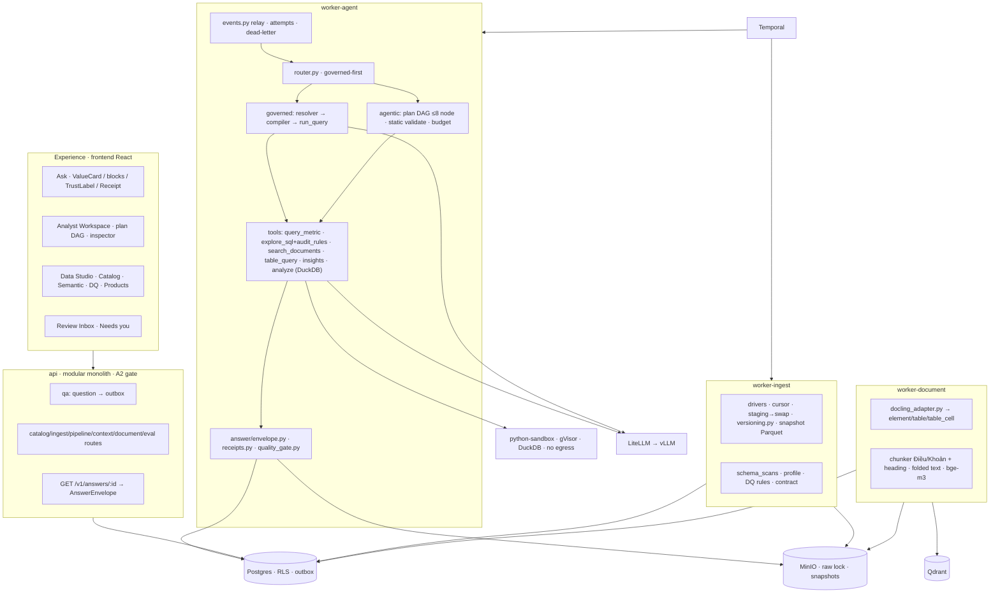
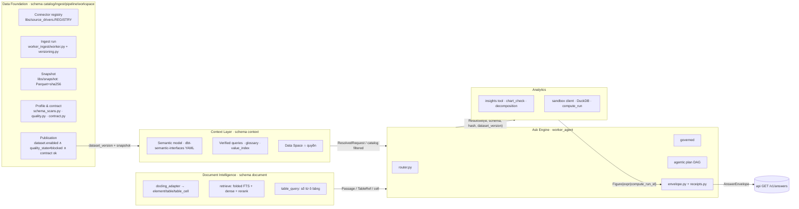
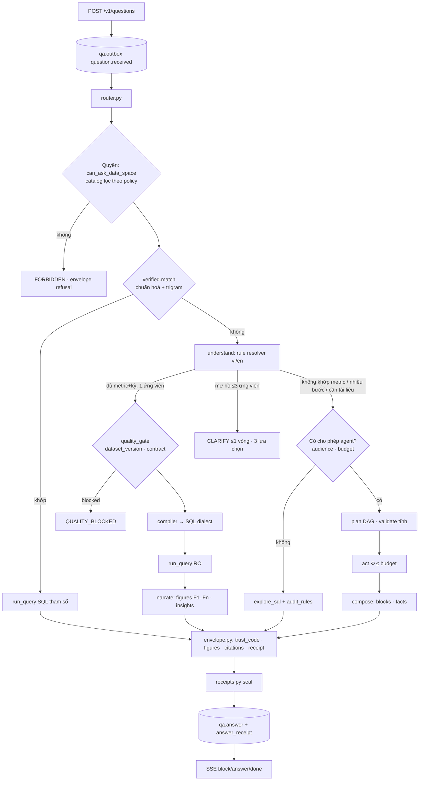
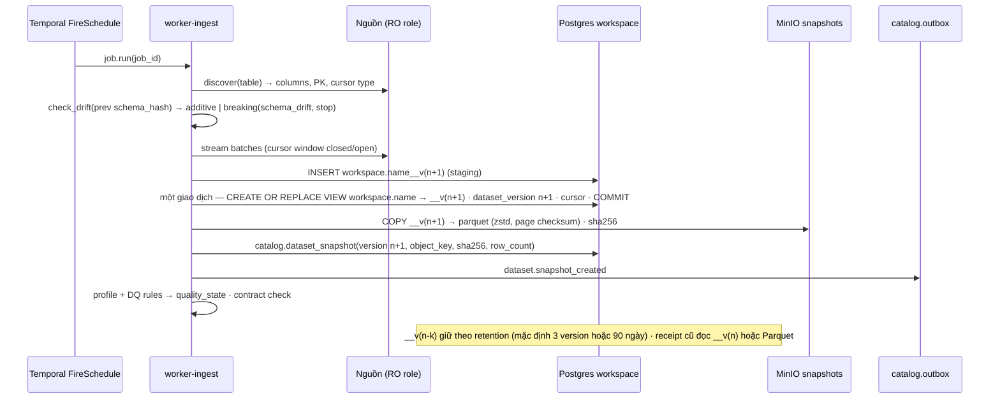
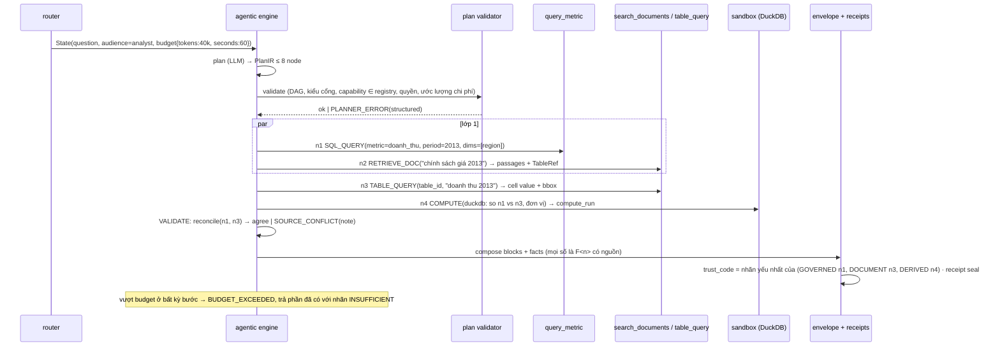
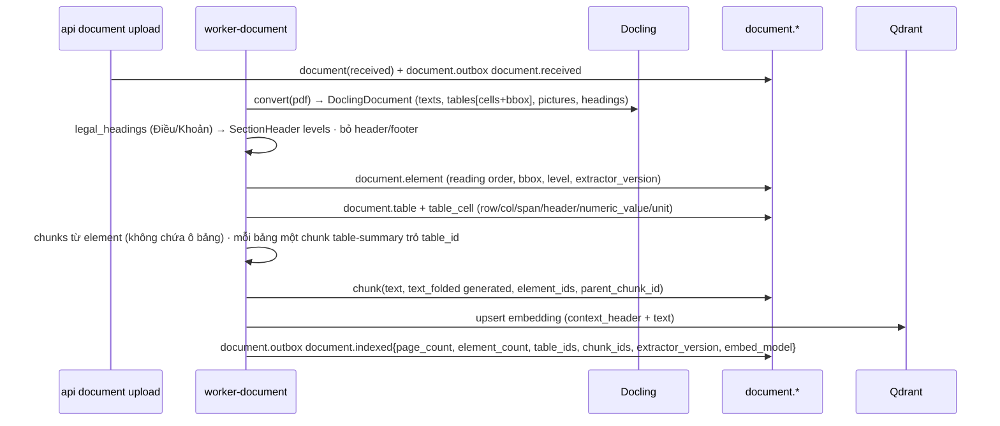
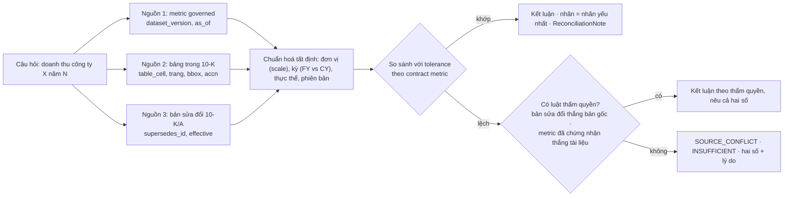
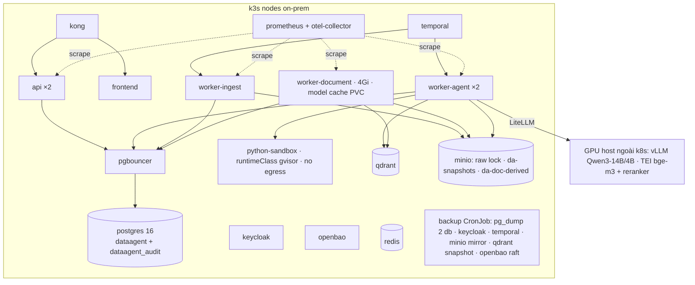
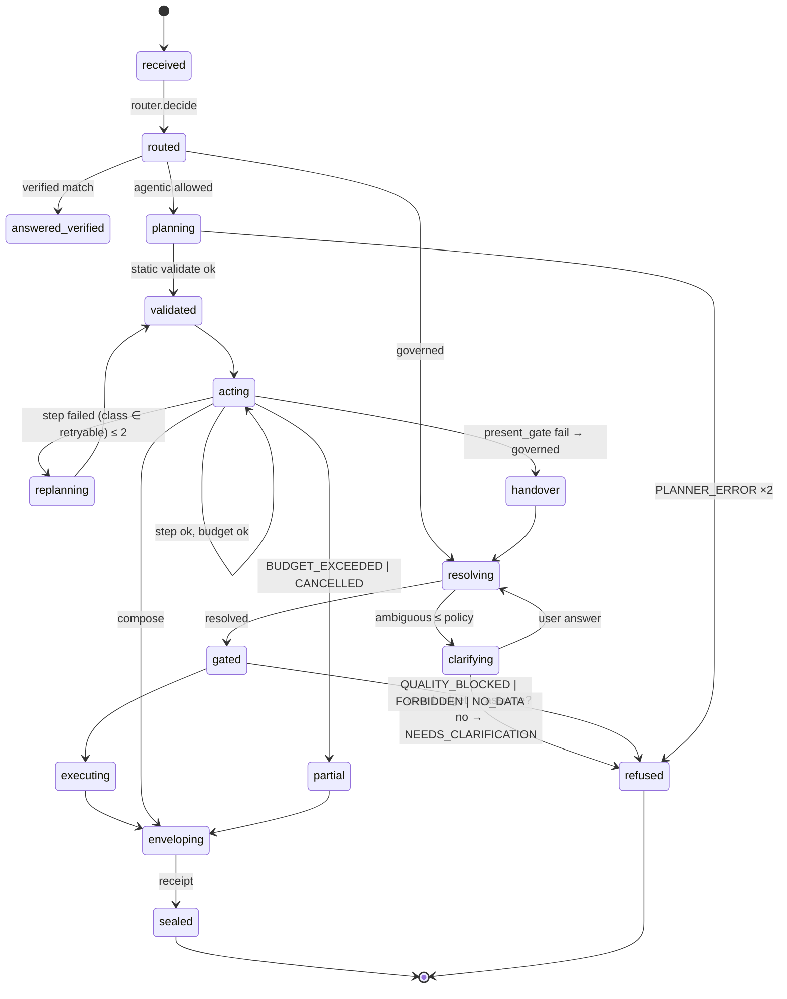

# ARCHITECTURE — Kiến trúc đích và ADR (Part 5)

> Ngày 12/11/2026. Kiến trúc đích **kế thừa ADR-28** (api modular monolith + worker theo schema) và sửa đúng những chỗ
> audit đã chứng minh là sai ([00-ASSESSMENT.md](00-ASSESSMENT.md) §2). §9 là **sổ tên** (naming registry): mọi spec ở
> `*_SPEC.md` và `API_AND_SCHEMA_CONTRACTS.md` phải dùng đúng tên ở đó; coding agent không được đặt tên khác.

## 1. Ba phương án

| Tiêu chí | A — Minimal pragmatic | B — Modular Data Agent (**chọn, biến thể B+**) | C — Advanced agentic |
| --- | --- | --- | --- |
| Mô tả | Thay các khối tự viết bằng OSS: dlt sở hữu ingest, GX chạy DQ, LangGraph chạy agent, Unstructured/Docling + LlamaIndex cho tài liệu; api mỏng | Giữ api + 4 worker; hợp đồng rõ giữa Data Foundation, Ask, Analytics, Document; **governed-first**, agent trong plan DAG kiểm tĩnh có ngân sách; OSS chỉ ở biên (Docling, DuckDB, sqlglot, gVisor) | Supervisor + chuyên gia sinh động, deep research, SOP tự học, agent registry; LangGraph/pydantic-graph checkpoint từng bước |
| Accuracy | Phụ thuộc OSS; mất kiểm tất định đã có (compiler, guard, receipt) | Đo được: governed 100 % câu đơn AW; agent chỉ ở chỗ cần | Cao hơn trên câu khó **nếu** model đủ; FDABench: reflection đắt 2–3×, DataSpace 44 % lỗi ở lúc nộp kết quả |
| Latency | — | governed 2,3 s; agentic 16 s (đo) | ≥ agentic; deep ~ phút |
| Cost (GPU/token) | — | 536 token/câu đơn | 20k+ token/câu; GPU chung hết trần |
| Complexity | Thấp bề mặt, cao ở chỗ nối (RLS, OpenBao, `_dlt_*`, 2 persistence) | Trung bình; đã có 70 % | Cao; thêm persistence agent, registry, policy |
| Scalability | Theo OSS | Worker theo schema scale ngang; GPU là trần | GPU là trần nặng hơn |
| Maintainability | Phụ thuộc 5 dự án, 2 trong đó dừng/đổi hướng | Code tự viết đã có test (2 120 unit) | Nhiều lớp LLM khó test |
| Security | dlt/LangGraph không biết RLS; GX engine riêng | Quyền trước khi sinh, RO role, sandbox pod + gVisor | Agent sinh tool: bề mặt tấn công rộng |
| Manpower | 2–3 (tái tích hợp) | 2–4 | 4–6 + MLE |
| Time to MVP | 16+ tuần (viết lại chỗ nối) | **12–16 tuần** | 24+ |
| Vendor lock-in | dltHub/GX Cloud/LangSmith kéo | Không (MIT/Apache ở biên) | LangSmith |
| OSS dependency risk | Cao (vanna archived, pandas-ai dừng, MetricFlow đổi giấy phép 2 lần) | Thấp (Docling LF AI, DuckDB LTS, sqlglot) | Trung bình |

**Chọn B+.** Lý do: (1) bằng chứng đo được nói đường governed đúng và rẻ, agent chỉ thêm giá trị ở câu nhiều bước;
(2) nền ADR-28 đã có và đúng cho on-prem (RLS, OpenBao, outbox, A2 gate); (3) A phải tháo những thứ đang đúng để
nhét OSS không biết RLS; (4) C là mục tiêu R2–R4, không phải MVP, và mọi benchmark 2026 nói harness + ngữ cảnh > tự chủ.

## 2. Hình tổng thể

## 3. Sơ đồ thành phần: ranh giới module và hợp đồng

Hợp đồng giữa module (chi tiết ở [API_AND_SCHEMA_CONTRACTS.md](API_AND_SCHEMA_CONTRACTS.md)):

| Hợp đồng | Chủ | Người dùng | Điểm chính |
| --- | --- | --- | --- |
| `DatasetVersion` + `DatasetSnapshot` | Data Foundation | Ask, Analytics, Eval | version bất biến, Parquet + sha256, `available_at` |
| `DatasetContract` + `quality_state` | Data Foundation | Ask (quality_gate), Products | `blocked` ⇒ `QUALITY_BLOCKED` |
| `ResolvedRequest` (AnalysisSpec) | Context/Ask | compiler, eval | metric_version, dims, period, filters, compare_to, output contract |
| `ResultSet` | Ask | Analytics, FE | id, schema, rows (cap), `result_sha256`, `dataset_versions[]`, `query_run_id` |
| `Figure` | Ask/Analytics | envelope | `{id, value, unit, source: query_run|compute_run|table_cell, expr?}` |
| `AnswerEnvelope` | Ask | API/FE/Eval | `trust_code`, blocks, figures, citations, receipt_id, refusal |
| `DocumentElement/Table/TableCell` | Document | Ask (table_query), KB ngoài | page, bbox, span, header, numeric_value |
| `Passage` | Document | Ask | chunk_id, text, page_from/to, element_ids, validity |
| `PlanIR` | Ask | FE (DAG), eval | node kind ∈ {SQL_QUERY, RETRIEVE_DOC, TABLE_QUERY, COMPUTE, VALIDATE, CLARIFY}, output_contract, budget |
| Outbox event | mọi module | relay | `attempts`, `dead_at` |

## 4. Dòng dữ liệu một câu hỏi (governed-first)

Quy tắc định tuyến (tất định, ở `router.py`):

1. Verified query khớp → VERIFIED, không LLM.
2. Resolver tất định đủ (metric có trong catalog, kỳ đọc được, ≤ 1 ứng viên/slot) → governed → GOVERNED.
3. Resolver mơ hồ (2–3 ứng viên) → CLARIFY theo policy (executive 1 vòng/3 lựa chọn; analyst 3/5).
4. Câu hỏi nêu đại lượng **không có** trong catalog, hoặc có từ khoá phân tích nhiều bước (`why`, so sánh nhiều metric,
   "theo tài liệu"), hoặc `purpose=deep` → agentic nếu audience cho phép và budget còn; nếu không → explore_sql có
   audit → EXPLORATORY; nếu audit từ chối → INSUFFICIENT_EVIDENCE.
5. Mọi đường kết thúc ở `envelope.py`; không đường nào tự ghi `qa.answer`.

## 5. Sequence cho các use case quan trọng

### 5.1 Nạp dữ liệu có version và snapshot

### 5.2 Câu hỏi lai số + tài liệu (agentic, có ngân sách)

### 5.3 Tài liệu có bảng

### 5.4 Đối chiếu nguồn chéo (cross-source)

LLM **không** chọn số; nó chỉ viết câu từ facts mà bước tất định đã gắn nhãn `agree | authority | conflict`.

## 6. Bản đồ tích hợp API

| Bề mặt | Giữ | Thêm (xem CONTRACTS §3) |
| --- | --- | --- |
| `/v1/questions`, `/v1/answers/{id}`, `/stream`, `/steps`, `/receipt`, `/lineage` | giữ | `GET /v1/answers/{id}` trả `AnswerEnvelope` (trust_code, blocks, figures, citations, receipt_id); `audience` trong body `POST /v1/questions` |
| `/v1/datasets/*` | giữ | `GET /v1/datasets/{id}/versions`, `GET /v1/datasets/{id}/versions/{v}/snapshot` (signed URL), `GET/PUT /v1/datasets/{id}/contract` |
| `/v1/documents/*` | giữ | `GET /v1/documents/{id}/elements?page=`, `GET /v1/documents/{id}/tables`, `GET /v1/tables/{id}/cells` |
| `/v1/eval-sets/*` | giữ | case có `expected_action`, `failure_category`, `rubric`, `snapshot_ref`; `POST /v1/eval-sets/{id}/runs` ghi report |
| `/v1/sources/*` | giữ | `GET /v1/connectors` sinh từ registry driver (chỉ kind có driver + test) |
| Outbox events | giữ | `dataset.snapshot_created`; payload `document.indexed` mở rộng; `answer.sealed` |
| MCP `/mcp` | giữ (vào) | server ra ngoài: R2 (D12) |

Mọi endpoint mới phải vào bản chụp A2 (`backend/services/api/catalogue/`) theo quy trình `docs/v3/06-api-v1.md` §4;
route không có trong A2 fail lúc import.

## 7. Topology triển khai và lưu trữ

| Kho | Dùng cho | Quyết định |
| --- | --- | --- |
| Postgres | mọi metadata, workspace tables (theo version), FTS, receipts | giữ; thêm `unaccent` extension |
| MinIO | raw (lock), **`da-snapshots`** (Parquet theo dataset_version, lock), doc derived | thêm bucket lock cho `da-ingest`, `da-raw-docs` |
| Qdrant | embedding chunk | giữ |
| DuckDB | tính trong sandbox trên Parquet/Arrow; đọc snapshot | in-process, không service |
| ClickHouse / Kafka / Langfuse | — | tắt ở local; cờ ở production |
| Redis | SSE stream, idempotency, rate limit | pin phiên bản; fail-closed cho idempotency khi mất Redis |

## 8. Mô hình trạng thái, lỗi và quan sát

### 8.1 Agent state (một lượt)

Trạng thái và từng bước được ghi **khi chuyển** (`agent_run`, `agent_step` upsert theo bước — F-30), không chỉ cuối lượt.

### 8.2 Lớp lỗi và đường phục hồi

| Lớp | Mã | Thử lại | Replan | Người |
| --- | --- | --- | --- | --- |
| Tạm thời (timeout, mất kết nối, 429) | `TOOL_UNAVAILABLE` | 1 lần, backoff | không | không |
| Tham số sai (validator) | `CONTRACT_MISMATCH` | sửa tại chỗ 1 lần | 1 | không |
| Thiếu dữ liệu | `NO_DATA`, `NO_JOIN_PATH` | không | 1 (tìm bảng khác) | gợi steward |
| Quyền | `FORBIDDEN` | không | **không** | không (không lộ tên) |
| Chất lượng/độ tươi | `QUALITY_BLOCKED`, `STALE_DATA` | không | không | steward |
| Audit SQL từ chối | `AUDIT_REJECTED` | 1 lần cùng bước, cấm SQL cũ | 1 | không |
| Ngân sách | `BUDGET_EXCEEDED` | không | không | người xác nhận thêm (analyst) |
| Xung đột nguồn | `SOURCE_CONFLICT` | không | không | hiện hai số |
| Planner | `PLANNER_ERROR` | 1 | 1 | không |
| Huỷ | `CANCELLED` | — | — | — |

Outbox: `attempts` tăng mỗi lần claim; lỗi tạm thời backoff 5/15/60 phút; `attempts ≥ 5` → `dead_at` + sự kiện
`outbox.dead_letter` → notify admin; handler lỗi **không** chặn lô (mỗi sự kiện một savepoint).

### 8.3 Quan sát

| Lớp | Cơ chế | Việc phải làm |
| --- | --- | --- |
| Metrics | `prometheus_client` `/metrics` ở api, 3 worker: request/handler latency histogram, outbox lag, LLM tokens theo role, query_run duration, sandbox duration, eval pass rate | F-11 |
| Trace | OTel SDK → otel-collector (có sẵn trong deploy) → Tempo (thay Langfuse); `traceparent` đã có | F-11 |
| Trace nghiệp vụ | `agent_run/agent_step` theo bước; receipt; lineage | F-30 |
| Chi phí | `LLM_PRICES` theo model local = giây GPU × giá cấu hình (không để 0) | F-04 |
| Eval | nightly real-model → `eval.run` + report JSON; gate đọc retrieval + agent-eval + why | F-10 |

## 9. Sổ tên (naming registry) — bắt buộc dùng

### 9.1 Bảng / cột mới (qua `backend/schema` generator + migration ≥ `v3_0036`)

| Đối tượng | Cột chính | Tính năng |
| --- | --- | --- |
| `catalog.dataset_snapshot` | id, org_id, dataset_id, version, object_key, sha256, row_count, byte_size, columns jsonb, available_at, created_by_run_id, created_at | F-01 |
| `catalog.dataset_contract` | dataset_id (PK), org_id, schema_hash_expected, freshness_sla jsonb, required_rules jsonb (GX vocab), status (draft/active/broken), updated_by, version | F-02 |
| `workspace.<name>__v<n>` (bảng) + `workspace.<name>` (view) | như hiện tại | F-01 |
| `qa.answer.trust_code` | enum: VERIFIED, GOVERNED, EXPLORATORY, DERIVED, DOCUMENT, INSUFFICIENT | F-03 |
| `qa.answer.envelope` jsonb | AnswerEnvelope đã chuẩn hoá | F-03 |
| `qa.compute_run` | id, org_id, answer_id, step_id, code_sha256, code_object_key, input_refs jsonb [{result_set_id|snapshot_id, sha256}], lib_versions jsonb, output_sha256, runtime (duckdb/pandas), duration_ms | F-09 |
| `document.element` | id, document_id, page_no, order_idx, kind (text/heading/list/table/picture/caption/footnote/formula/header/footer), level, bbox jsonb, text, parent_element_id, extractor_version, confidence | F-07 |
| `document.table` | id, document_id, element_id, page_from, page_to, n_rows, n_cols, header_rows, caption, continues_table_id | F-07 |
| `document.table_cell` | table_id, row_idx, col_idx, row_span, col_span, text, numeric_value, unit, is_header, page_no, bbox jsonb | F-07 |
| `document.chunk.text_folded` (generated: `unaccent(lower(text))`) + GIN; `chunk.element_ids uuid[]`, `chunk.parent_chunk_id` | — | F-08, F-25 |
| `<schema>.outbox.attempts int, last_error text, dead_at timestamptz` | — | F-11 |
| `agent.agent_run.budget_tokens, budget_seconds, used_tokens` | — | F-04 |
| `eval.eval_item.expected_action, failure_category, rubric, verification_status, snapshot_ref jsonb` (bảng thật là `eval_item`, không phải `eval_case`) | — | F-10 |

### 9.2 Sự kiện outbox mới / mở rộng

`dataset.snapshot_created{dataset_id, version, snapshot_id, sha256}`; `document.indexed` thêm `{page_count, element_count,
table_ids[], chunk_ids[], extractor_version, embed_model}`; `answer.sealed{answer_id, trust_code, receipt_id}`;
`outbox.dead_letter{schema, event_id, event_type, attempts, last_error}`.

### 9.3 Module / file mới

| Đường dẫn | Việc |
| --- | --- |
| `backend/libs/snapshot/` | Parquet writer/reader (pyarrow), sha256, metadata provenance, DuckDB reader |
| `backend/libs/source_drivers/registry.py` | `REGISTRY: dict[kind, Driver]`; `discover()`, `stream()`, `type_map()` |
| `backend/services/worker_ingest/versioning.py` | staging `__v<n>`, swap view, retention |
| `backend/services/worker_agent/quality_gate.py` | đọc `quality_state` + contract cho mọi dataset trong request |
| `backend/services/worker_agent/router.py` | governed-first; quyết định đường; budget |
| `backend/services/worker_agent/answer/envelope.py` | dựng `AnswerEnvelope` cho mọi đường; `trust_code = min(...)` |
| `backend/services/worker_agent/receipts.py` | `seal(answer_id, envelope)` dùng chung (chuyển `_seal_receipt`) |
| `backend/services/worker_agent/sqlgen/audit_rules.py` | kiểm tất định: measure ∈ metric catalog; filter ∈ SQL; đơn vị |
| `backend/services/worker_agent/agentic/budget.py` | token/thời gian; `BUDGET_EXCEEDED` |
| `backend/services/worker_agent/agentic/tools/insights.py` | bọc `answer/insights.py`, `skills/anomaly.py` |
| `backend/services/worker_agent/answer/chart_check.py` | validator AN-03 |
| `backend/services/worker_agent/documents/table_query.py` | số từ `table_cell` qua SQL, trích dẫn ô |
| `backend/services/worker_agent/documents/reconcile.py` | chuẩn hoá + so sánh nguồn chéo |
| `backend/services/worker_document/docling_adapter.py`, `tables.py`, `legal_headings.py` | F-07 |
| `backend/libs/code_sandbox/duck.py` | mở DuckDB có khoá cấu hình |
| `backend/libs/sql_guard/lineage.py` | sqlglot lineage |
| `model/eval/cases/golden/{nyc311,edgar}/*.jsonl`, `model/eval/snapshots/*.manifest.json` | F-10 |
| `tests/e2e/nyc311/`, `deploy/docker/semantic/ds-311.yaml` | F-10 |
| `deploy/ansible/roles/k8s_gvisor/`, `deploy/k8s/*/runtimeclass-gvisor.yaml` | F-12 |
| `deploy/k8s/dev/service/tei.yaml` (CPU, cờ) | eval full stack |

### 9.4 Mã lỗi

Giữ danh sách `libs/contracts/v1/errors.py`; thêm `AUDIT_REJECTED`, `SOURCE_CONFLICT`. Không thêm mã khác mà không sửa
tài liệu này.

### 9.5 Nhãn tin cậy

`trust_code` là **enum tiếng Anh** lưu trên `qa.answer` và trên từng block/figure; chuỗi hiển thị tiếng Việt chỉ ở
frontend (`trust.ts`). Nhãn câu trả lời = nhãn yếu nhất trong các số; thứ tự: VERIFIED > GOVERNED > DERIVED > EXPLORATORY >
DOCUMENT > INSUFFICIENT. (`DERIVED` = tính tất định từ nguồn có nhãn ≥ GOVERNED, có `compute_run`.)

## 10. ADR mới

| ADR | Quyết định | Lý do | Hệ quả |
| --- | --- | --- | --- |
| ADR-50 | Governed-first router; agent chỉ cho composite | Đo 20/20 vs 17/20 ở 42× chi phí | `router.py`; memory "xoá governed" bị thay |
| ADR-51 | Dataset theo version: bảng `__v<n>` + view + Parquet snapshot có checksum; không `DROP` | Bất biến 2/9; receipt tái lập | migration lớn; retention |
| ADR-52 | AnswerEnvelope + `trust_code` enum + receipt cho mọi đường | A-1, A-10, N-2 | FE đọc một shape |
| ADR-53 | Docling là backend trích tài liệu; bảng là `element/table/table_cell`; số trong bảng đi SQL | U-1; bất biến 3 | image +2–3 GB; PoC-1 là điều kiện |
| ADR-54 | DuckDB 2.0 LTS trong sandbox và cho snapshot; gVisor RuntimeClass | N-10, N-3 | node prep Ansible |
| ADR-55 | DQ là cổng: `quality_state=blocked` chặn governed/report/product; contract tối thiểu | D-3 | steward phải ack |
| ADR-56 | Outbox có attempts + dead-letter; handler cô lập savepoint | P-4 | — |
| ADR-57 | Eval online chạy nightly với model thật trên snapshot cố định; ngưỡng chỉ chốt từ lượt chạy thật | P-5 | TEI phải có ở môi trường eval |
| ADR-58 | YAML semantic theo `dbt-semantic-interfaces`; compiler nội bộ giữ | D4 | map hai chiều |
| ADR-59 | Đóng băng bề ngang: không schema/màn/connector mới trước cổng P0 | §2.3 của 00 | Review từ chối PR mở rộng |

### 9.6 Bổ sung từ các spec (đã duyệt gộp 12/11/2026)

Các spec đề xuất thêm; từ đây chúng là một phần của sổ tên. Chi tiết DDL/JSON ở [API_AND_SCHEMA_CONTRACTS.md](API_AND_SCHEMA_CONTRACTS.md).

| Đối tượng | Nội dung | Spec |
| --- | --- | --- |
| `catalog.dataset_snapshot.status` | `ok \| skipped` (quá ngưỡng hoặc MinIO lỗi vẫn có dòng) | DATA |
| `catalog.dataset_version.physical_table, retained_until` | tên bảng `__v<n>` và hạn giữ | DATA |
| `catalog.column_profile.quantiles, histogram, length_stats` jsonb; `catalog.column_meta.pii_evidence` jsonb | profiling sâu, RES-24 | DATA |
| `libs/quality_vocab/` | từ vựng expectation GX dùng chung api + worker | DATA |
| proposal `kind=pipeline_steps` (Review Inbox) | AUD-04 | DATA |
| mã `PRECONDITION_REQUIRED` (HTTP 428) | If-Match bắt buộc (DF-18) | DATA |
| `qa.conversation.slots` jsonb | ConversationSlots (F-21) | ASK |
| `context.example_query.question_core text, params jsonb` + GIN `pg_trgm` | verified fuzzy (F-22) | ASK |
| `context.metric_version.rules` jsonb (`required_dimensions`, `sign_rule`, `tolerance`, `source_document_id`) | F-28, F-26 | ASK |
| `query.query_run.executed_as text`; `catalog.source.role_mapping` jsonb | F-29 | ASK |
| `org.data_space.agent_policy` jsonb (`agent_enabled`, `allow_explore`, `budget_overrides`); `org.data_space.retrieval_thresholds` jsonb | F-04, RG-03 | ASK, DOC |
| `qa.plan.question_core text` + index `(data_space_id, question_core, space_version)` | plan reuse | ASK |
| `worker_agent/clarify_policy.py` (chuyển từ `agentic/`), `libs/language/messages/` | policy chung; catalog vi/en | ASK |
| Block types mới: `inference`, `hypothesis`, `recommendation`; `ChartIssue.code` enum | F-09 | ANALYTICS |
| `qa.compute_run.runtime ∈ {insights, decomposition, duckdb, pandas}` | F-09 | ANALYTICS |
| Kind lịch Temporal `monitor`; `monitor.alert.figures` jsonb | F-20 | ANALYTICS |
| `workspace.tile_snapshot.rows, dataset_versions, result_sha256` | tile tái lập | ANALYTICS |
| `worker_document/intake.py`, `worker_document/packs/{vi,en}.py` | nhận dạng loại; gói ngôn ngữ tiêu đề/thay thế/scale | DOC |
| `document.document_page.extractor_version`; bảng `document.version_diff` | reprocess theo version; diff phiên bản | DOC |
| `conflict.claim.metric_id` | link claim ↔ metric cho reconcile | DOC |
| `backend/libs/contracts/v1/document_export.json` | hợp đồng export cho KB ngoài | DOC |
| `model/eval/cases/tables.jsonl`, `model/eval/cases/charts.jsonl`, `model/eval/docs/{teds,order,cer,bakeoff}.py`, `make docling-bakeoff` | PoC-1, AN-13 | DOC, ANALYTICS |
| `eval.eval_item` (không phải `eval_case`) + cột ở §9.1 | bảng case thật | EVAL |
| `qa.answer_receipt.data_product_id` → nullable | receipt cho câu ngoài data product (agentic) | CONTRACTS |
| Prometheus: `ask_route_total`, `document_parse_seconds`, `document_tables_total`, `document_quality_issues_total{kind}`, `ingest_rows_total{outcome}` | F-11 | mọi spec |
