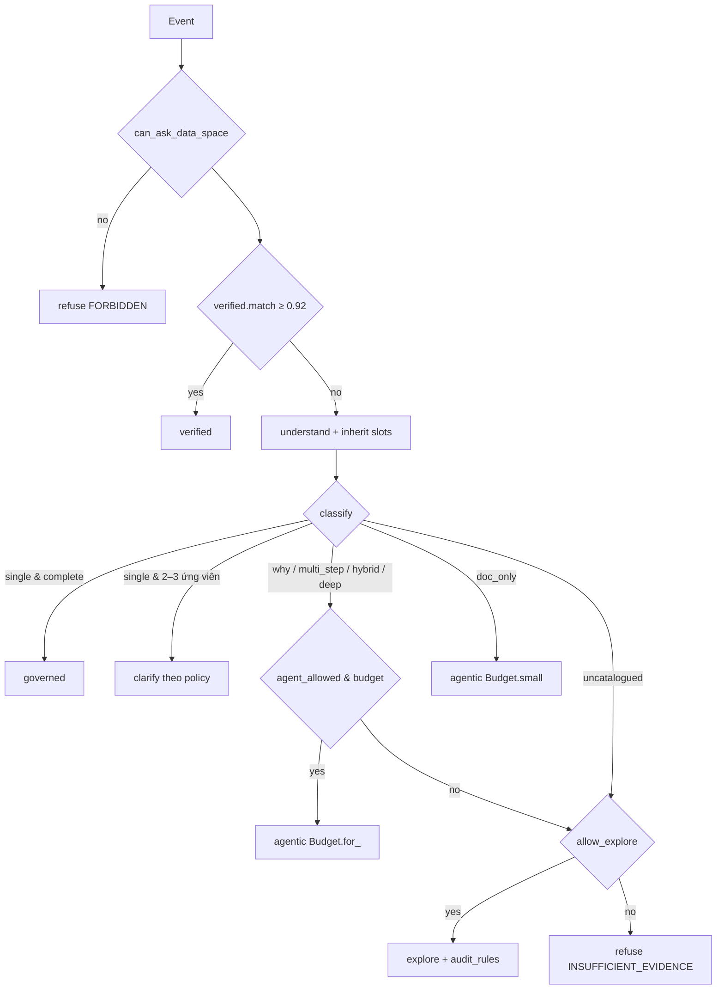
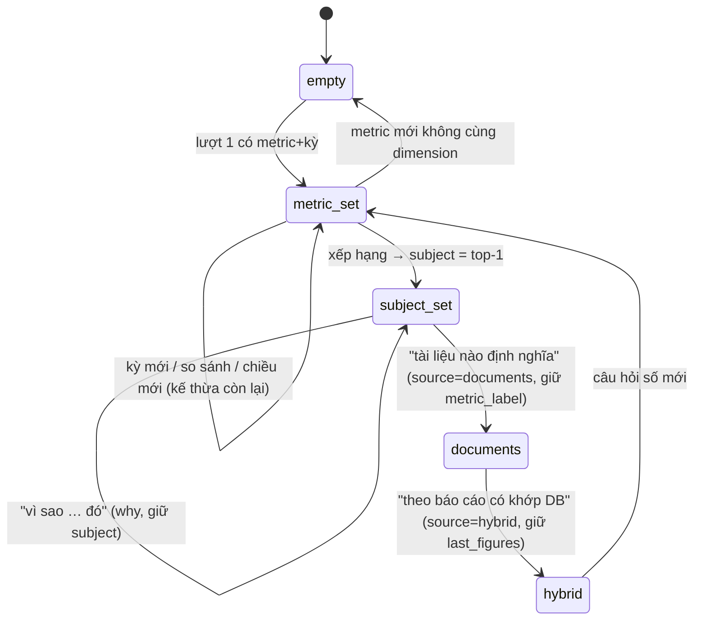

# ASK_ENGINE_SPEC — Conversational Ask Engine (Part 6)

> Ngày 12/11/2026. Đặc tả triển khai cho các tính năng Ask ở [STRATEGY.md](STRATEGY.md) §3: F-03, F-04, F-05, F-06,
> F-21, F-22, F-26, F-28, F-29, F-30 (phần Ask). Tên bảng, module, mã lỗi, sự kiện lấy **đúng** từ
> [ARCHITECTURE.md](ARCHITECTURE.md) §9; chỗ "hiện tại" dẫn `file:dòng` từ [evidence/audit-ask.md](evidence/audit-ask.md).
> Mọi đường dẫn dưới đây tương đối với `backend/services/worker_agent/` trừ khi ghi khác. Baseline đo ngày 12/11:
> governed 20/20 (536 token, 2,3 s), agentic 17/20 (22 626 token, 16,1 s) trên 20 câu đầu DS-AW
> ([evidence/baseline.md](evidence/baseline.md)).

## 0. Phạm vi và nguyên tắc

| Loại câu hỏi | Đường xử lý | Nhãn đích |
| --- | --- | --- |
| Một metric / kỳ / chiều / lọc (structured) | verified → governed | VERIFIED / GOVERNED |
| Định nghĩa, chính sách, "tài liệu nào nói" (document) | retrieve + answer có trích dẫn | DOCUMENT |
| Lai số + tài liệu, "có khớp không" (hybrid) | agentic plan DAG: `investigate_numbers` ∥ `investigate_documents` → `reconcile.py` | min(…) hoặc SOURCE_CONFLICT |
| Follow-up ("so với cùng kỳ", "chi nhánh nào") | slot carry-over → governed | GOVERNED |
| Mơ hồ (2–3 ứng viên) | CLARIFY theo policy, một vòng cho executive | NEEDS_CLARIFICATION |
| Nhiều bước ("vì sao giảm") | agentic plan DAG ≤ 8 node, ngân sách | DERIVED / EXPLORATORY |
| Ngoài dữ liệu (kỳ ngoài coverage, đại lượng không có trong catalog) | từ chối có mã, không đoán | NO_DATA / INSUFFICIENT_EVIDENCE |

Bất biến áp dụng: 5 (LLM đề xuất, kiểm tất định, người quyết), 6 (LLM không tính số), 13 (quyền trước khi sinh), 14 (nhãn
trên mọi câu trả lời), 16 (output contract trước khi chạy), 17 (plan DAG kiểm tĩnh). Hai điều cấm: không đường nào tự
ghi `qa.answer` ngoài `answer/envelope.py` + `receipts.py`; không chuỗi tiếng Việt mới trong harness (dùng message
catalog, §11).

## 1. Hiện trạng dẫn chiếu (để biết sửa ở đâu)

| Điểm | Hiện tại | Dẫn chiếu |
| --- | --- | --- |
| Thứ tự trong `_run` | `answer_verified_first` → agentic nếu `ASK_ENGINE=agentic` → governed | `questions.py:799` |
| Resolver tất định | `understand/resolver.py:155 understand`, PROCEED_AT 0.8, clarify ≤ 3 lựa chọn | audit-ask §2 |
| Khớp verified | nguyên văn chuẩn hoá, bỏ từ chỉ kỳ khi SQL có `:period_start/:period_end` | `sqlgen/verified.py:67` |
| Audit SQL | chỉ ở agentic (`tools/query.py:263 _audit`, LLM); governed `answer_by_sql` không audit | `sqlgen/answer.py:155` |
| Nhãn tin cậy | chuỗi tiếng Việt trên `figures[].trust`; mã chỉ ở FE | `workspace.TRUST_LABEL`, `questions.py:2175`, `frontend/.../dataAnswer.ts:66-125` |
| Receipt | chỉ governed `_seal_receipt` | `questions.py:2516` |
| Clarify | `clarify_policy.apply` chỉ ở `mode=ask`; `ask_user` đi thẳng `s.clarify` | `engine.py:203, 495`; `tools/__init__.py:29` |
| Ngân sách | MAX_STEPS 8, MAX_STEP_RUNS 14, không token/giây | `engine.py` hằng |
| Lịch sử đa lượt agentic | 5 lượt văn xuôi, không slot | `engine._history:143` |
| Zero vs no-data | `present_gate.no_figure` coi toàn 0 là không có | `present_gate.py:31` |
| Danh tính thực thi | credential dịch vụ của nguồn + rewrite policy | `query/executor.py:517` |
| Trace | ghi một lần cuối lượt | `turn_trace.py:428` |

## 2. F-04 Governed-first router và ngân sách

### A. Định nghĩa

- Mục đích: mọi câu hỏi đi qua một bộ quyết định tất định (`router.py`) chọn đường rẻ nhất đủ đúng; agent chỉ nhận câu
  thật sự nhiều bước hoặc lai nguồn; mỗi lượt agent có ngân sách token và giây.
- User story: "Là quản lý, tôi hỏi một con số và nhận câu trả lời trong 3 giây với nhãn Có quản trị; nếu hỏi 'vì sao'
  tôi chờ lâu hơn nhưng biết hệ thống đang làm gì và không bao giờ quá 60 giây."
- Giá trị: giữ 20/20 và 536 token cho câu đơn; chặn chi phí 42× lan sang câu đơn.
- Input: `Event(question_id, conversation_id, data_space_id, user_id, audience, purpose, depth)`. Output: `RouteDecision`.
- Non-scope: thay planner LLM; xoá đường governed.

### B. Thiết kế

Module `router.py`:

```python
@dataclass(frozen=True)
class RouteDecision:
    path: Literal["verified", "governed", "clarify", "agentic", "explore", "refuse"]
    reason: str                      # mã ngắn cho trace: VQ_MATCH, RESOLVED, AMBIGUOUS, UNCATALOGUED, MULTI_STEP, DOC_ONLY, HYBRID, FORBIDDEN
    budget: Budget | None            # chỉ khi path == "agentic"
    resolved: Understanding | None   # kết quả resolver nếu có
    clarify: Clarify | None

def decide(event, ctx: ToolContext, slots: ConversationSlots) -> RouteDecision:
    if not can_ask_data_space(ctx):                       # quyền trước mọi thứ (bất biến 13)
        return RouteDecision("refuse", "FORBIDDEN", None, None, None)
    vq = verified.match(event.text, ctx)                  # F-22: fuzzy
    if vq: return RouteDecision("verified", "VQ_MATCH", None, None, None)
    u = understand(event.text, ctx, inherit=slots)        # rule resolver, kế thừa slot (F-21)
    kind = classify(event.text, u, ctx)                   # tất định, §2.B.2
    if kind == "single" and u.complete and u.candidates_per_slot <= 1:
        return RouteDecision("governed", "RESOLVED", None, u, None)
    if kind == "single" and 2 <= u.max_candidates <= policy(ctx.audience).max_options:
        return RouteDecision("clarify", "AMBIGUOUS", None, u, clarify_policy.build(u, ctx))
    if kind in ("multi_step", "hybrid", "doc_only", "why") or event.purpose == "deep":
        if agent_allowed(ctx.audience, ctx.space.policy):
            return RouteDecision("agentic", kind.upper(), Budget.for_(ctx.audience, kind), u, None)
        if kind == "doc_only":
            return RouteDecision("agentic", "DOC_ONLY", Budget.small(), u, None)   # documents không cần planner nhiều bước
    if kind == "uncatalogued" and ctx.space.allow_explore:
        return RouteDecision("explore", "UNCATALOGUED", None, u, None)
    return RouteDecision("refuse", "INSUFFICIENT_EVIDENCE", None, u, None)
```

`classify` là tất định, không gọi LLM:

| Tín hiệu | Nguồn | Kết quả |
| --- | --- | --- |
| `u.metric` có trong catalog, không từ khoá phân tích | resolver | `single` |
| Từ khoá `why` của pack (`understand/packs/vi.py: why`) hoặc "giải thích", "nguyên nhân", "driver" | pack | `why` |
| ≥ 2 metric hoặc "so sánh … và …", "tương quan" | resolver | `multi_step` |
| Từ khoá `knowledge` của pack ("theo tài liệu", "định nghĩa", "chính sách", "quy định") **và** không có metric | pack | `doc_only` |
| Từ khoá `knowledge` **và** có metric hoặc số | pack + resolver | `hybrid` |
| `_asks_quantity` nhưng không metric nào khớp ≥ 0,8 và `_unnamed_quantity` không chặn | resolver | `uncatalogued` |

`agentic/budget.py`:

```python
@dataclass
class Budget:
    tokens: int; seconds: int; steps: int
    used_tokens: int = 0; started: float = field(default_factory=monotonic)
    @classmethod
    def for_(cls, audience, kind):            # executive: 15k/30s/6; analyst: 40k/60s/8; deep: 120k/180s/12
    def charge(self, usage): ...               # gọi từ llm.py sau mỗi call (hook `on_usage`)
    def check(self):                           # raise BudgetExceeded(code=BUDGET_EXCEEDED, remaining=...)
```

`engine.after_act` gọi `budget.check()` trước khi lập bước tiếp; vượt → `State.partial=True`, compose với những gì đã có,
`trust_code=INSUFFICIENT`, refusal detail `BUDGET_EXCEEDED`. Lưu `agent_run.budget_tokens/budget_seconds/used_tokens`.

State transitions: theo [ARCHITECTURE.md](ARCHITECTURE.md) §8.1 (`received → routed → …`). `RouteDecision.reason` ghi
vào `qa.plan.steps.router` và `agent_run.operator`.

Retry/idempotency: `decide` thuần, không I/O ngoài DB đọc; handler `question.received` idempotent theo `question.status`
(giữ như `questions.py:22`). Timeout: toàn lượt = `budget.seconds` (agentic) hoặc `GOVERNED_TIMEOUT_S=30`.

Security: `audience` đọc từ `event.payload.audience`, **api** đặt từ vai của người hỏi trong Data Space (AC01/AC02 →
`executive`, AC03/AC04 → `analyst`); client không được gửi `audience` (giữ nguyên tắc R0-5). **Đã làm (AE-03,
19/11/2026):** suy từ quyền, không từ mã vai (một tổ chức thêm vai của mình): có `view_detail`, `steward`,
`prepare_data`, `admin_data`, `run_agent` hoặc `create_agent` → `analyst`, chỉ hỏi → `executive`
(`api/modules/qa/questions.audience_of`); `QuestionCreate` cấm trường lạ nên body có `audience` nhận 422. `agent_allowed` đọc
`org.data_space.policy.agent_enabled` (cột có sẵn dạng jsonb `ingest_profile`? không — dùng `agent_def.policy`; xem đề xuất
§13).

Logging/metrics: counter `ask_route_total{path,reason}`; histogram `ask_turn_seconds{path}`; gauge `ask_budget_used_ratio`.

#### Đã làm (AE-01, 19/11/2026): khác thiết kế ở đâu

- `router.py` chỉ quyết **agent có chạy trước hay không**. Các nhánh `clarify`, `explore`, `refuse` vẫn là của
  đường governed như hiện có (clarify của resolver, model reader → analyst → SQL khám phá → tài liệu, từ chối quyền);
  câu mà luật không đặt là planner, không phải chuỗi governed đó.
  Vì vậy `RouteDecision` rút gọn thành `Route(path ∈ {governed, agentic}, reason)`. `Budget` thuộc AE-02.
- Router đọc câu hỏi **đúng như đường governed**: phần bóc so sánh, grain, phân tích, điều kiện chuyển sang
  `understand/asked.py`, và `_understand_and_plan` cũng dùng nó.
- `knowledge` của pack là chế độ thời điểm (số đã nộp hay hiện tại), không phải "hỏi tài liệu". Ý định tài liệu là
  trường mới `documents` của pack. `≥ 2 metric` = `Understanding.named_metrics` (resolver đếm metric được gọi tên).
- Lý do: `RESOLVED` → governed; `AMBIGUOUS` → governed (cho tới khi planner hỏi lại với candidate metric đã
  certified); `UNCATALOGUED` → agentic (planner trả lời câu không phải số từ corpus); `WHY`, `MULTI_METRIC`, `HYBRID`,
  `DOC_ONLY`, `DEEP` → agent; `FORBIDDEN`, `GONE` → governed (nó trả lời từ chối). `ASK_ENGINE=router` (mặc định) |
  `agentic` (agent trước mọi câu, như trước AE-01: đường lui) | `governed`. Đếm ở `dataagent_ask_route_total{path,reason}`.
- `MULTI_METRIC` chỉ khi hai metric hoà điểm **và** câu nối chúng (trường `joins` của pack: và, với, so sánh; and,
  vs). DS-AW aw057/aw058 "Doanh số Trade Sales theo ngân sách" gọi tên hai metric nhưng hỏi một; agent sai cả hai.
- Đo 19/11 (DS-AW, 61 câu): 61 → governed; `agent-eval --engines router` 49/61, trùng từng câu với governed;
  853 token và 2,6 s mỗi câu.
- Chưa có: ghi `reason` vào `qa.plan.steps.router` và timeline; `audience` (AE-03). Trace theo bước: xong ở AE-18 (23/11/2026).

#### Đã làm (AE-02, 19/11/2026)

- `agentic/budget.py`: token, giây, bước theo `audience` (AE-03) và `deep` — executive 15k/30 s/6, analyst
  40k/60 s/8, deep 120k/180 s/12 (provisional). Token đọc từ bộ đếm của `turn_trace` (mọi lần gọi model của lượt,
  tính từ lúc đặt ngân sách); không cần hook riêng ở `llm.py`.
- Kiểm ở điểm rẽ (`after_act`, `after_review`, route của `replan`), không giữa một bước: hết ngân sách thì sang
  `compose` với cái đã có (`present_gate` vẫn quyết trả lời hay giao về governed). `agent.agent_run.stop_reason` =
  `budget_tokens | budget_duration | budget_steps` (cột và CHECK đã có, không migration); `qa.plan.steps.operator.stopped`
  và câu `why` nói lý do. Chưa có: `trust_code=INSUFFICIENT` cho câu trả lời dừng sớm (AE-04).
- Đo 19/11, 20 câu DS-AW đầu, engine `agentic`: không ngân sách 19/20, p95 48 s, token p95 49k; analyst 19/20,
  p95 50,7 s (≤ 60 s); executive 19/20, p95 29,6 s, token p95 30,5k. Token có thể vượt hạn mức một lần `compose`
  (kiểm trước, không cắt ngang lời gọi model).

### C. OSS

Không phụ thuộc mới. Ý tưởng `check_answerable` (NVIDIA auto-ontology, Apache-2.0, [evidence/oss-agents.md](evidence/oss-agents.md) §6)
cho `classify`: điểm phủ catalog trước khi sinh.

### D. Test

- `tests/unit/worker_agent/test_router.py`: 12 case (verified, resolved, ambiguous executive/analyst, why, hybrid,
  doc_only, uncatalogued allow/deny, forbidden, purpose=deep, budget by audience).
- `tests/unit/worker_agent/test_budget.py`: charge/check, partial compose.
- `tests/integration/worker_agent/test_router_paths.py`: 20 câu DS-AW đầu qua `router.decide` → 20 `governed`.
- `make agent-eval`: `--engines router` thêm vào `agentic/evaluate.py`; cột `path`.

### E. DoD

Trên 61 câu DS-AW: ≥ 55 đi `verified|governed`; token trung bình câu `single` ≤ 1 000; không câu nào agentic vượt 60 s;
`ask_route_total` xuất hiện trên `/metrics`; `audience` không nhận từ client (test 422).



## 3. Hiểu câu hỏi, phân rã, giải thực thể

### 3.1 Resolver tất định (giữ, mở rộng)

`understand/resolver.py:155` giữ thứ tự: bỏ kỳ (`text.find_period`, pack vi/en, ISO, fiscal) → xếp hạng → khớp cụm dài
nhất trên synonym (0,9) → `value_retrieval.sem_value_retrieval` (trigram ≥ 0,8, margin 0,15) → tên metric/dimension (1,0).
Mở rộng:

1. **Metric–measure linking cho khái niệm dẫn xuất** (ablation DS-BH: 31/101 câu không nối được bảng vì "biên lợi nhuận",
   "giá trị đơn bình quân" không trùng tên cột). Thêm bảng tra `derived_concepts` sinh từ semantic model:
   `metric.expr` được parse bằng sqlglot (`expression_columns`, đã có ở `semantic/analysis.py`) → tập measure; mỗi
   metric có `name, synonyms, measures[], required_dims[]`. Resolver trả `Understanding.metric_measures` cho
   `sqlgen/schema.link` ưu tiên bảng chứa các measure đó (điểm +2 mỗi measure).
2. **`unplaced_cut` → ứng viên dimension theo giá trị**: "theo chi nhánh" không khớp dimension nhưng `value_index` có
   giá trị kiểu "Chi nhánh Hà Nội" → đề xuất dimension đó với confidence 0,7 → clarify nếu < PROCEED_AT.
3. Giữ `profile_supplements` (RES-03) khi `value_index` trống.

Pseudocode đầu ra:

```python
@dataclass
class Understanding:                 # giữ các trường hiện có (metric, group_by, filters, period, compare_to, top_n, ...)
    metric_measures: list[str]       # mới
    candidates: dict[str, list[Candidate]]   # slot → ứng viên có điểm; max_candidates property
    complete: bool                   # metric và kỳ đã có hoặc kế thừa
    inherited: set[str]              # slot nào kế thừa từ lượt trước (F-21)
    coverage: Coverage | None        # semantic/coverage.py (AGC-10)
```

### 3.2 LLM reader (giữ) và khi nào dùng agent

`llm_reader.read` (alias `planner`, Qwen3-4B) chỉ chạy khi resolver không `complete` **và** `classify == single`; trả codes
+ `grounding`; `partial` → `to_confirm` → CLARIFY (không thử explore trước như `questions.py:1862` hiện nay — thay đổi
hành vi: hỏi trước, khám phá sau khi người dùng chọn "Dùng ước lượng"). Agent chỉ ở `why/multi_step/hybrid/doc_only/deep`.

### 3.3 Phân rã trong agent

Planner (prompt `PLANNER`, specialist cards) sinh PlanIR ≤ 8 node; `plan.validate` (có sẵn, `tools/plan.validate_tool_calls`
hiện **không ai gọi** — AUD-11) được gọi bắt buộc trước `act`: DAG không chu trình, `capability ∈ registry`, cổng có kiểu,
mỗi node có `output_contract`, ước lượng chi phí ≤ budget, dataset của mọi `SQL_QUERY` ∈ quyền. Lỗi → `PLANNER_ERROR` có
cấu trúc, replan 1 lần, rồi refuse.

## 4. Schema linking, semantic layer, text-to-SQL, kiểm tĩnh

### 4.1 Schema linking (`sqlgen/schema.py:103 link`)

Giữ: điểm tên bảng/cột/giá trị, `MAX_TABLES=4`, đóng bao FK. Thêm: (a) điểm `metric_measures` (§3.1); (b) "reverse
linking": với câu `uncatalogued`, sinh SQL nháp một lần bằng `skeleton` rồi rút bảng/cột, hợp với tập trực tiếp
(DeepEye-SQL, 01 §3.4); (c) loại bảng có `quality_state=blocked` khỏi tập liên kết (F-02).

### 4.2 Semantic layer (F-28)

Compiler `semantic/compiler.py` giữ. Thêm vào model và YAML (`api/modules/context/semantic_yaml.py` theo
`dbt-semantic-interfaces`, Apache-2.0, [evidence/oss-data.md](evidence/oss-data.md) §6):

| Khai báo | Nơi | Hành vi compiler |
| --- | --- | --- |
| `metric.required_dimensions[]` | `context.metric_version` (jsonb `rules`) | thiếu → `CompileError(CONTRACT_MISMATCH, missing_dimension=…)`; resolver hỏi lại một câu với giá trị gợi ý từ `value_index` |
| `metric.sign_rule` (`by_account_operator`, `balance`/`flow`) | cùng jsonb | emit `CASE dim_account.operator WHEN '-' THEN -x ELSE x END`; `flow` cộng theo kỳ, `balance` đọc cuối kỳ (semi-additive sẵn có) |
| `metric.type ∈ simple|ratio|derived` | theo dbt spec | `ratio`: `NULLIF(denominator,0)` trên **tổng**, không trung bình tỷ lệ (bẫy DS-BH); `derived`: `expr` trên input_metrics compile riêng rồi join theo grain |
| `measure.additivity` (đã có) | — | giữ; `none` chặn share/cumulative/decomposition |

Import: mapping hai chiều `SemanticModel/Metric` ↔ `context.semantic_entity/semantic_measure/metric_version`; validator
Pydantic của spec chạy trước khi tạo bản nháp (dry run mặc định như `make semantic-import`).

### 4.3 Verified query khớp gần đúng (F-22)

`sqlgen/verified.py:match` hiện khớp nguyên văn. Mới:

```python
def match(text, ctx) -> VerifiedHit | None:
    q = norm(text)                                  # libs.language.norm
    q_slots, q_core = extract_slots(q, ctx)         # kỳ, giá trị lọc (value_index), top_n → tham số
    cands = sql_select("""SELECT id, question_norm, params FROM context.example_query
                          WHERE org_id=:org AND data_space_id=:ds AND status='active'
                          AND similarity(question_core, :core) > 0.6 ORDER BY similarity DESC LIMIT 5""")
    for c in cands:
        score = token_set_ratio(q_core, c.question_core) / 100          # rapidfuzz (đã pin)
        if score >= 0.92 and slots_compatible(q_slots, c.params): return VerifiedHit(c, bind(q_slots))
    return None
```

Cần cột `question_core` (chuẩn hoá, bỏ slot) và `params jsonb` trên `context.example_query` (đề xuất §13); `pg_trgm` GIN
trên `question_core`. Khi `0,8 ≤ score < 0,92`: không tự dùng, đưa làm ví dụ few-shot cho `examples` của sqlgen và gợi ý
"Câu đã kiểm gần giống" trong ClarificationCard. Tile/dashboard reuse (AN-10): cùng hàm, nguồn thêm `workspace.tile`
có `question_norm`.

### 4.4 Sinh SQL khám phá (giữ) và kiểm tĩnh

Giữ 3 cách × 2 nhiệt (`sqlgen/generate.py`), vote (`vote.py`: ≥ 4/6, 3/6 review, ≤ 2/6 hỏi). Thay `sqlgen/check.py:40
problems` bằng thang kiểm thứ tự cố định (mnemiq/Wren dry-plan, Apache-2.0):

```python
def static_check(sql, ctx) -> list[Problem]:
    tree = sqlglot.parse_one(sql, read=ctx.dialect, error_level=ErrorLevel.RAISE)
    if not isinstance(tree, (exp.Select, exp.Union, exp.With)): return [Problem("NOT_QUERY")]
    if tree.find(exp.Insert, exp.Update, exp.Delete, exp.Merge, exp.Create, exp.Drop, exp.Alter, exp.Command, exp.Set, exp.Into, exp.Copy):
        return [Problem("WRITE_NODE")]
    bad_fn = [f for f in tree.find_all(exp.Anonymous) if f.name.lower() not in ctx.allowed_functions]
    qualified = qualify(tree, schema=ctx.allowed_schema, dialect=ctx.dialect,
                        validate_qualify_columns=True, on_qualify=lambda t: t if ctx.allowed(t) else raise_(Problem("TABLE_OUT_OF_SCOPE", t)))
    problems += [Problem("SELECT_STAR")] if tree.find(exp.Star) else []
    problems += audit_rules.check(qualified, ctx)          # §5
    problems += explain_dry_run(qualified, ctx)            # EXPLAIN qua executor, không chạy; lỗi cú pháp dialect
    return problems
```

`qualify` của sqlglot 30 (`sqlglot.optimizer.qualify`, MIT) cần nâng pin từ 25.24.5 (PoC-5). `ctx.allowed_schema` = cột
của dataset được phép sau lọc quyền (`sqlgen/space.py:35`).

## 5. F-05 audit_rules.py — kiểm tất định SQL khám phá, cả hai đường

### A. Định nghĩa

Loại "sai bảng/sai measure" (eval 03/11 và 12/11: "Doanh thu 2013" → 4 057 065; "Biên lợi nhuận gộp" → lãi gộp; "Số đơn
Internet" → 21 289) bằng luật, trước LLM audit; áp cho `sqlgen/answer.py:155 answer_by_sql` (governed fallback) **và**
`tools/query.py:263` (agentic). Non-scope: thay LLM audit (giữ làm lớp sau).

### B. Thiết kế

```python
# sqlgen/audit_rules.py
@dataclass
class AuditProblem: code: str; detail: dict; fatal: bool

def check(tree: exp.Expression, ctx: AuditContext) -> list[AuditProblem]:
    out = []
    # R1 measure ∈ metric catalog: nếu resolver/planner gán quantity ↔ metric có trong catalog
    if ctx.target_metric:
        allowed = set(ctx.metric_measures[ctx.target_metric])            # từ semantic (sqlglot expression_columns)
        used = {c.name.lower() for c in tree.find_all(exp.Column) if in_aggregate(c)}
        if used and not used & allowed:
            out.append(AuditProblem("MEASURE_NOT_IN_METRIC", {"used": used, "allowed": allowed}, fatal=True))
    # R2 filter của câu hỏi có mặt: mọi giá trị value_index khớp trong câu phải xuất hiện trong WHERE/HAVING (literal hoặc IN) hoặc trong group_by output
    for v in ctx.question_values:                       # từ resolver (_named_members)
        if not (literal_in_where(tree, v) or column_in_group_by(tree, v.dimension)):
            out.append(AuditProblem("FILTER_DROPPED", {"value": v.text}, fatal=True))
    # R3 kỳ: nếu câu hỏi có kỳ, WHERE phải chạm cột thời gian của bảng (time dimension của entity)
    if ctx.period and not touches_time_column(tree, ctx.time_columns):
        out.append(AuditProblem("PERIOD_DROPPED", {}, fatal=True))
    # R4 đơn vị/độ lớn: nếu metric có unit % và SQL không chia, hoặc chia mà metric là tiền → cảnh báo
    if ctx.target_unit == "%" and not tree.find(exp.Div): out.append(AuditProblem("UNIT_MISMATCH", {}, fatal=False))
    # R5 grain: COUNT(DISTINCT x) khi metric khai additive full → cảnh báo
    return out
```

Hành vi: `fatal` → ứng viên bị loại khỏi vote (không chạy); nếu mọi ứng viên bị loại → `AUDIT_REJECTED` → agentic replan
một lần với `AuditProblem` trong observation (đã có cơ chế `refused_sql` fingerprint `tools/base.py:56`); governed →
refusal `INSUFFICIENT_EVIDENCE` kèm gợi ý "metric gần nhất: …". Non-fatal → câu trả lời kèm caveat và hạ nhãn
EXPLORATORY (không bao giờ lên GOVERNED).

Idempotent, thuần; log `sql_audit_total{code,fatal,path}`.

### C. OSS

sqlglot (MIT) AST; ý tưởng `strict_mode`/`denied_functions` của WrenAI (`core/wren/README.md`, Apache-2.0).

### D. Test

`tests/unit/worker_agent/test_audit_rules.py` (10 case: quota thay revenue, gross profit thay margin, Bikes bị bỏ, kỳ bị bỏ,
% không chia, distinct trên additive, pass sạch ×4); `tests/integration/worker_agent/test_sqlgen_audit.py` chạy
`answer_by_sql` trên DS-AW với 6 câu bẫy; PoC-3 bằng `make sqlgen-ablation ABLATION_ARGS="--variants all --audit on,off"`.

### E. DoD

PoC-3: "sai bảng" 2/20 → 0 trên 20 câu đầu DS-AW; từ chối sai tăng ≤ 5 điểm trên 61 câu; `AUDIT_REJECTED` xuất hiện
trong `qa.answer.envelope.refusal` khi mọi ứng viên bị loại.

## 6. Thực thi và kiểm kết quả

### 6.1 Danh tính thực thi (F-29)

Hiện `query/executor.py:517` dùng credential dịch vụ của nguồn, người hỏi chỉ qua rewrite policy (`query/scope.py`).
Mới, theo engine:

| Engine | Cơ chế | Fallback |
| --- | --- | --- |
| Postgres nguồn | `SET LOCAL ROLE <mapped_role>` trong tx READ ONLY nếu `catalog.source.role_mapping` có map người hỏi/nhóm → role; `statement_timeout` giữ | rewrite policy như hiện tại |
| MySQL | tx READ ONLY (có sẵn) + rewrite | — |
| SQL Server | không có RO tx: `SET TRANSACTION ISOLATION LEVEL SNAPSHOT` + user có quyền `db_datareader` đã kiểm ở `source_tests.py:77-90`; guard + rollback | — |
| Workspace nội bộ | `scoped_session(user_id)` (đã đúng) | — |

Mọi `query_run` ghi `executed_as` (role) để audit (đề xuất cột §13).

### 6.2 present_gate: NULL vs 0 (F-06)

```python
def no_figure(datasets, coverage) -> Verdict:
    if all(ds.rows == [] for ds in datasets):                     return Verdict.NO_ROWS
    if all(v is None for v in numeric_cells(datasets)):           return Verdict.ALL_NULL
    if all(v == 0 for v in numeric_cells(datasets)):
        if coverage and coverage.period_in_range(ctx.period):     return Verdict.GENUINE_ZERO    # trả lời "0", nhãn giữ
        return Verdict.OUT_OF_COVERAGE                             # period_moved hoặc NO_DATA
    return Verdict.OK
```

`GENUINE_ZERO` không replan, không handover (sửa 2/3 lỗi của lượt 12/11). `OUT_OF_COVERAGE` → `query_metric` đã có
`period_moved`; nếu kỳ hỏi ngoài `[first_period, last_full_period]` → `NO_DATA` kèm khoảng dữ liệu có.

### 6.3 Contract sau khi chạy

`after_drafts` giữ kiểm cột; thêm: đơn vị mọi figure khớp `metric.unit`; `_dropped_members` (RES-03) chạy cho cả governed
(hiện chỉ agentic). Thiếu → một lần replan (agentic) hoặc `CONTRACT_MISMATCH` (governed).

## 7. F-03 AnswerEnvelope và receipt cho mọi đường

### A. Định nghĩa

Một shape duy nhất cho câu trả lời; `trust_code` enum lưu DB; receipt niêm phong cho cả governed lẫn agentic; `INSUFFICIENT`
do server đặt. Đóng AUD-05, A-1, A-10, N-2.

### B. Thiết kế

```python
# answer/envelope.py
class Figure(BaseModel):
    id: str                      # "F3"
    value: Decimal | int | float | None
    unit: str | None
    source: Literal["query_run", "compute_run", "table_cell", "verified_query"]
    source_id: UUID
    expr: str | None             # cho số dẫn xuất tất định (insights, comparison)
    dataset_versions: list[dict] # [{dataset_id, version, snapshot_id}]
    trust: TrustCode

class Block(BaseModel):          # giữ kiểu block hiện có (markdown, kpi, chart, table, insights, callout, code, follow_ups)
    kind: str; payload: dict; trust: TrustCode; figure_ids: list[str]; citation_ids: list[str]

class Citation(BaseModel):
    id: str; document_id: UUID; chunk_id: UUID | None; table_id: UUID | None; cell: dict | None; page_from: int; page_to: int; quote: str; valid_at: date | None

class AnswerEnvelope(BaseModel):
    answer_id: UUID; question_id: UUID
    path: Literal["verified","governed","agentic","explore","document"]
    trust_code: TrustCode                  # = min(block.trust) hoặc INSUFFICIENT
    headline: str | None; text: str        # text chỉ chứa {{F<n>}} cho số
    blocks: list[Block]; figures: list[Figure]; citations: list[Citation]
    refusal: Refusal | None                # {code, detail, next_action}
    coverage: dict | None; caveats: list[str]; clarification: Clarify | None
    receipt_id: UUID | None
    budget: dict | None                    # {tokens, seconds, used_tokens, partial}
    plan_id: UUID | None

TRUST_ORDER = [VERIFIED, GOVERNED, DERIVED, EXPLORATORY, DOCUMENT, INSUFFICIENT]
def overall(blocks, figures, refusal) -> TrustCode:
    if refusal and not figures: return INSUFFICIENT
    codes = [f.trust for f in figures] + [b.trust for b in blocks if b.kind != "markdown"]
    return max(codes, key=TRUST_ORDER.index) if codes else (DOCUMENT if citations else INSUFFICIENT)
```

Quy tắc nhãn figure: `verified_query` → VERIFIED; `query_run` từ compiler với metric certified → GOVERNED; metric chưa
certified → EXPLORATORY; `compute_run` → DERIVED nếu mọi input ≥ GOVERNED, else EXPLORATORY; `table_cell` → DOCUMENT;
giá trị từ `explore_sql` → EXPLORATORY (non-fatal audit vẫn EXPLORATORY). Signals (`agentic/signals.py`) **hạ nhãn**:
`quality_state=warning` → tối đa EXPLORATORY; `freshness overdue` → INSUFFICIENT + `STALE_DATA` (BR-178).

`receipts.py.seal(envelope)`: chuyển `questions.py:2516 _seal_receipt` thành hàm chung; ghi `qa.answer_receipt` +
`answer_receipt_figure` (mỗi figure: source, sha, expr), `dataset_versions` lấy từ `catalog.dataset_snapshot` hiện hành
của mỗi dataset đã chạm; `compute_run` id cho figure DERIVED; `sealed_at` trong cùng giao dịch với `qa.answer`.
`qa.answer.trust_code`, `qa.answer.envelope` ghi tại đây; `engine.persist` và `questions._answer` chỉ dựng `AnswerEnvelope`
rồi gọi `envelope.persist(session, env)`.

`replay.py` mở rộng: figure `compute_run` → tải code từ `code_object_key`, input từ snapshot, chạy lại trong sandbox,
so `output_sha256`.

API: `GET /v1/answers/{id}` trả `AnswerEnvelope`; SSE `answer` payload = envelope rút gọn (không rows). FE: `trust.ts`
chỉ map enum → chuỗi; bỏ suy luận từ `generated_by`.

Sự kiện `answer.sealed{answer_id, trust_code, receipt_id}` vào `qa.outbox` (dùng cho eval nightly và correction gate).

#### Đã làm (AE-04, 19–20/11/2026): phạm vi

- `libs/contracts/v1/trust.py`: `TrustCode` (StrEnum) + `TRUST_ORDER` + `weakest`. Migration **v3_0045**:
  `qa.answer.trust_code` (CHECK theo enum) và `qa.answer.envelope` jsonb, cả hai nullable (câu trả lời cũ không có).
- `worker_agent/answer/envelope.py`: một bảng đổi các câu nhãn tiếng Việt worker đang ghi (`LABELS`) sang mã, quy tắc
  nhãn yếu nhất, figure không hiển thị → INSUFFICIENT, figure có `expr` → DERIVED khi nguồn ≥ GOVERNED, từ chối/hỏi lại
  → INSUFFICIENT, không số không khối → DOCUMENT nếu có trích dẫn. Năm đường ghi `qa.answer` (`_finish`, tài liệu,
  governed, `sqlgen._store_answer` khám phá/verified, `engine.persist`) ghi `trust_code` + `envelope`; sự kiện SSE
  `answer` mang `trust_code`.
- `envelope` lưu **bản đồ tin cậy** (path, mã từng figure và block, `stopped` của AE-02), không chép lại text/figures/
  blocks đã có cột riêng; API dựng `AnswerEnvelope` đầy đủ ở AE-06, receipt chung ở AE-05.
- Chưa có: receipt/`answer.sealed` (AE-05). Signals hạ nhãn: xong ở AE-21 (23/11/2026), `trust(…, ceiling)`.
- **AE-06 (21/11/2026):** quy tắc chuyển sang `libs/contracts/v1/trust.py` (worker và api dùng chung).
  `GET /v1/answers/{id}` (và MCP) trả `AnswerView` + `trust_code` + `trust` {path, trust_code, figures, blocks, stopped};
  câu trả lời trước v3_0045 được tính lúc đọc (`api/modules/qa/answer_trust.py`, `path` = null). FE: `trust.ts trustOfCode`
  dựng nhãn từ mã (thêm DERIVED), chi tiết từ `trust.figures`; bảng nhãn tiếng Việt trong `dataAnswer.ts` đã bỏ.
- **AE-05 (23/11/2026):** `worker_agent/receipts.py` `seal(session, Receipt, figures)` dùng chung: ghi
  `qa.answer_receipt` + `answer_receipt_figure`, khoá, và `answer.sealed{answer_id, question_id, trust_code, receipt_id,
  engine}` vào `qa.outbox` trong cùng giao dịch với `qa.answer`. Governed ghi receipt cho mọi câu trả lời có số (trong
  hoặc ngoài data product; hàng figure vẫn dựng ở `questions._receipt_figures`); khám phá, verified query
  (`sqlgen/answer._store_answer`) và agentic (`engine.persist`) niêm phong figure từ query run của nó
  (`receipts.runs_of` đọc `query.query_run` bằng `svc_query`, `query_figures`), `compiler_version = none`, `models` từ
  lượt (`turn_trace.models_called` cho agentic). Migration **v3_0049**: `answer_receipt.data_product_*` nullable cùng
  nhau, trigger cho receipt không data product chỉ với câu không `in_scope`. Câu hỏi lại, từ chối, tài liệu không có số
  thì không có receipt. Chưa có: `dataset_versions` của figure khám phá/agentic (replay đọc dữ liệu hiện hành), figure
  agentic chưa ghi ô `{row, col}` nên replay đọc theo F<n>; consumer của `answer.sealed` (eval nightly, correction gate)
  chưa có, sự kiện nằm trong outbox chờ.

### C. OSS — không.

### D. Test

`tests/unit/worker_agent/test_envelope.py` (min rule 8 case; INSUFFICIENT khi refusal; DERIVED chỉ khi input ≥ GOVERNED;
signals hạ nhãn), `tests/integration/worker_agent/test_envelope_both_paths.py` (cùng câu qua governed và agentic → cùng
shape, receipt tồn tại, `trust_code` lưu), `tests/integration/api/test_answer_envelope.py` (GET trả enum; FE schema qua
`make api-types`), `tests/integration/worker_agent/test_replay_compute_run.py`.

### E. DoD

100 % câu trả lời (cả hai đường, 61 câu DS-AW) có `trust_code` ≠ NULL và `receipt_id`; replay 61 receipt khớp sha;
`frontend` không còn mapping chuỗi tiếng Việt → enum (grep `"Theo chỉ số chuẩn"` = 0).

## 8. F-21 Bộ nhớ hội thoại và kế thừa slot

### 8.1 Năm loại bộ nhớ (phân biệt rõ)

| Loại | Kho | Ai ghi | Ai đọc | Vòng đời |
| --- | --- | --- | --- | --- |
| Business semantic memory | `context.*` (metric_version, glossary, synonym, value_index, relationship) | steward (duyệt), đề xuất từ correction gate | resolver, compiler, planner catalog | version, OCC |
| Conversation memory | `qa.conversation`, `qa.question.seq/parent_question_id`, `qa.plan.chips` + **`ConversationSlots`** (jsonb trên `qa.conversation`, đề xuất §13) | engine sau mỗi lượt | router/resolver lượt sau | retention hội thoại |
| Query example memory | `context.example_query` (+ `question_core`, `params`) | 👍 → đề xuất → duyệt | verified.match, sqlgen examples | active/retired |
| Source/document knowledge | `document.*`, `conflict.claim` | worker-document | retrieve, table_query | validity `effective_from/to` |
| Execution history | `agent_run`, `agent_step`, `query_run`, `qa.compute_run`, `answer_receipt` | engine (theo bước, F-30) | replay, Context Studio, eval | retention audit |
| Memory cá nhân (giữ) | `qa.memory_fact` (preference/definition/fact/feedback, scope org/space/user) | `agentic/memory.py` khi `worth_remembering` | `_situation` | consolidate (RES-10, P2) |

### 8.2 ConversationSlots

```python
class ConversationSlots(BaseModel):
    subject: Subject | None        # {dimension_id, value, label}   ví dụ chi nhánh X
    metric_id: UUID | None; metric_label: str | None
    period: Period | None; compare_to: str | None
    filters: list[Filter]          # typed (compiler.Filter)
    group_by: list[UUID]
    source: Literal["metrics","documents","hybrid"] | None
    dataset_ids: list[UUID]; document_ids: list[UUID]
    last_answer_id: UUID | None; last_figures: list[str]   # "F1"… để "con số này" tham chiếu
    updated_seq: int
```

Quy tắc kế thừa (áp cho **cả hai** đường, ở `understand(inherit=slots)` và `engine._situation`):

| Lượt mới có | Kế thừa | Ghi đè |
| --- | --- | --- |
| Chỉ kỳ mới ("tháng 10 thì sao") | metric, filters, group_by, subject | period |
| Chỉ so sánh ("so với cùng kỳ") | metric, period, filters | compare_to |
| Chỉ chiều/xếp hạng ("chi nhánh nào nhiều nhất") | metric, period, filters, compare_to (bỏ) | group_by, top_n |
| Đại từ chủ thể ("chi nhánh đó", "con số này") | subject ← top-1 của lượt trước / last_figures | — |
| Metric mới hoặc `_asks_quantity` khác | **không kế thừa metric**; kế thừa period nếu lượt mới không có kỳ; filters chỉ khi cùng dimension tồn tại trên metric mới | metric |
| Từ khoá `knowledge` ("tài liệu nào định nghĩa") | subject, metric_label (làm query truy hồi), period | source=documents |
| "theo báo cáo … có khớp DB không" | metric, period, subject, last_figures | source=hybrid |

Viết lại câu follow-up trước truy hồi (RG-07): `rewrite_for_retrieval(text, slots)` tất định: thay đại từ bằng
`subject.label`, thêm `metric_label` và kỳ dạng chữ; chỉ gọi LLM `rewriter` (fast) khi câu < 4 token nội dung. Lưu câu
đã viết lại vào `qa.plan.steps.retrieval_query` để eval.

**Đã làm (AE-11, 24/11/2026)**, `worker_agent/understand/slots.py`:

- `ConversationSlots` được **dựng lại mỗi lượt** từ những gì lượt trước đã lưu, không giữ bản sao trên
  `qa.conversation`. Lượt governed lấy từ `qa.plan.chips` và `qa.answer.figures`, lượt agentic từ `reading` của
  dataset. Như vậy chỉ có một bản ghi về cách một lượt đã đọc, slots không thể lệch với nó, và không cần migration
  `qa.conversation.slots`.
- Lượt mới bị tách đường không còn mất ngữ cảnh. Hai đường cùng một quy tắc: governed qua
  `resolver.follow_up(..., slots=, compare_to=)`; agentic qua `engine._readings` (một lượt governed thành `reading` như
  của agent) và khối `<slots>` trong situation.
- `subject` là thành viên có giá trị lớn nhất trong các figure chỉ cắt theo đúng chiều `group_by` đầu tiên của lượt trước.
  Nó chỉ được dùng khi câu hỏi gọi "<tên chiều hoặc synonym> đó/này/ấy" hoặc "that <tên chiều>". Chữ "đó" đứng một mình
  không đủ, vì đã bỏ dấu thì "đó" trùng "do" (vì).
- Câu chỉ nêu so sánh kế thừa metric, kỳ và filter. Câu nêu metric mới thì chỉ kế thừa kỳ, và chỉ khi câu đó nối tiếp
  hội thoại ("còn …", "… thì sao").
- `rewrite_for_retrieval` là tất định. Chưa gọi LLM `rewriter` cho câu ngắn: câu ngắn được thêm metric và kỳ bằng chữ.
  Câu đã viết lại nằm ở `detail.retrieval_query` của bước `search_documents`.
- Chưa làm: chuyển `source=hybrid` ("theo báo cáo … có khớp DB không"), chờ AE-13.
- Đo: 30 case nhiều lượt trên từ vựng DS-AW (`tests/unit/worker_agent/test_conversation_slots.py`): 30/30.
- Router (24/11): đọc câu hỏi cùng slots của lượt trước, như đường governed (`router.reading`). Trước đó, một
  follow-up không nêu metric bị đọc thành `unknown`, đi UNCATALOGUED sang agent, tốn khoảng 40 lần token, và các quy
  tắc kế thừa của governed chỉ chạy sau khi agent trả câu hỏi về. Cùng lúc thêm một chốt cho `follow_up`: câu còn từ nêu
  một đại lượng mà metric trước không có ("Giá cổ phiếu hôm nay" sau "Doanh thu năm 2013") là câu hỏi mới, không kế
  thừa. Đây là cùng luật mà `engine._standalone` của agent đã dùng.



## 9. Clarification policy (tập trung)

`agentic/clarify_policy.py` thành module dùng chung `clarify_policy.py` (cả governed):

| Audience | Vòng tối đa | Lựa chọn tối đa | Sau khi vượt | Mặc định |
| --- | --- | --- | --- | --- |
| executive | 1 | 3 | giả định ứng viên điểm cao nhất, ghi `assumption` vào caveats và envelope | "Dùng mặc định" luôn có |
| analyst | 3 | 5 | giả định + đề nghị mở Workspace | — |
| agent (lượt chạy theo lịch) | 0 | — | từ chối `NEEDS_CLARIFICATION` cho chủ sở hữu | — |

Chỉ hỏi khi: (a) ≥ 2 ứng viên cùng slot với điểm chênh < 0,15; (b) `required_dimensions` thiếu và `value_index` có ≥ 2
giá trị; (c) kỳ không đọc được **và** slots không có period; (d) planner `mode=ask` hoặc tool `ask_user`. Không hỏi khi:
slot kế thừa được; chỉ một ứng viên; câu hỏi có từ chỉ "mặc định". Mọi đường ra `Clarify` (resolver, `llm_reader.to_confirm`,
planner `mode=ask`, `ask_user`) đi qua `clarify_policy.apply(clarify, ctx, prior_rounds)`; `engine.act:495` sửa theo đó.
`prior_rounds` đếm từ `qa.answer.kind='clarification'` trong hội thoại (có sẵn).

**Đã làm (AE-10, 23/11/2026):** `worker_agent/clarify_policy.py` (chuyển từ `agentic/`): `apply(plan)` cho `mode=ask`,
`gate(clarify, audience, prior_rounds)` cho mọi `Clarify` khác (tool `ask_user`, hỏi chỉ số không tên của agent) và
`prior_rounds(session, question)` dùng chung. Governed: lựa chọn chỉ số và chiều cắt theo audience (`event.payload.audience`,
AE-03); hết vòng thì `_assume_when_spent` lấy chỉ số xếp đầu (hoặc bỏ chiều không có, trả số tổng hợp) và câu trả lời ghi
"Đã hỏi làm rõ đủ số lần: …". Lượt `agent` theo lịch (0 vòng) chưa tách: lịch chạy không qua Ask.

**Đã đổi (24/11/2026):**

- Một cut mà Data Space không có ("theo lý do mua hàng") không còn bị hỏi lại ở đường agent, vì câu hỏi lại đó không có
  phương án nào để chọn. Hệ thống trả số tổng, báo cho planner, và nêu cut trong caveat như BR-81 làm với cut không được
  phép (`engine._unknown_cut`).
- Giữ nguyên `to_confirm` (model đọc một metric mà chữ trong câu chỉ khớp một phần) dù chỉ có một phương án. Lý do: đó là
  một đại lượng khác, hẹp hơn ("doanh thu phí bảo hiểm nhân thọ" bị đọc thành "Doanh thu thuần"). Trả lời luôn thì sai đề
  bài, và SQL khám phá đã được thử trước khi hỏi.
- Giữ nguyên `missing_period`, được thêm sau sự cố 17/11: một câu trả lời đã hiện số của kỳ khác.

## 10. Hybrid merge và đối chiếu nguồn (F-26)

`investigate_numbers ∥ investigate_documents` (giữ, `engine.act:479`). Mới `documents/reconcile.py`, chạy như node
`VALIDATE` tất định trước `compose`:

```python
def reconcile(num: Figure, doc_cells: list[TableCellRef], metric: MetricVersion) -> Reconciliation:
    cands = []
    for c in doc_cells:
        v = normalize_value(c.numeric_value, scale=c.scale, unit=c.unit, target_unit=metric.unit)   # 383,285 × 10^6
        p = normalize_period(c.period_hint, c.fiscal_year_end) ; e = normalize_entity(c.entity_hint)
        if p != num.period or e != num.subject: continue
        diff = abs(v - num.value) / max(abs(num.value), 1)
        cands.append((c, v, diff))
    if not cands: return Reconciliation("NO_COMPARABLE", ...)
    c, v, diff = min(cands, key=lambda t: t[2])
    if diff <= metric.tolerance (mặc định 0.005): return Reconciliation("AGREE", num, c, v, diff)
    auth = authority(num, c)   # amendment > original (supersedes_id); certified metric > document; else None
    return Reconciliation("AUTHORITY", winner=auth, ...) if auth else Reconciliation("CONFLICT", ...)
```

Kết quả `CONFLICT` → envelope `refusal.code=SOURCE_CONFLICT` nhưng **vẫn** hiện hai figure (nhãn riêng) và một block
`callout` do server điền; reporter chỉ viết câu quanh `{{F}}`. `AGREE`/`AUTHORITY` → block `ReconciliationNote` (01 §5.5) với
STAGE/TARGET/BASIS/GRAIN/RULES/RESIDUAL điền tất định.

## 11. Tiếng Việt và catalog thông điệp

`libs/language` giữ (`norm`, `number`, packs vi/en). Mới `libs/language/messages/{vi,en}.yaml` + `msg(key, **kw)`; mọi
chuỗi người dùng thấy trong `questions.py`, `stream_contract.progress_message`, `_history`, refusal/clarification, caveats,
`TRUST_LABEL` chuyển sang key; locale từ `organization.locale` (`use_locale`). Prompt hệ thống giữ tiếng Việt nhưng tách
file `prompts/vi/*.txt`, `prompts/en/*.txt`; test `tests/unit/repo/test_no_hardcoded_vi.py` quét `worker_agent/**` (ngoài
`prompts/`, `packs/`) bằng regex ký tự có dấu → phải = 0 sau AE-16. Đồng âm khi bỏ dấu (lãi/lại): resolver ưu tiên khớp
có dấu trước, bỏ dấu sau (điểm 0,9 → 0,8).

## 12. Nhất quán và tất định

- LLM: `temperature=0.0` (có sẵn `llm.py json_chat`), thêm `seed` cố định từ hash câu hỏi khi backend hỗ trợ.
- Governed: cùng SQL + policy + as_of trong 600 s cache (`executor.cache_ttl`) → cùng kết quả; cùng câu hai lần trong
  một Data Space → cùng `ResolvedRequest` (tất định).
- Agentic: cùng câu → **cùng plan** nếu `verified`/`qa.plan` của lượt trước trong hội thoại khác có `question_core` bằng và
  Data Space không đổi version semantic (`context.data_space.version`): tái dùng PlanIR (cache `qa.plan` theo
  `(question_core, space_version)`), chỉ chạy lại node. Đây là "verified plan reuse"; không áp nếu người dùng đã sửa plan.
- Eval đo `consistency_rate` (cùng câu 3 lần → cùng figures) trên 20 câu.

## 13. Sáu câu hỏi mẫu — đi từng lượt

Giả định Data Space "Bán hàng" có metric `DOANH_THU` (certified, unit VND, period_semantics sum, required_dimensions []),
dimension `chi_nhanh`, kho tài liệu có "Quy định ghi nhận doanh thu 2026" và báo cáo tài chính quý (PDF có bảng). Hôm nay
12/11/2026; audience executive.

| # | Câu | Slots trước | Route (`reason`) | Hỏi lại? | PlanIR / SQL | trust_code | Receipt |
| --- | --- | --- | --- | --- | --- | --- | --- |
| 1 | Doanh thu tháng trước tăng bao nhiêu? | rỗng | resolver: metric DOANH_THU (0,9 synonym), period=2026-10 (pack "tháng trước"), "tăng bao nhiêu" → `compare_to=previous_period` (pack comparison) → `governed` (RESOLVED) | không | `compile_metric(DOANH_THU, period 10/2026, compare previous_period)` → `semantic/compare.py` UNION ALL; figures F1 (10/2026), F2 (09/2026), F3 = F1−F2 (`expr`), F4 = % (`expr`) | GOVERNED | sql sha, result sha, dataset_version, metric_version, F3/F4 `expr` |
| 2 | So với cùng kỳ năm ngoái thì sao? | metric, period=2026-10, compare=previous_period | chỉ so sánh → kế thừa metric+period, ghi đè `compare_to=same_period_last_year` → `governed` | không | như trên với 10/2025 | GOVERNED | như trên |
| 3 | Chi nhánh nào đóng góp nhiều nhất? | metric, period=2026-10, compare=sply | chỉ chiều/xếp hạng → kế thừa metric+period, bỏ compare, `group_by=[chi_nhanh]`, `top_n=1` (bare superlative, GEN-03) → `governed`; sau khi trả lời `subject = top-1` | không (nếu "chi nhánh" khớp dimension ≥ 0,8; nếu có cả `chi_nhanh` và `vung` chênh < 0,15 → 1 câu, 2 lựa chọn + "Dùng mặc định") | `compile_metric(DOANH_THU, 10/2026, group_by chi_nhanh, order desc)`; insights: concentration (F5 share, `expr`) | GOVERNED | + figure share `expr` |
| 4 | Tại sao chi nhánh đó giảm? | metric, period, subject=CN-X, last_figures | `why` → `agentic` (WHY; Budget executive 15k/30s/6) | không (subject kế thừa) | PlanIR: n1 SQL_QUERY DOANH_THU, CN-X, 10/2026 vs 09/2026 (GOVERNED) → n2 COMPUTE `explain_change` (skill decomposition: additive theo `nhom_hang`, `kenh`; reconcile to total) → n3 RETRIEVE_DOC "chính sách/giá/khuyến mãi tháng 10 CN-X" (filter validity 10/2026) → n4 VALIDATE (causal_claim=0 ngoài khối Giả thuyết) → compose: kpi + DriverBar (DERIVED) + callout tài liệu (DOCUMENT, nhãn riêng "Giả thuyết từ tài liệu") | DERIVED (min của số); phần giải thích tài liệu không kéo nhãn xuống (01 §5.5) | compute_run (code decomposition, input sha), citations chunk/page |
| 5 | Số liệu này được định nghĩa trong tài liệu nào? | subject, metric_label="doanh thu", last_figures | `doc_only` (knowledge, không metric mới) → `agentic` Budget.small (1 node) | không | rewrite: "định nghĩa doanh thu" + glossary synonym; RETRIEVE_DOC filter `purpose=policy`; answer với trích dẫn ≥ 0,9 quote; nếu `context.metric_version.description` có `source_document_id` (đề xuất §14) → trả thẳng link, nhãn DOCUMENT; không thấy → "không tìm thấy" + gợi steward | DOCUMENT | citations (document_id, page, quote, valid_at) |
| 6 | Theo báo cáo tài chính, con số này có khớp database không? | metric, period 10/2026, subject, last_figures F1 | `hybrid` → `agentic` Budget executive | có thể 1 câu nếu nhiều báo cáo cùng kỳ (Q3 vs tháng 10): "Báo cáo nào?" 3 lựa chọn từ `document.title` khớp kỳ | PlanIR: n1 SQL_QUERY DOANH_THU 10/2026 (hoặc dùng lại F1 qua `last_answer_id` → `query_run` cũ, không chạy lại nếu cùng dataset_version) ∥ n2 RETRIEVE_DOC báo cáo kỳ 10/2026 → TABLE_QUERY(table_id, "doanh thu") → n3 VALIDATE `reconcile.py` → compose | AGREE: min(GOVERNED, DOCUMENT) = DOCUMENT cho khối đối chiếu; CONFLICT: INSUFFICIENT + SOURCE_CONFLICT, hai figure giữ nhãn riêng | query_run F1, table_cell (table_id,row,col,page,bbox), reconcile diff, authority rule |

## 14. Đề xuất thêm vào ARCHITECTURE §9

| Đối tượng | Cột / nội dung | Dùng cho |
| --- | --- | --- |
| `qa.conversation.slots jsonb` | ConversationSlots (§8.2) | F-21 |
| `context.example_query.question_core text, params jsonb` + GIN `pg_trgm` | F-22 | — |
| `context.metric_version.rules jsonb` (`required_dimensions`, `sign_rule`, `tolerance`, `source_document_id`) | F-28, F-26, câu 5 | — |
| `query.query_run.executed_as text` | F-29 | — |
| `catalog.source.role_mapping jsonb` | F-29 | — |
| `org.data_space.agent_policy jsonb` (`agent_enabled`, `allow_explore`, `budget_overrides`) | F-04 | — |
| `qa.plan.question_core text` + index `(data_space_id, question_core, space_version)` | §12 plan reuse | — |
| Module `clarify_policy.py` (chuyển từ `agentic/`), `libs/language/messages/` | §9, §11 | — |

## 15. Danh sách task

| ID | Ưu tiên | Mô tả | Thay đổi cần làm | Công nghệ | Phụ thuộc | Vai | Công sức | Tiêu chí chấp nhận | Test | Deliverable | Rollback |
| --- | --- | --- | --- | --- | --- | --- | --- | --- | --- | --- | --- |
| AE-01 | P0 | `router.py` + `classify` tất định; `_run` gọi router thay chuỗi if | `questions.py:799`, `router.py` (mới), `understand/packs/{vi,en}.py` (why/knowledge keywords) | — | — | BE/AI | M | 20 câu DS-AW đầu → `governed`; `ask_route_total` có | `test_router.py`, `test_router_paths.py` | router + metric | cờ `ASK_ROUTER=off` trả về `_run` cũ |
| AE-02 | P0 | `agentic/budget.py`; hook usage ở `llm.py`; `after_act` check; partial compose | `agentic/engine.py`, `llm.py`, `agentic/budget.py` | — | AE-01 | BE | S | agentic ≤ 60 s p95; `agent_run.used_tokens` ghi | `test_budget.py` | — | hằng budget lớn |
| AE-03 | P0 | `audience` từ api theo vai; từ chối client gửi | `api/modules/qa/questions.py`, `routes.py:161` | — | — | BE | S | 422 khi client gửi `audience` | `tests/integration/api/test_questions_audience.py` | — | — |
| AE-04 | P0 | `answer/envelope.py` + `TrustCode` enum + `overall` | mới; `agentic/engine.py persist`, `questions.py _answer/_refuse`, `sqlgen/answer._store_answer`, `sqlgen/verified.py` | pydantic | — | BE | M | mọi đường trả `AnswerEnvelope` | `test_envelope.py`, `test_envelope_both_paths.py` | — | cột mới nullable |
| AE-05 | P0 | `receipts.py` dùng chung; `qa.compute_run`; `answer.sealed` | chuyển `questions.py:2516`; migration `qa.answer.trust_code/envelope`, `qa.compute_run` | — | AE-04 | BE/DB | M | 61/61 câu có receipt; replay khớp | `test_replay_compute_run.py` | migration v3_0036 | — |
| AE-06 | P0 | API `GET /v1/answers/{id}` trả envelope; SSE `answer` payload; A2 cập nhật; `make api-types` | `api/modules/qa/routes.py`, `catalogue/`, FE `trust.ts`, `dataAnswer.ts` | — | AE-04 | BE/FE | M | FE không map chuỗi tiếng Việt | `test_answer_envelope.py`, vitest `trust.test.ts` | — | — |
| AE-07 | P0 | `sqlgen/audit_rules.py` R1–R5; gắn vào `check.problems` cho cả `answer_by_sql` và `tools/query._audit` | `sqlgen/check.py`, `sqlgen/answer.py:155`, `tools/query.py:263` | sqlglot | — | AI/BE | S | PoC-3 đạt | `test_audit_rules.py`, `test_sqlgen_audit.py` | — | cờ `SQL_AUDIT_RULES=off` |
| AE-08 | P0 | Nâng sqlglot 25.24.5 → 30.x; `static_check` thang kiểm + `qualify(on_qualify)` + EXPLAIN dry-run | `requirements.txt` (api, worker_agent), `sqlgen/check.py`, `libs/sql_guard` | sqlglot 30 (MIT) | PoC-5 | BE | S | 3 suite xanh; `TABLE_OUT_OF_SCOPE` bắt được | `test_guard.py`, `test_sqlgen.py` | — | pin cũ |
| AE-09 | P0 | `present_gate.no_figure` phân biệt NULL/0 theo coverage; `_dropped_members` cho governed | `agentic/present_gate.py:31`, `questions.py:1232 _no_value` | — | — | AI | S | 2 câu tồn kho DS-AW xanh ở agentic | `test_present_gate.py` (+4) | — | — |
| AE-10 | P0 | `clarify_policy.py` dùng chung; `ask_user`/`to_confirm`/`mode=ask` đều qua `apply`; hỏi trước explore | `agentic/engine.py:495,203`, `questions.py:1862`, `tools/__init__.py` | — | AE-03 | AI | S | executive không bao giờ > 1 vòng/3 lựa chọn | `test_clarify_policy.py` (+6) | — | — |
| AE-11 | P1 | `ConversationSlots` + quy tắc kế thừa cho cả hai đường; `rewrite_for_retrieval` | `understand/resolver.follow_up:337`, `agentic/engine._situation:341`, `questions.py:2024`, migration `qa.conversation.slots` | — | AE-01 | AI/BE | M | 30 case multi-turn: kế thừa đúng ≥ 90 % | `test_conversation_slots.py`, `test_follow_up_retrieval.py` | — | — |
| AE-12 | P1 | Verified fuzzy match + `question_core/params`; tile reuse | `sqlgen/verified.py:67`, migration `context.example_query`, `tiles.py` | rapidfuzz, pg_trgm | — | BE | S | 20 biến thể câu đã kiểm → ≥ 18 khớp; 0 khớp sai trên 20 câu khác | `test_verified_fuzzy.py` | — | ngưỡng 1.0 |
| AE-13 | P1 | `reconcile.py` + node VALIDATE + `ReconciliationNote` block + `SOURCE_CONFLICT` | `documents/reconcile.py` (mới), `agentic/engine.compose`, `agentic/blocks.py`, `libs/contracts/v1/errors.py` | — | DI table_cell (F-07), AE-04 | AI/BE | M | 25 case hybrid: đúng/từ chối đúng ≥ 70 % | `test_reconcile.py`, `test_hybrid_answers.py` | — | — |
| AE-14 | P1 | Semantic rules: `required_dimensions`, `sign_rule`, `ratio/derived` theo dbt-semantic-interfaces; YAML map | `semantic/compiler.py`, `semantic_yaml.py`, migration `metric_version.rules`, `ds-aw.yaml` | dbt-semantic-interfaces (Apache-2.0) | — | AI/DB | M | AGC-12 case tài chính DS-AW xanh; import/export round-trip | `test_compiler_rules.py`, `test_semantic_yaml_dsi.py` | — | rules null = hành vi cũ |
| AE-15 | P1 | Metric–measure linking + reverse linking + loại bảng blocked | `understand/resolver.py`, `sqlgen/schema.py:103` | sqlglot | AE-08 | AI | S | DS-BH-style 31 câu không nối → ≤ 10 (đo lại trên TLC) | `test_schema_link_measures.py` | — | — |
| AE-16 | P1 | Message catalog vi/en; prompts tách thư mục; test cấm chuỗi có dấu trong harness | `libs/language/messages/`, `questions.py`, `stream_contract.py`, `prompts/` | Babel (đã có) | — | BE | M | `test_no_hardcoded_vi.py` = 0 | unit repo | — | — |
| AE-17 | P1 | Danh tính thực thi: `SET LOCAL ROLE` theo `role_mapping`; `executed_as`; SQL Server SNAPSHOT | `query/executor.py:244,517`, migration | — | — | BE/DB | M | query_run ghi role; test Postgres với 2 role | `test_executor_identity.py` | — | mapping rỗng = cũ |
| AE-18 | P1 | Trace theo bước: `turn_trace` upsert `agent_step` sau mỗi bước; `/steps` sống | `turn_trace.py:428`, `agentic/engine.act` | — | — | BE | S | `/steps` có dữ liệu khi đang chạy | `test_turn_trace_live.py` | — | — |
| AE-19 | P1 | Plan reuse theo `question_core + space_version`; `consistency_rate` trong `agentic/evaluate.py` | `agentic/engine.plan`, `qa.plan` migration, `evaluate.py` | — | AE-01 | AI | S | 20 câu ×3 → consistency ≥ 0,9 | `test_plan_reuse.py` | — | — |
| AE-20 | P1 | `plan.validate` bắt buộc trước `act` (AUD-11): DAG, capability, cổng, chi phí, quyền | `agentic/engine.py`, `tools/plan.py` | — | AE-02 | AI | S | plan lỗi → `PLANNER_ERROR` có cấu trúc, không chạy | `test_agentic_core.py` (+5) | — | — |
| AE-21 | P1 | Signals hạ nhãn (`quality_state`, freshness) thay vì chỉ caveat | `agentic/signals.py`, `answer/envelope.py` | — | AE-04, F-02 | AI | S | dataset warning → tối đa EXPLORATORY | `test_envelope.py` (+3) | — | — |
| AE-22 | P2 | Correction memory consolidation + màn xem/xoá (RES-10) | `agentic/memory.py` | — | — | AI/FE | M | — | — | — | — |

Thứ tự: AE-01 → AE-02/03 → AE-04 → AE-05 → AE-06 → AE-07/08 → AE-09/10 → (P1) AE-11 → AE-12 → AE-14/15 → AE-13 → AE-16…21.
