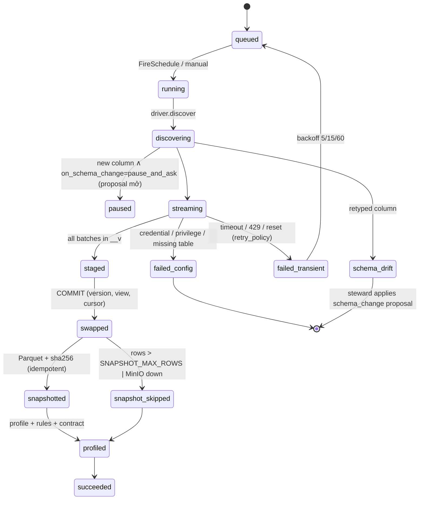

# DATA_PIPELINE_SPEC — Data Foundation / Data Preparation (Part 6)

> Ngày 12/11/2026. Đặc tả kỹ thuật cho F-01, F-02, F-24, F-23, F-30 (phần dữ liệu) của [STRATEGY.md](STRATEGY.md) §3,
> theo sổ tên [ARCHITECTURE.md](ARCHITECTURE.md) §9. Mọi câu "hiện tại" dẫn tới [evidence/audit-data.md](evidence/audit-data.md)
> (`file:dòng` là của HEAD `9e503407`). Ngưỡng ở mục E là **đề xuất**, chưa đo; cách rebase ở
> [DATASET_AND_EVALUATION.md](DATASET_AND_EVALUATION.md) §6.

## 0. Workflow đích và ai làm bước nào

```text
Source Discovery → Ingestion → Raw Storage → Profiling → Quality Validation → Schema Understanding
      → Normalization → Semantic Enrichment → Publication
```

| Bước | Hiện tại (bằng chứng) | Đích | Tất định / LLM / Người |
| --- | --- | --- | --- |
| Source Discovery | Test kết nối, `scan_schemas` qua `information_schema`; không có khám phá PK/cursor/quyền SELECT theo bảng cho driver ngoài Postgres (`worker.py:140-151`) | `Driver.discover()` trả bảng, cột + kiểu catalog, PK, ứng viên cursor, quyền SELECT; sinh card connector từ registry | **Tất định** |
| Ingestion | Cursor incremental, lô 5 000, `INGEST_MAX_ROWS` 2 000 000 (`worker.py:103-106,240-291`); full = `DROP TABLE` lô đầu (`routines/workspace.sql:54`, `worker.py:632`) | Biên đóng/mở, backfill có `end_value`, staging `__v<n+1>` rồi swap view, completeness marker | **Tất định** |
| Raw Storage | `raw`, `da-raw-crawl`, `da-period-close` có object lock; `da-ingest`, `da-raw-docs` không (`minio-init.yaml:20,77-96`); xoá upload xoá object (`ingest/routes.py:1288`) | Mọi bucket raw có lock + retention; upload xoá mềm; snapshot Parquet theo version | **Tất định** |
| Profiling | count/null/distinct/min/max/top_values, TABLESAMPLE > 200k (`schema_scans.py:548-631`); `pattern_hint` không ai ghi; PII evidence không lưu | Thêm histogram, quantile, độ dài chuỗi, pattern_hint, freshness từ `pg_stat_user_tables`; lưu evidence PII | **Tất định** |
| Quality Validation | 7 kind luật SQL (`quality.py:70-146`), `quality_state` chỉ thành caveat (`signals.py:57-64`) | Từ vựng GX, `mostly`, `row_condition`; contract; `blocked` chặn governed/report/product | **Tất định**; luật đề xuất = LLM → người duyệt |
| Schema Understanding | FK khai báo → `context.relationship(pending_review)` (`schema_scans.py:840-872`); `description_status='suggested'` không ai ghi | Giữ; LLM đề xuất mô tả cột/join thống kê là P2 | LLM đề xuất → **người** duyệt |
| Normalization | Pipeline bước SQL (CTE) ≤ 200k dòng (`pipelines.py:59-105,365-470`); agent ghi thẳng steps vào pipeline active (`prep.py:262-285`) | Bước prep thành bản nháp (`status=draft`) chờ duyệt; If-Match bắt buộc | LLM đề xuất → **người** duyệt; chạy **tất định** |
| Semantic Enrichment | Semantic model, glossary, value_index (có, `context.*`) | Không đổi ở spec này (xem ASK_ENGINE_SPEC) | Người |
| Publication | `dataset.enabled` là điều kiện duy nhất Ask đọc (`semantic/loader.py:104`); product review có `_still_at_the_bar` (`reviews.py:235-272`) | `enabled ∧ quality_state ≠ blocked ∧ contract.status = active`; sự kiện `dataset.snapshot_created` | **Tất định** (cổng) + người (chứng nhận) |

Nguyên tắc xuyên suốt: **AI không bao giờ sửa dữ liệu raw**. Mọi "sửa" là một bước pipeline có version, chạy đọc-chỉ trên
nguồn và vật chất hoá thành dataset `origin=derived` có `lineage_edge`; raw và `workspace.<name>__v<n>` không bị UPDATE.

## 1. F-01 — Dataset có version, snapshot bất biến (P0)

### A. Định nghĩa

- **Mục đích**: mỗi lần nạp tạo một phiên bản vật lý mới; dữ liệu phiên bản cũ còn đọc được; receipt của câu trả lời trỏ
  tới phiên bản còn dữ liệu; snapshot Parquet bất biến có checksum để tái lập ngoài Postgres.
- **User story**: *Là steward, tôi mở receipt của một câu trả lời tháng trước và chạy lại đúng số đó dù nguồn đã nạp lại ba lần.*
- **Giá trị**: bất biến 2 và 9 thành thật; eval có snapshot cố định; audit tái lập.
- **Input**: lượt nạp (full/incremental/backfill), commit upload. **Output**: `workspace.<name>__v<n>`, view `workspace.<name>`,
  `catalog.dataset_version` n, `catalog.dataset_snapshot`, sự kiện `dataset.snapshot_created`.
- **Scope**: nguồn DB (4 driver), upload CSV/XLSX, pipeline materialize. **Non-scope**: time-travel theo hàng (SCD2) — dataset
  `history_kind` giữ như hiện tại; snapshot của nguồn federated (không sao chép, bất biến 15).

### B. Thiết kế

**Module & phụ thuộc**: `worker_ingest/versioning.py` (mới), `libs/snapshot/` (mới: pyarrow 26.0.1, duckdb 2.0 LTS reader),
`routines/workspace.sql` (sửa `da_materialize_upload`, thêm `da_swap_version`), `worker_agent/uploads.py`, `worker_agent/pipelines.py`,
`worker_agent/replay.py`, `api/modules/catalog` (versions/snapshot routes).

**Quy ước tên vật lý**: bảng `workspace.<physical_name>__v<n>` (`physical_name` từ `libs/tabular.physical_names`, ≤ 63 ký tự kể cả
hậu tố → cắt gốc còn 55); view `workspace.<physical_name>` luôn trỏ phiên bản **current**; `dataset.current_version` là nguồn sự
thật, view chỉ là tiện ích cho SQL tay và pipeline CTE.

**DDL (sketch; sinh qua `backend/schema` generator + migration `v3_0036`)**:

```sql
CREATE TABLE catalog.dataset_snapshot (
  id uuid PRIMARY KEY, org_id uuid NOT NULL, dataset_id uuid NOT NULL REFERENCES catalog.dataset(id),
  version int NOT NULL, object_key text NOT NULL, sha256 char(64) NOT NULL, row_count bigint NOT NULL,
  byte_size bigint NOT NULL, columns jsonb NOT NULL, available_at timestamptz NOT NULL,
  created_by_run_id uuid, created_at timestamptz NOT NULL DEFAULT now(),
  UNIQUE (org_id, dataset_id, version));
CREATE INDEX dataset_snapshot_dataset_idx ON catalog.dataset_snapshot (org_id, dataset_id, version DESC);
-- RLS org_isolation như mọi bảng có org_id; svc_catalog: SELECT, INSERT; không UPDATE/DELETE (snapshot bất biến)
ALTER TABLE catalog.dataset_version ADD COLUMN physical_table text, ADD COLUMN retained_until timestamptz;
```

Routine mới `workspace.sql`:

```sql
-- da_swap_version(dataset_id, physical_name, n): trong một giao dịch
CREATE OR REPLACE VIEW workspace.<physical_name> AS SELECT * FROM workspace.<physical_name>__v<n>;
UPDATE catalog.dataset SET current_version = n WHERE id = dataset_id;
```

`da_materialize_upload(..., replace)` **không còn `DROP TABLE`**: tham số `replace` đổi nghĩa thành "tạo version mới" và ghi vào
`__v<n+1>`; `da_materialize_upsert` (v3_0035) chuyển vào generator (`routines/workspace.sql`), merge vào bản sao
`__v<n+1>` tạo bằng `CREATE TABLE … AS SELECT * FROM __v<n>` rồi upsert (incremental có merge key), hoặc append vào
`__v<n>` khi không có merge key **và** không đổi schema (chế độ "append-in-place" ghi `dataset_version.change_kind='append'`
và snapshot mới; không tạo bảng mới để tránh nhân đôi dung lượng mỗi giờ).

**Thuật toán nạp full (staging → swap)**

```text
run(job):
  n = dataset.current_version; target = f"{name}__v{n+1}"
  CREATE TABLE workspace.target (LIKE schema_from_discover)          # kiểu từ catalog nguồn (F-24)
  for batch in driver.stream(window): COPY/INSERT target               # lô 5 000 như hiện tại
  if rows_read > INGEST_MAX_ROWS: fail(config, "ingest it incrementally")  # giữ
  BEGIN
    INSERT catalog.dataset_version(n+1, schema_hash, diff, change_kind, physical_table=target, valid_from=now())
    UPDATE dataset_version n SET valid_to = now()
    da_swap_version(dataset_id, name, n+1)
    UPDATE ingestion_job SET cursor_value = upto   # cùng giao dịch, như hiện tại worker.py:635-645
    emit catalog.outbox 'dataset.version_created'  # đã có? nếu chưa: thuộc 'dataset.snapshot_created' bên dưới
  COMMIT
  snapshot(dataset_id, n+1)                                            # ngoài giao dịch DB, idempotent
  retention(dataset_id)                                                # giữ ≥ 3 version hoặc 90 ngày, và mọi version còn receipt
```

Lỗi giữa chừng: `target` bị bỏ (`DROP TABLE IF EXISTS target` ở lượt sau có cùng `n+1`), view và `current_version` không đổi →
**không còn trạng thái bảng nửa vời** (hiện tại có, `audit-data.md` §2).

**Snapshot Parquet** (`libs/snapshot/writer.py`):

```python
def write_snapshot(conn, dataset, version) -> Snapshot:
    tbl = read_arrow(conn, f"SELECT * FROM workspace.{dataset.physical}__v{version}")   # DuckDB postgres READ_ONLY hoặc asyncpg → pyarrow
    tbl = tbl.replace_schema_metadata({**tbl.schema.metadata, b"dataagent.org_id": ..., b"dataagent.dataset_id": ...,
                                       b"dataagent.version": str(version), b"dataagent.run_id": ..., b"dataagent.available_at": ...})
    buf = pa.BufferOutputStream()
    pq.write_table(tbl, buf, compression="zstd", write_page_checksum=True, write_statistics=True, version="2.6")
    data = buf.getvalue().to_pybytes(); sha = sha256(data).hexdigest()
    key = f"{org_id}/{dataset_id}/v{version}/{sha[:12]}.parquet"      # content-addressed, bucket da-snapshots (object lock)
    minio.put(key, data, if_none_match="*")                             # idempotent: tồn tại thì bỏ qua
    insert catalog.dataset_snapshot(..., object_key=key, sha256=sha, row_count=tbl.num_rows, columns=schema_json(tbl))
    emit catalog.outbox 'dataset.snapshot_created' {dataset_id, version, snapshot_id, sha256}
```

Giới hạn: snapshot chỉ cho `row_count ≤ SNAPSHOT_MAX_ROWS` (mặc định 20 000 000) và viết theo row group 1 048 576; trên ngưỡng
ghi `dataset_snapshot` với `object_key = null`, `status = skipped` (cột `status` — đề xuất thêm §9) và cảnh báo.

**Retention**: xoá `__v<k>` khi `k < current − KEEP_VERSIONS(3)` **và** `valid_to < now() − KEEP_DAYS(90)` **và** không có
`qa.answer.dataset_versions` tham chiếu `k` (query đếm; receipt trỏ version là lý do giữ). Parquet không xoá (bucket lock).

**Replay** (`worker_agent/replay.py`): đọc `dataset_versions` trên receipt → nếu `__v<k>` còn → chạy SQL trên bảng đó (viết lại
tên bảng bằng sqlglot `exp.Table` replace); nếu không còn → DuckDB đọc Parquet snapshot (`libs/snapshot/reader.py`,
`enable_external_access=false` sau khi `httpfs` đã nạp, hoặc tải file về `/tmp` rồi đọc local) và chạy cùng SQL transpile sang
dialect duckdb. So `result_sha256`.

**API** (thêm vào A2):

| Method | Path | Capability | Trả về |
| --- | --- | --- | --- |
| GET | `/v1/datasets/{id}/versions` | `catalog.read` | `[{version, change_kind, valid_from, valid_to, physical_table, snapshot: {id, sha256, row_count} \| null}]` |
| GET | `/v1/datasets/{id}/versions/{v}/snapshot` | `catalog.read` | 302 → presigned URL 10 phút, hoặc 404 `NO_DATA` khi `skipped` |

**Retry/timeout/idempotency**: lượt nạp có `run_id`; staging table tên theo `n+1` nên chạy lại cùng lượt là idempotent; snapshot
idempotent theo `sha256`; `retry_policy` giữ (`worker.py:842-848`).

**Security**: bucket `da-snapshots` object lock GOVERNANCE (dev) / COMPLIANCE (prod), retention ≥ `KEEP_DAYS`; presigned URL chỉ
cho `catalog.read` trong org; snapshot không chứa cột `pii_label` chưa confirm là "không PII"? **Quyết định**: snapshot chứa mọi
cột (nó là bản sao vật lý) nhưng `column_policy mask` được áp khi **đọc** qua DuckDB reader (reader nhận policy list) — không
áp lúc ghi để snapshot vẫn là sự thật.

**Logging/metrics**: `ingest_run_duration_seconds{kind}`, `ingest_rows_total{outcome=written|dlq}` (sửa `rows_written` để trừ DLQ,
`worker.py:650-653`), `snapshot_bytes_total`, `dataset_versions_retained`.

### C. OSS

| Thành phần | Dùng gì | Phiên bản / giấy phép (evidence/oss-data.md §3, §5) | Adapter |
| --- | --- | --- | --- |
| pyarrow | `pq.write_table(compression=zstd, write_page_checksum=True, version='2.6')`, `replace_schema_metadata` | 26.0.1, Apache-2.0 (đã pin) | `libs/snapshot/writer.py` |
| DuckDB | reader Parquet + `postgres` extension READ_ONLY để xuất Arrow | 2.0.0 LTS, MIT, Python ≥ 3.11 | `libs/snapshot/reader.py`, dùng `libs/code_sandbox/duck.py` để mở có khoá |
| dlt | **không phụ thuộc**; lấy ý: `_dlt_loads` completeness marker → `dataset_version.valid_from` chỉ set khi COMMIT; backfill `end_value` | 1.32.0 Apache-2.0 | — |

PoC: PoC-2 của OPEN_SOURCE_RESEARCH §4 (DuckDB) + đo thời gian snapshot 2 000 000 dòng AdventureWorks (`FactInternetSales`
60 398 dòng × nhân bản) trên worker-ingest 256Mi → quyết định `SNAPSHOT_MAX_ROWS` và giới hạn RAM pod (dự kiến 1Gi).

### D. Test

| Loại | File | Chứng minh |
| --- | --- | --- |
| Unit | `tests/unit/worker_ingest/test_versioning.py` | tên `__v<n>` ≤ 63 ký tự, swap SQL sinh đúng, retention chọn đúng version |
| Unit | `tests/unit/repo/test_snapshot.py` (libs) | metadata provenance, sha256 ổn định, page checksum bật |
| Integration | `tests/integration/worker_ingest/test_worker.py::test_full_load_creates_new_version_and_keeps_old` | sau 2 lượt full: 2 bảng, view trỏ v2, v1 đọc được |
| Integration | `tests/integration/worker_ingest/test_versioning_failure.py` | lỗi giữa lô 3/5 → view không đổi, không bảng nửa vời |
| Integration | `tests/integration/worker_agent/test_uploads.py::test_commit_creates_version` | upload commit không DROP |
| Integration | `tests/integration/worker_agent/test_answers.py::test_replay_reads_old_version` | receipt trỏ v1 sau khi nạp v2, replay bằng |
| Contract | `tests/integration/api/test_catalog.py::test_versions_and_snapshot_routes` | A2, 302 presigned |
| Performance | `tests/integration/worker_ingest/test_snapshot_perf.py` (mark `slow`) | 2 000 000 dòng ≤ 120 s, RSS ≤ 1Gi |
| Failure injection | như trên: MinIO 503 → snapshot `skipped`, run vẫn `succeeded`, sự kiện có `snapshot_id=null` |

### E. DoD (đề xuất)

- 100 % receipt tạo trước khi nạp lại replay ra cùng `result_sha256` trên DS-AW (test trên).
- Không còn `DROP TABLE` trong `routines/workspace.sql`, `worker.py`, `uploads.py` (grep = 0 ngoài retention).
- `make test-unit`, `make test-integration` xanh; migration `v3_0036` up/down xanh trong `tests/integration/migrate`.

## 2. F-02 — Dataset contract và DQ gate (P0)

### A. Định nghĩa

- **Mục đích**: luật chất lượng có từ vựng chuẩn, contract tối thiểu cho mỗi dataset đã bật, và `quality_state=blocked` thật sự
  chặn số đi ra.
- **User story**: *Là quản lý, tôi hỏi doanh thu khi bảng nguồn bị trùng khoá; hệ thống nói "dữ liệu đang bị chặn vì luật X, steward
  Y đang xử lý" thay vì trả một con số.*
- **I/O**: luật (`ingest.quality_rule`), kết quả (`quality_result`), contract (`catalog.dataset_contract`) → `quality_state`,
  `QUALITY_BLOCKED` ở Ask/report/product.
- **Non-scope**: incident workflow đầy đủ (RES-26, P2); luật tự sinh từ profile (P1, DF-11).

### B. Thiết kế

**Từ vựng expectation** (`libs/quality_vocab/` — đề xuất thêm §9, hoặc đặt trong `worker_agent/quality.py` nếu không cần chia sẻ
với api): ánh xạ một chiều từ GX Core 1.x (Apache-2.0; tên đọc ở evidence/oss-data.md §2):

| `kind` hiện tại (`quality.py:70-146`) | Tên chuẩn (`expectation`) | Tham số | Ghi chú |
| --- | --- | --- | --- |
| `not_null` | `expect_column_values_to_not_be_null` | column, mostly | |
| `range` | `expect_column_values_to_be_between` | column, min, max, mostly | |
| `unique` | `expect_column_values_to_be_unique` | column | |
| (mới) | `expect_compound_columns_to_be_unique` | columns[] | kiểm **trùng dòng** theo khoá tổ hợp |
| `in_list` | `expect_column_values_to_be_in_set` | column, values[], mostly | |
| (mới) | `expect_column_values_to_match_regex` | column, regex, mostly | pattern_hint của profile đề xuất |
| `sum_matches` | `expect_table_row_count_to_equal_other_table` **hoặc** `expect_column_sum_to_be_between` | tuỳ tham số cũ | giữ `sum_matches` làm alias |
| `freshness` | `expect_column_max_to_be_between` với `min_value = now − window` | column, window | như GX khuyến nghị |
| `custom_sql` | `expect_query_to_return_no_rows` | sql | giữ guard read-only |
| (mới) | `row_condition` | biểu thức lọc trước khi kiểm (chỉ cột so hằng, `AND`) | compile bằng sqlglot, không chuỗi tự do |

Kết quả giữ shape GX: `{success, unexpected_count, unexpected_percent, partial_unexpected_list(≤20, che PII), observed_value}` ghi
vào `quality_result.violations` (jsonb, đã có) — thêm khoá chuẩn, không đổi cột.

**Contract** (`catalog.dataset_contract`, DDL ở ARCHITECTURE §9.1):

```json
{ "schema_hash_expected": "…", "freshness_sla": {"kind": "max_age", "value": "26h"},
  "required_rules": [{"expectation": "expect_column_values_to_not_be_null", "column": "order_date", "severity": "high"},
                     {"expectation": "expect_compound_columns_to_be_unique", "columns": ["order_id","line_no"], "severity": "high"}],
  "status": "active", "version": 3 }
```

Trạng thái: `draft → active` (steward, If-Match), `active → broken` (tự động khi `schema_hash` hiện hành ≠ expected hoặc luật
`high` fail hai lượt liên tiếp), `broken → active` (steward xác nhận sau khi sửa). Contract là **tuỳ chọn** cho dataset
`enabled`, **bắt buộc** cho dataset là member của data product `active` (`reviews.py:_still_at_the_bar` thêm điều kiện).

**Quality state** (`quality.py:293-331` giữ, mở rộng): `blocked` khi (luật `high` fail) **hoặc** (contract `broken`); `warning` khi
luật `medium` fail hoặc freshness quá SLA; `ok`; `unknown`.

**Gate** `worker_agent/quality_gate.py`:

```python
def check(datasets: list[DatasetRef], session) -> GateResult:
    rows = select dataset.id, quality_state, contract.status for ids
    blocked = [d for d in rows if d.quality_state == "blocked" or d.contract_status == "broken"]
    if blocked: return GateResult(code="QUALITY_BLOCKED", datasets=blocked, reason=latest_failed_rules(blocked))
    warn = [d for d in rows if d.quality_state == "warning"]
    return GateResult(code=None, caveats=[caveat(d) for d in warn])
```

Gọi ở: `router.py` sau resolve (mọi dataset của metric/verified query/explore link) — trước compile; `report_runs.py` trước mỗi
truy vấn; `reviews.py` khi duyệt product; `tiles.py` refresh. Agentic: thay caveat của `signals.py` bằng gate (một chỗ). Nhãn
`warning` → caveat + **không** hạ nhãn (giữ RES-07 "còn" để quyết sau khi đo).

**Ack**: steward `POST /v1/datasets/{id}/quality/acknowledge` (có) ghi `acknowledged_by/at` → `blocked` → `warning` trong
`ack_ttl` (24 h mặc định) rồi tự quay lại nếu luật vẫn fail.

**API**: `GET/PUT /v1/datasets/{id}/contract` (PUT yêu cầu `If-Match`, capability `catalog.write`, maker ≠ checker khi
`status=active` theo công tắc `allow_self_approval`).

**Metrics**: `quality_gate_blocked_total{surface=ask|report|product}`, `quality_rule_eval_seconds`.

### C. OSS

GX Core 1.24.1 (Apache-2.0): **chỉ từ vựng và result shape**; không cài. pointblank (MIT) để tham chiếu khi cần engine.
soda-core **không** (ELv2). PoC: không cần — luật chạy trên executor hiện có.

### D. Test

| Loại | File | Chứng minh |
| --- | --- | --- |
| Unit | `tests/unit/worker_agent/test_quality_vocab.py` | map 7 kind cũ ↔ expectation; `mostly`; `row_condition` chỉ nhận cột-so-hằng |
| Unit | `tests/unit/worker_agent/test_quality_gate.py` | blocked/warning/ok/unknown; contract broken ⇒ blocked |
| Integration | `tests/integration/worker_agent/test_answers.py::test_blocked_dataset_refuses_with_quality_blocked` | governed: 0 figure, mã đúng, dataset tên không lộ ngoài quyền |
| Integration | `tests/integration/worker_agent/test_report_runs.py::test_report_skips_blocked_dataset` | báo cáo ghi phần thiếu |
| Integration | `tests/integration/api/test_catalog.py::test_contract_put_requires_if_match` | 428/412 |
| Golden | case `A-S3-NEG-stale`, `A-S3-NEG-dup` ở DATASET_AND_EVALUATION | expected_action `refuse` |
| Failure injection | luật `high` fail 2 lượt → contract `broken` → ask bị chặn → ack → warning → hết ack_ttl → blocked |

### E. DoD (đề xuất)

- Trên bộ vàng: mọi case `failure_category ∈ {duplicates, stale_data, partial_ingestion}` có `expected_action=refuse` được
  từ chối với `QUALITY_BLOCKED`/`STALE_DATA` (100 %); không case thường nào bị chặn nhầm (false block = 0).
- Mỗi dataset member của product `active` có contract `active`.

## 3. F-24 — Connector registry, discovery, kiểu từ catalog, staging (P1, phần "registry + discovery" làm sớm cùng F-01)

### A. Định nghĩa

- **Mục đích**: thêm engine mới không phải sửa 4 chỗ (`catalog/schemas.py:19-35`, `catalog/routes.py:97-153`,
  `source_drivers.read/stream`, `worker.py:_QUOTED`, `schema_scans._scan_source`); card picker chỉ hiện kind có driver + test;
  kiểu cột từ catalog nguồn cho mọi driver (hết suy kiểu từ lô đầu, `worker.py:186-203`).
- **Non-scope**: driver Oracle/BigQuery/Databricks/Snowflake (ẩn khỏi picker, STRATEGY §6); CDC log; REST (dlt `rest_api`, P2).

### B. Thiết kế

```python
# libs/source_drivers/registry.py
@dataclass(frozen=True)
class Capabilities: discover: bool; stream: bool; profile: bool; read_only_tx: bool; dialect: str; cursor_types: frozenset[str]
class Driver(Protocol):
    kind: str; capabilities: Capabilities
    async def test(self, cfg, secret) -> TestResult
    async def discover(self, cfg, secret, schemas: list[str]) -> list[TableInfo]   # TableInfo: name, columns[{name, source_type, normalized_type, nullable}], pk[], cursor_candidates[], can_select
    async def stream(self, cfg, secret, query: ReadPlan) -> AsyncIterator[Batch]   # Batch: Arrow RecordBatch hoặc list[tuple]
    def type_map(self, source_type: str) -> str                                      # → normalized_type (int, numeric, text, date, timestamp, timestamptz, bool, json, uuid, bytes)
REGISTRY: dict[str, Driver] = {d.kind: d for d in (PostgresDriver(), MySQLDriver(), SqlServerDriver(), ClickHouseDriver())}
def connector_cards() -> list[Card]: return [Card.from_driver(d) for d in REGISTRY.values()]
```

- `SourceKind` CHECK trong DDL giữ danh sách rộng (thiết kế), nhưng api `GET /v1/connectors` và `POST /v1/sources` chỉ chấp nhận
  `kind ∈ REGISTRY` (422 `UNSUPPORTED` kèm thông điệp) cho đến khi driver có.
- `_WORKSPACE_TYPES` (`worker.py:37-43`) thay bằng `driver.type_map`; `json → jsonb`, `uuid → uuid`, `timestamp → timestamptz`
  (theo `organization.time_zone` nếu nguồn không có tz; ghi vào `column_meta.unit`?) — không còn `text` mặc định.
- Drift: `check_drift` so **kiểu normalized** từ `discover()` với `column_meta.normalized_type` của version hiện hành: thêm cột →
  additive (v3_0030 giữ), bỏ cột → giữ NULL, đổi kiểu → `schema_drift` (giữ). Giá trị không ép được dù kiểu catalog đúng →
  DLQ `quarantine_30d` (giữ) và `rows_written` trừ DLQ.
- Discovery cho onboarding: `POST /v1/sources/{id}/discover` (có sẵn `scan`? nếu `scan_run kind=schema` đã phủ thì mở rộng
  payload thêm `pk`, `cursor_candidates`, `can_select`); UI chọn cursor chỉ từ `cursor_candidates`.
- Incremental: giữ cửa sổ `(cursor_value, upto]`; thêm tuỳ chọn `range_start ∈ {closed, open}` (mặc định open, như hiện tại) và
  `lookback` (ví dụ `1d` cho cursor ngày); backfill có `end_value` cố định không cập nhật `cursor_value` (giữ `Window` 122-131).

### C. OSS

dlt (Apache-2.0) — chỉ ngữ nghĩa; sqlglot 30.x để render query discovery theo dialect (`source_meta.py` đã làm vậy cho
MySQL/SQL Server).

### D. Test

`tests/unit/repo/test_source_registry.py` (mọi kind trong card đều có driver; `type_map` phủ bảng kiểu chuẩn);
`tests/unit/worker_ingest/test_worker.py` (drift theo kiểu normalized; `rows_written` = read − dlq);
`tests/integration/worker_ingest/test_mysql_ingest.py` (testcontainers, kiểu DATETIME → timestamptz, JSON → jsonb);
`tests/integration/api/test_catalog.py::test_connectors_from_registry` (4 card).

### E. DoD (đề xuất)

- `grep -rn "kind ==" backend/services/worker_ingest backend/services/worker_agent/schema_scans.py` = 0 (dispatch qua registry).
- Nạp MySQL/SQL Server/ClickHouse mẫu: 0 cột `text` cho nguồn kiểu timestamp/json/uuid.

## 4. F-23 — Lineage cột và cạnh nạp (P1)

### B. Thiết kế

- `libs/sql_guard/lineage.py`: `column_lineage(sql, schema, dialect) -> list[Edge(from=(table, column), to=(out_column), via='sql')]`
  bằng `sqlglot.lineage.lineage()` sau `qualify(expr, schema=catalog_schema)`; literal bị che; giới hạn 2 s/câu (thread timeout),
  quá thì ghi edge mức bảng từ `tables_of`.
- Ghi: pipeline materialize (`pipelines.py:458`) và derived (`derived.py:156`) thêm edge cột; **job nạp ghi edge** `source → dataset`
  (`from_kind=source`) ở cuối lượt (xoá cạnh dựng lúc đọc ở `pipeline/routes.py:1028-1030`); verified query/tile ghi edge
  `dataset → tile`.
- Nâng sqlglot 25.24.5 → 30.x là điều kiện (PoC-5).

### D/E

`tests/unit/repo/test_sql_lineage.py` (CTE, subquery, UNION, `*` cần schema, Placeholder khi không giải được);
`tests/integration/worker_agent/test_pipelines.py::test_materialize_writes_column_edges`. DoD: 100 % pipeline DS-AW có edge cột;
không regression `test_guard.py`/`test_sqlgen.py` sau nâng sqlglot.

## 5. F-30 (phần dữ liệu) — Bước prep là bản nháp, OCC bắt buộc (P0 vì là S1)

### B. Thiết kế

- `pipeline.pipeline` có `status` (active/draft/…): giữ. Thêm `pipeline.step_proposal` (đề xuất thêm §9) hoặc dùng cơ chế
  proposal chung của Review Inbox (`inbox.*`, `change_proposed`) — **chọn Review Inbox**: `prep.py` thay vì ghi `pipeline.steps`
  (`prep.py:262-285`) thì tạo proposal `kind=pipeline_steps` với `payload={steps, base_version}`; chạy `check_steps` (giữ) và một
  **dry run** `LIMIT 0` + totals check (BR-23) trước khi mở proposal; reviewer accept → api áp với OCC `expected_version`.
- Pipeline `draft` (chưa có lịch, chưa active): agent được ghi thẳng (người tạo đang soạn) — ranh giới là `status`.
- `PATCH /v1/pipelines/{id}` và mọi PATCH tài sản ngữ cảnh (metric, data product, dataset description, workspace, monitor): `If-Match`
  **bắt buộc** (428 `PRECONDITION_REQUIRED` khi thiếu, 412 khi lệch) — `kernel/etag.py` thêm danh sách route bắt buộc; frontend
  `lib/v1` gửi ETag từ GET.

### D/E

`tests/integration/worker_agent/test_prep.py::test_agent_steps_on_active_pipeline_open_a_proposal`;
`tests/integration/api/test_pipeline.py::test_patch_steps_requires_if_match`; frontend vitest cho mutation gửi `If-Match`.
DoD: AUD-04, AUD-09 đóng; 0 ghi thẳng vào pipeline active (grep `pipeline.steps` writer ngoài api apply).

## 6. Raw bất biến, xoá mềm, sửa dữ liệu có kiểm soát

- `minio-init.yaml`: `da-ingest`, `da-raw-docs`, `da-snapshots` tạo `--with-lock`, retention GOVERNANCE 90 ngày dev / COMPLIANCE
  theo policy prod (như `raw`, `minio-init.yaml:77-96`).
- `DELETE /v1/uploads/{id}` → `uploads.deleted_at` (soft delete), object giữ đến hết retention; dataset từ upload → `enabled=false`.
- **Sửa dữ liệu**: không có endpoint UPDATE dữ liệu. Người dùng muốn "sửa" một giá trị → tạo bước pipeline `compute` có điều kiện
  (`CASE WHEN id = … THEN … END`) đi qua proposal (§5) → dataset derived mới có version; rollback = tắt bước (version mới) —
  raw và `__v<n>` không đổi. Agent có thể **đề xuất** bước này, không áp.

## 7. Profiling sâu và PII evidence (P1, DF-10/DF-11)

- `schema_scans.py:556-631` thêm trên mẫu: `percentile_cont(0.05,0.25,0.5,0.75,0.95)` cho số/ngày, `histogram` 20 bin (số),
  `length_min/max/avg` (chuỗi), `pattern_hint` (3 pattern đại diện kiểu `\d{4}-\d{2}`, `[A-Z]{2}\d+`, sinh tất định từ mẫu
  200 giá trị bằng thay chữ số→`9`, chữ→`A`), freshness `n_tup_ins/upd/del` + `last_autoanalyze` từ `pg_stat_user_tables`
  (Postgres; driver khác `null`). Lưu vào `column_profile` (thêm cột `quantiles jsonb, histogram jsonb, length_stats jsonb` —
  đề xuất thêm §9).
- PII: `pii.column_decision` (`pii/__init__.py:289-310`) trả thêm `evidence={share, distinct, samples_checked}` → `column_meta.pii_evidence jsonb`
  (đề xuất §9); phản hồi người dùng → `column_meta.pii_confirmed=false/true` giữ.
- Luật DQ đề xuất từ profile (tất định, không LLM): null_ratio < 0,001 → `not_null`; distinct = count → `unique`; cardinality
  ≤ 20 → `in_set`; pattern phủ ≥ 99 % → `match_regex(mostly=0.99)`; tất cả `origin=agent_suggested, status=proposed` chờ steward.



```mermaid
flowchart LR
  R[run n+1] --> ST[workspace.name__v3 staging]
  ST --> SW{COMMIT}
  SW --> V[(dataset_version 3<br/>physical_table=__v3)]
  SW --> VW[view workspace.name → __v3]
  SW --> C[cursor_value=upto]
  SW --> P[Parquet da-snapshots/org/ds/v3/sha.parquet]
  P --> S[(dataset_snapshot 3 · sha256)]
  S --> E[outbox dataset.snapshot_created]
  V2[(__v2 giữ ≥3 version/90 ngày/receipt)] -.replay.-> RC[receipt dataset_versions=[2]]
  P -.DuckDB reader.-> RC
```

## 8. Đề xuất thêm vào sổ tên §9

| Tên | Lý do |
| --- | --- |
| `catalog.dataset_snapshot.status` (`ok \| skipped`) | snapshot quá ngưỡng hoặc MinIO lỗi vẫn có dòng |
| `catalog.column_profile.quantiles, histogram, length_stats` jsonb | profiling sâu |
| `catalog.column_meta.pii_evidence` jsonb | RES-24 |
| `libs/quality_vocab/` (hoặc `worker_agent/quality_vocab.py`) | từ vựng GX dùng chung api + worker |
| proposal `kind=pipeline_steps` trong Review Inbox | AUD-04 |
| mã `PRECONDITION_REQUIRED` (HTTP 428) | If-Match bắt buộc |

## 9. Danh sách task

| ID | Ưu tiên | Mô tả | Thay đổi cần làm | Công nghệ | Phụ thuộc | Vai | Công sức | Tiêu chí chấp nhận | Test | Deliverable | Rollback |
| --- | --- | --- | --- | --- | --- | --- | --- | --- | --- | --- | --- |
| DF-01 | P0 | Schema + migration `v3_0036`: `dataset_snapshot`, cột `dataset_version.physical_table/retained_until`, `dataset_contract`, outbox `attempts/last_error/dead_at` | `backend/schema/csdl/source/tab3.md` (+3b), `parse_d4`, `gen_ddl`, `gen_orm`, `alembic/versions/v3_0036_*.py`, `routines/workspace.sql` (`da_swap_version`, chuyển `da_materialize_upsert`) | SQL, generator | — | DB | M | up/down xanh; `coverage.md` = None; ORM khớp DDL | `tests/integration/migrate` | migration + model | `alembic downgrade` |
| DF-02 | P0 | `versioning.py`: staging `__v<n+1>`, swap, retention | `worker_ingest/versioning.py`, `worker.py:600-660` | asyncpg | DF-01 | DE | M | full ×2 → 2 bảng, view v2, v1 đọc được; lỗi giữa lô → view không đổi | `test_worker.py`, `test_versioning_failure.py` | code + test | feature flag `INGEST_VERSIONED=0` giữ đường cũ một release |
| DF-03 | P0 | Upload commit và pipeline materialize tạo version (bỏ DROP) | `worker_agent/uploads.py:249-255,360`, `pipelines.py:365-470`, `derived.py` | SQL | DF-02 | BE | S | grep DROP = 0; upload v1→v2 giữ v1 | `test_uploads.py`, `test_pipelines.py` | code | cùng flag DF-02 |
| DF-04 | P0 | `libs/snapshot` writer/reader + bucket `da-snapshots` lock | `backend/libs/snapshot/{writer,reader}.py`, `minio-init.yaml`, `libs/code_sandbox/duck.py` | pyarrow 26, duckdb 2.0 | DF-01 | BE | M | sha256 ổn định; page checksum; reader áp mask policy; PoC-2 số đo ghi `model/eval/` | `test_snapshot.py`, perf mark slow | lib + manifest | không ghi snapshot (cờ) |
| DF-05 | P0 | Gọi snapshot cuối lượt nạp/upload/materialize + sự kiện `dataset.snapshot_created` + API versions/snapshot | `worker_ingest/worker.py`, `uploads.py`, `pipelines.py`, `api/modules/catalog/routes.py`, A2 catalogue, `frontend/src/lib/v1` types | — | DF-02, DF-04 | BE | S | 2 endpoint trong A2; presigned 302 | `test_catalog.py` | API | — |
| DF-06 | P0 | Replay đọc version cũ hoặc Parquet | `worker_agent/replay.py`, `libs/snapshot/reader.py` | sqlglot table rewrite, duckdb | DF-04 | BE | M | 100 % receipt DS-AW replay bằng sau nạp lại | `test_answers.py::test_replay_reads_old_version` | code | — |
| DF-07 | P0 | Từ vựng expectation + `mostly` + `row_condition` + `compound unique`; map 7 kind cũ | `worker_agent/quality.py`, `libs/quality_vocab/`, `api/modules/ingest` schemas | sqlglot | — | BE | M | 7 kind cũ chạy không đổi kết quả; 3 expectation mới có test | `test_quality_vocab.py`, `test_quality_sql.py` | code | alias kind cũ giữ |
| DF-08 | P0 | `quality_gate.py` + gọi ở router/report/product/tile; contract `status` → state | `worker_agent/quality_gate.py`, `report_runs.py`, `reviews.py`, `tiles.py`, `agentic/signals.py` | — | DF-01, DF-07, AE-03 (router) | BE | M | blocked ⇒ `QUALITY_BLOCKED`, 0 figure; false block 0 trên DS-AW | `test_quality_gate.py`, `test_answers.py::…quality_blocked` | code | env `QUALITY_GATE=warn` chỉ caveat |
| DF-09 | P0 | Contract API `GET/PUT /v1/datasets/{id}/contract` (If-Match, maker≠checker) + màn Data Studio | `api/modules/catalog/routes.py`, A2, `frontend/src/features/data/ContractPanel.tsx` | — | DF-01 | BE, FE | M | 428/412 đúng; product active cần contract active | `test_catalog.py`, vitest | API + UI | — |
| DF-10 | P1 | Profiling sâu + freshness pg_stat + pattern_hint | `worker_agent/schema_scans.py:556-631`, DDL `column_profile` (+3 cột) | SQL | DF-01 | DE | M | DS-AW: mọi cột số có quantiles; pattern_hint ≠ null cho cột mã | `test_schema_scans.py` | code | cột mới nullable |
| DF-11 | P1 | Luật DQ đề xuất từ profile (tất định) + PII evidence lưu | `worker_agent/schema_scans.py`, `libs/pii`, `column_meta.pii_evidence` | — | DF-10, DF-07 | DE | S | ≥ 1 đề xuất/bảng DS-AW, tất cả `proposed` | `test_schema_scan_pii.py` | code | — |
| DF-12 | P1 | Registry driver + `connector_cards()` + api từ chối kind không có driver | `libs/source_drivers/registry.py`, `catalog/routes.py:97-153`, `catalog/schemas.py` | — | — | BE | M | grep `kind ==` = 0 trong ingest/scans; 4 card | `test_source_registry.py`, `test_catalog.py` | code | — |
| DF-13 | P1 | `discover()` mọi driver: PK, cursor_candidates, can_select; `type_map` thay `_WORKSPACE_TYPES`; drift theo kiểu normalized | `libs/source_drivers/*.py`, `worker_ingest/worker.py:37-43,186-203,384-394`, `source_meta.py` | sqlglot | DF-12 | DE | M | MySQL DATETIME→timestamptz, JSON→jsonb; retype → schema_drift | `test_mysql_ingest.py`, `test_worker.py` | code | — |
| DF-14 | P1 | `rows_written` trừ DLQ; metrics Prometheus cho ingest | `worker.py:650-653`, `worker_ingest/main.py` | prometheus_client | PL-xx (metrics) | DE | S | `/metrics` có 3 series | `test_worker.py` | code | — |
| DF-15 | P1 | Nâng sqlglot 30.x + `libs/sql_guard/lineage.py` | `requirements.txt` ×3, `libs/sql_guard/lineage.py` | sqlglot 30 | — | BE | M | PoC-5 xanh; lineage CTE/UNION/subquery | `test_sql_lineage.py`, `test_guard.py`, `test_sqlgen.py` | lib | pin lại 25.24.5 |
| DF-16 | P1 | Ghi edge cột (pipeline, derived) và edge `source→dataset` ở job nạp; bỏ edge dựng lúc đọc | `pipelines.py:458`, `derived.py:156`, `worker.py`, `pipeline/routes.py:1028` | — | DF-15 | BE | S | 100 % pipeline DS-AW có edge cột | `test_pipelines.py` | code | — |
| DF-17 | P0 | Prep steps qua proposal khi pipeline active; dry-run trước | `worker_agent/prep.py:262-285`, `api/modules/pipeline/routes.py`, `inbox` kind mới | — | — | BE | S | AUD-04 đóng | `test_prep.py` | code | — |
| DF-18 | P0 | If-Match bắt buộc cho PATCH tài sản ngữ cảnh (428/412) + FE gửi ETag | `kernel/etag.py`, 6 module routes, `frontend/src/lib/v1/*.ts` | — | — | BE, FE | M | AUD-09 đóng; vitest mutation có header | `test_pipeline.py`, `test_context_*.py`, vitest | code | danh sách route bắt buộc rỗng |
| DF-19 | P0 | Object lock `da-ingest`, `da-raw-docs`, `da-snapshots`; upload xoá mềm | `deploy/k8s/*/job/minio-init.yaml`, `api/modules/ingest/routes.py:1288`, DDL `uploads.deleted_at` | MinIO | DF-01 | DevOps, BE | S | AUD-08 đóng; xoá rồi vẫn GET object được tới hết retention | `test_ingest.py` | manifest + code | — |
| DF-20 | P2 | Dedup/entity resolution: ẩn màn entity-link; xoá seed reference_entity ngân hàng | `frontend/src/features/crawl`, `deploy/docker/sql/*` | — | — | FE, DB | S | STRATEGY §6 | vitest | commit riêng | revert |
