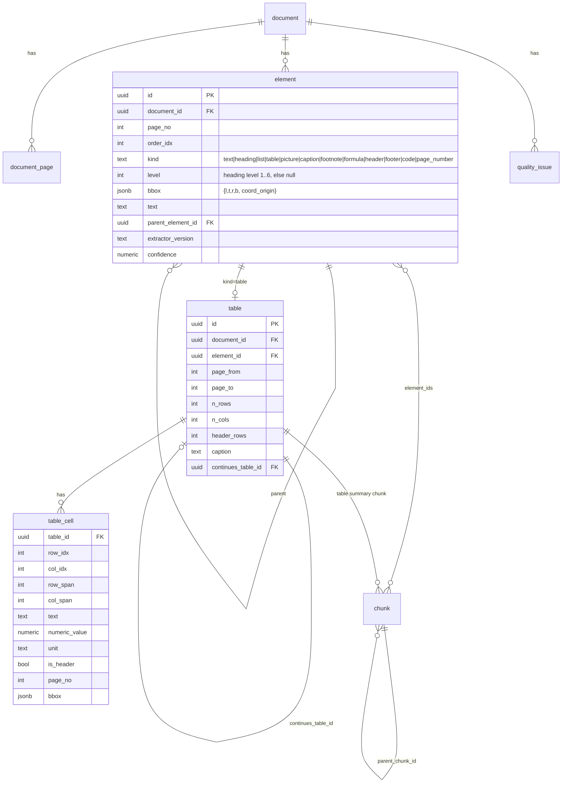

# DOCUMENT_INTELLIGENCE_SPEC — Xử lý tài liệu phi cấu trúc (Part 6)

> Ngày 12/11/2026. Đặc tả cho `worker_document` và `worker_agent/documents/`. Bằng chứng hiện trạng lấy từ
> [evidence/audit-docs.md](evidence/audit-docs.md); nghiên cứu OSS từ [evidence/oss-docs.md](evidence/oss-docs.md);
> baseline truy hồi từ [evidence/baseline.md](evidence/baseline.md). Tên bảng, cột, module, sự kiện theo
> [ARCHITECTURE.md](ARCHITECTURE.md) §9; tên chưa có ở §9 gom ở §12 cuối tài liệu. Quyết định kiến trúc nền: ADR-53
> (Docling là backend trích; bảng là `element/table/table_cell`; số trong bảng đi SQL).

## 0. Tóm tắt quyết định

| # | Quyết định | Lý do (bằng chứng) |
| --- | --- | --- |
| 1 | Docling (MIT, 2.150.0) **wrap** làm backend trích PDF/DOCX/HTML/ảnh; pipeline pdfminer + pypdfium2 hiện tại chỉ còn là **fallback** khi Docling lỗi | U-1: bảng dẹt `"a \| b"` (`extractors.py:264-273,403-420`); PDF không nhận bảng; Docling cho `TableCell` có bbox/span/header |
| 2 | Bảng là dữ liệu có cấu trúc: `document.table` + `document.table_cell`; **không ô bảng nào đi vào chunk/embedding** | Bất biến 3; RG-05 |
| 3 | Số lấy từ bảng tài liệu đi đường SQL (`table_query.py`) và trích dẫn tới ô (page, bbox), nhãn `DOCUMENT` | Prompt §6.4 "không dùng text đã flatten làm nguồn duy nhất" |
| 4 | XLSX nhận ở intake tài liệu, nhưng **không qua Docling**: mỗi sheet → một `document.table` bằng openpyxl (tất định) | Bảng là bảng; không OCR, không layout |
| 5 | Chỉ mục từ vựng bỏ dấu (`chunk.text_folded` + `unaccent` GIN) bên cạnh FTS `'simple'` | U-4: khong-dau recall@1 0,10 |
| 6 | Chunk theo cấp tiêu đề cho mọi tài liệu; Điều/Khoản chỉ là một bộ luật đặt tiêu đề (gói ngôn ngữ) | U-3, AUD-15 |
| 7 | Mọi stage sinh `quality_issue` đúng loại; trang `usable=false` không vào truy hồi | U-6: chỉ `low_ocr` được sinh |
| 8 | PoC-1 bake-off là **điều kiện** trước khi gộp Docling vào `main` | ADR-53; chưa có số tiếng Việt cho Docling |

## 1. Pipeline đích

```mermaid
flowchart LR
  A[1 Intake<br/>sniff + ext · sha256 · size · lock] --> B[2 Type route<br/>pdf/docx/html/image → Docling<br/>xlsx → tables.py<br/>txt/md → text<br/>msg/audio/pptx → UNSUPPORTED]
  B --> C[3 Parse/OCR<br/>docling_adapter.py<br/>Tesseract vie+eng · RapidOCR v6]
  C --> D[4 Layout<br/>reading order · header/footer drop · heading levels<br/>legal_headings.py]
  D --> E[5 Elements<br/>document.element · table · table_cell<br/>extractor_version]
  E --> F[6 Quality<br/>low_ocr · garbled_text · empty_chunk<br/>page.usable]
  F --> G[7 Enrich<br/>unit/scale · numeric_value · captions · validity]
  G --> H[8 Structured output<br/>extracted_record → target_dataset<br/>claims → conflict]
  H --> I[9 Retrieval prep<br/>chunk by heading · parent/child<br/>text_folded · bge-m3 → Qdrant]
  I --> J["10 Publish<br/>document.indexed (payload mở rộng)<br/>GET /elements · /tables · /cells"]
```



Mỗi stage là một hàm thuần trong `worker_document`, chạy tuần tự trong một handler `document.received` /
`document.reprocess`; stage lỗi ghi `quality_issue` và trạng thái `document.status`; stage 3 có fallback (§3.4).

## 2. Stage 1–2: Intake và nhận dạng loại

### 2.1 Hiện tại

Nhận dạng theo **đuôi file** (`api/modules/document/routes.py:96-114`), magic chỉ kiểm bên trong extractor
(`extractors.py:67-75, 343-348`); không XLSX/PPTX/TXT/MD; audio ném "not transcribed yet" (`processing.py:129`); bucket
`da-raw-docs` không object-lock (`minio-init.yaml:56`); dedup sha256 theo collection đã có (`routes.py:536-546`).

### 2.2 Đích

| Loại | Nhận dạng (magic → ext) | Stage 3 | MVP |
| --- | --- | --- | --- |
| PDF (text, scan, hỗn hợp) | `%PDF-` | Docling | có |
| DOCX | zip + `word/document.xml` | Docling (backend docx) | có |
| HTML | `<!DOCTYPE html` / `<html` hoặc ext | Docling (backend html) + lọc vùng chính hiện tại | có |
| Ảnh PNG/JPG/TIFF/WebP | magic | Docling (OCR FULL_PAGE) | có |
| XLSX | zip + `xl/workbook.xml` | `tables.py` (openpyxl) | có |
| TXT / MD | không magic, ext | text splitter (không Docling) | có |
| EML | ext + header `From:` | extractor hiện tại | có |
| PPTX, .msg, audio, .doc, .xls | — | **`UNSUPPORTED`** 415, mã rõ, không 202 | không |

```python
# worker_document/intake.py  (đề xuất tên, §12)
MAGIC = [(b"%PDF-", "pdf"), (b"\x89PNG", "image"), (b"\xff\xd8\xff", "image"),
         (b"II*\x00", "image"), (b"MM\x00*", "image"), (b"RIFF", "image")]
def detect(blob: bytes, filename: str) -> Media | Unsupported:
    kind = next((k for m, k in MAGIC if blob.startswith(m)), None)
    if kind is None and blob[:2] == b"PK":
        names = zip_names(blob[:65536])            # chỉ đọc central directory đầu
        kind = "docx" if "word/document.xml" in names else "xlsx" if "xl/workbook.xml" in names else None
    if kind is None and looks_like_html(blob[:4096]): kind = "html"
    if kind is None: kind = BY_EXT.get(ext(filename))     # txt, md, eml
    if kind is None or kind in UNSUPPORTED: return Unsupported(code="UNSUPPORTED", media=ext(filename))
    if ext(filename) in BY_EXT and BY_EXT[ext(filename)] != kind:
        raise QualityIssue("field_mismatch", f"extension {ext} vs content {kind}")   # ghi issue, vẫn xử lý theo magic
    return Media(kind)
```

Giới hạn giữ nguyên (200 MB, 2 000 trang, 40 Mpx/trang, docx inflate 300 MB); thêm **XLSX ≤ 50 MB, ≤ 200 000 ô/sheet**.
`da-raw-docs` tạo `--with-lock` + retention GOVERNANCE (dev) / COMPLIANCE (prod) như `raw` (`minio-init.yaml:77-96`);
`DELETE /v1/documents/{id}` là xoá mềm (`status=deleted`), không xoá object.

Versioning giữ `supersedes_id / effective_from / effective_to` và luồng `document.validity_proposed`; thêm diff phiên bản
ở §8.

## 3. Stage 3: Parse / OCR bằng Docling

### 3.1 Hiện tại

pdfminer `LAParams()` + sort (y, x) (`processing.py:145, 526-551`); OCR khi text layer < 20 ký tự (`:169`), tesseract psm 3
300 dpi (`:312-341`), conf < 0,85 → `usable=false` (`handler.py:384-394`); trang hỗn hợp (có text layer + ảnh chữ)
**không** OCR; không bỏ header/footer; heading theo cỡ chữ ≥ 1,16× (`:588-603`).

### 3.2 `worker_document/docling_adapter.py`

```python
from docling.document_converter import DocumentConverter, PdfFormatOption
from docling.datamodel.pipeline_options import (PdfPipelineOptions, TableFormerMode,
    TesseractCliOcrOptions, RapidOcrOptions, OcrMode, HeadingHierarchyOptions)
from docling.backend.docling_parse_v4_backend import DoclingParseV4DocumentBackend

EXTRACTOR_VERSION = "docling-2.150.0+adapter-1"      # ghi vào document.element.extractor_version

def converter_for(profile: IngestProfile) -> DocumentConverter:
    ocr = (RapidOcrOptions(lang=["vi"]) if profile.ocr_engine == "rapidocr"
           else TesseractCliOcrOptions(lang=profile.ocr_languages or ["vie", "eng"]))
    ocr.force_full_page_ocr = profile.force_ocr          # scan: FULL_PAGE
    opts = PdfPipelineOptions(
        do_ocr=True, do_table_structure=True,
        table_structure_options={"mode": TableFormerMode.ACCURATE, "do_cell_matching": True},
        ocr_options=ocr,
        heading_hierarchy_options=HeadingHierarchyOptions(enabled=True, max_level=6),
        artifacts_path=os.environ["DOCLING_ARTIFACTS_PATH"],   # PVC, air-gapped
        accelerator_options={"num_threads": int(os.environ.get("DOCLING_THREADS", "4")), "device": "cpu"},
        generate_page_images=True, images_scale=2.0,         # 144 dpi như hiện tại cho preview
    )
    opts.replace_broken_text_layer = True                     # PDF scan có text layer rác (phổ biến ở VN)
    return DocumentConverter(format_options={InputFormat.PDF: PdfFormatOption(
        pipeline_options=opts, backend=DoclingParseV4DocumentBackend)})

def convert(blob_path: Path, profile: IngestProfile) -> DoclingDocument:
    with time_limit(profile.max_seconds_per_doc or 1800):     # tất định: 1 800 s/tài liệu, 2 000 trang
        return converter_for(profile).convert(blob_path).document
```

Quyết định:

- **Trang hỗn hợp**: Docling OCR vùng ảnh có chữ ngay cả khi có text layer (`do_ocr=True` mặc định bitmap areas) → đóng
  lỗ hổng "trang hỗn hợp không OCR".
- **Engine OCR** theo `collection.ingest_profile.ocr_engine ∈ {tesseract, rapidocr}`; mặc định `tesseract` (có CER tiếng
  Việt công bố 0,14); đổi mặc định sang `rapidocr` chỉ khi PoC-1 (§11) cho CER không tệ hơn.
- **Model weights**: `docling-tools models download` lúc build image vào `/models/docling` rồi copy lên PVC
  `worker-document-models`; `DOCLING_ARTIFACTS_PATH=/models/docling`; không tải lúc chạy (cụm không egress).
- **Tài nguyên pod**: `worker-document` limits `cpu 4 / memory 4Gi` (hiện 2/2Gi, `audit-platform.md` §5); `DOCLING_THREADS=4`;
  một tài liệu một lúc (semaphore 1) — ~1 trang/s CPU theo tech report.
- **VLM pipeline (granite-docling) và picture description**: **không dùng** (không tiếng Việt, cạnh tranh GPU).

### 3.3 Trang: text layer, OCR, độ tin cậy

```python
for page in doc.pages.values():
    text_layer = page_has_native_text(page)                # từ backend: số ký tự native > 20
    ocr_conf = mean_conf(page_ocr_cells(page)) if page_was_ocred(page) else None
    usable = (ocr_conf is None) or (ocr_conf >= profile.min_ocr_conf or 0.85)
    write document_page(page_no, text_layer, ocr_conf, usable, image_ref, layout_ref, extractor_version)
    if ocr_conf is not None and ocr_conf < 0.85: issue("low_ocr", page_no, severity="high")
```

Giữ quy tắc hiện tại: trang `usable=false` chờ người (`handler.py:384-394`); thêm: nếu > 30 % trang không usable thì
`document.status = needs_review`, không index phần nào.

### 3.4 Fallback

Docling ném lỗi hoặc quá `max_seconds_per_doc` → ghi `quality_issue(kind="garbled_text", severity="high", resolution=
"docling_failed: <exc>")`, chạy pipeline hiện tại (`processing.py`) với `extractor_version="legacy-pdfminer-1"`; tài liệu
vẫn `ready` nhưng **không có** `document.table` → câu hỏi số trên bảng của tài liệu đó trả `INSUFFICIENT_EVIDENCE` với lý
do. Không im lặng hạ cấp như `strategy="auto"` của Unstructured (điều không sao chép).

## 4. Stage 4–5: Layout và Element

### 4.1 Mô hình dữ liệu



Postgres giữ **element, table, table_cell, chunk** (truy vấn được, trích dẫn được); MinIO `da-doc-derived` giữ ảnh trang,
ảnh picture, và **bản JSON lossless của `DoclingDocument`** (`layout_ref`) để reprocess không cần chạy lại model.
`extractor_version` ghi trên element và page; reprocess khi version đổi (hiện reprocess chỉ theo hash,
`handler.py:279-290`).

### 4.2 Ánh xạ `DoclingDocument → element`

```python
def elements_of(doc: DoclingDocument, document_id) -> list[Element]:
    out, order = [], 0
    for item, level in doc.iterate_items(with_groups=False):   # thứ tự = reading order của body
        prov = item.prov[0] if item.prov else None
        kind = KIND[type(item).__name__]      # TextItem→text, SectionHeaderItem→heading, ListItem→list,
                                             # TableItem→table, PictureItem→picture, CaptionItem→caption, …
        if kind in ("header", "footer", "page_number"): continue          # bỏ, nhưng vẫn đếm để debug
        out.append(Element(order_idx=order, page_no=prov.page_no, bbox=prov.bbox.as_dict(),
                           kind=kind, level=(item.level if kind == "heading" else None),
                           text=item.text or "", confidence=getattr(item, "confidence", None)))
        order += 1
    return out
```

Quy tắc bổ sung (Docling chưa làm hết):

- **Header/footer/TOC** (RES-15): ngoài nhãn `furniture` của layout model, bỏ khối lặp ≥ 60 % số trang ở dải 8 % trên/dưới
  (so khớp text sau `norm`); bỏ khối mục lục = chuỗi dòng kết thúc bằng số trang với dấu chấm dẫn (`\.{3,}\s*\d+$`), xuất
  hiện ở ≤ 5 trang đầu.
- **Caption** gắn `parent_element_id` → picture/table gần nhất cùng trang (Docling đã có `captions` trên TableItem; ánh
  xạ sang `parent_element_id`).
- **Footnote** = text nhỏ ở đáy trang bắt đầu bằng số/ký hiệu, `kind=footnote`, `parent_element_id` = element chứa marker.
- **Formula**: kind `formula`, text = LaTeX nếu bật `do_formula_enrichment` (tắt mặc định — CPU; bật theo profile).
- **Confidence** của element = `ocr_conf` trang nếu element đến từ OCR, else `null`.

### 4.3 Bảng: `worker_document/tables.py`

```python
def tables_of(doc, elements_by_ref) -> list[tuple[Table, list[TableCell]]]:
    result, prev = [], None
    for t in doc.tables:                                   # TableItem
        data = t.data                                      # TableData: grid, num_rows, num_cols, table_cells
        cells = []
        for c in data.table_cells:                         # TableCell: spans, offsets, column_header/row_header
            num, unit = parse_number(c.text, scale_hint(t, c))     # §4.4
            cells.append(TableCell(row_idx=c.start_row_offset_idx, col_idx=c.start_col_offset_idx,
                row_span=c.end_row_offset_idx - c.start_row_offset_idx,
                col_span=c.end_col_offset_idx - c.start_col_offset_idx,
                text=c.text, numeric_value=num, unit=unit,
                is_header=c.column_header or c.row_header, page_no=c_page(t, c), bbox=c.bbox.as_dict() if c.bbox else None))
        tbl = Table(element_id=elements_by_ref[t.self_ref].id, page_from=t.prov[0].page_no,
                    page_to=t.prov[-1].page_no, n_rows=data.num_rows, n_cols=data.num_cols,
                    header_rows=count_header_rows(cells), caption=caption_text(t))
        if prev and continues(prev, tbl, cells):            # §4.3.1
            tbl.continues_table_id = prev.table.id
        result.append((tbl, cells)); prev = result[-1]
    return result
```

#### 4.3.1 Bảng nhiều trang

`continues(prev, cur)` đúng khi: `cur.page_from == prev.page_to + 1` **và** `cur.n_cols == prev.n_cols` **và** (cur không có
hàng header hoặc header của cur ≈ header của prev, Jaccard token ≥ 0,8) **và** không có element `heading` giữa hai bảng.
Khi đúng: `continues_table_id` trỏ bảng trước; `table_query` đọc chuỗi bảng như một bảng logic (hàng đánh lại chỉ số,
header lấy từ bảng đầu). Không gộp vật lý (giữ provenance từng trang).

#### 4.3.2 Ô gộp

`row_span/col_span` giữ như Docling; khi header gộp ngang ("Năm 2023" trên hai cột "Kế hoạch | Thực hiện"), header path
của ô = ghép các header phủ cột đó theo thứ tự hàng: `["Năm 2023", "Thực hiện"]` (tính lúc truy vấn, không lưu).

### 4.4 Đơn vị và scale

`parse_number(text, scale_hint)` tất định: bỏ ký tự ngàn theo locale của collection (`ingest_profile.decimal_mark`),
`(1.234)` → −1234, `-`/`—` → null, `%` → unit `percent`; `scale_hint` lấy từ caption/ô header/ghi chú cùng trang theo gói
ngôn ngữ: vi `(triệu đồng)`, `đơn vị: tỷ đồng`, `nghìn`; en `in millions`, `in thousands`, `$ in billions` → `unit` = `VND`
/ `USD` và `numeric_value` **đã nhân scale** (lưu cả `text` gốc). Nếu hai hint mâu thuẫn → không nhân, `unit=null`,
`quality_issue(field_mismatch)` ở mức low.

### 4.5 XLSX

`tables.py.xlsx_tables(blob)`: mỗi sheet → một `element(kind=table, page_no=sheet_index)` + `table` (caption = tên sheet) +
`table_cell` (numeric từ kiểu ô, công thức lấy giá trị đã tính `data_only=True`, ô gộp từ `merged_cells`); header_rows =
số hàng đầu toàn chuỗi. Không embedding; chunk "table summary" như §5.3. Sheet > 200 000 ô → `UNSUPPORTED` cho sheet
đó + issue.

## 5. Stage 9 (phần chunk): `legal_headings.py` và chunker theo tiêu đề

### 5.1 Hiện tại

Chunker chỉ hiểu Phần/Chương/Mục/Điều/Khoản (`processing.py:40-43, 383-523`); tài liệu khác rơi về gói đoạn theo trang
(`:517-519`); không overlap, không parent/child; `context_header` có (`:376-380`).

### 5.2 `worker_document/legal_headings.py`

Docling trả `SectionHeaderItem.level` theo outline/numbering/font; văn bản pháp quy Việt Nam thường không có outline nên
cần một **pass đặt lại level theo gói ngôn ngữ**:

```python
PATTERNS_VI = [(r"^(PHẦN|Phần)\s+(THỨ\s+)?[IVX\d]+", 1), (r"^(CHƯƠNG|Chương)\s+[IVX\d]+", 2),
               (r"^(MỤC|Mục)\s+\d+", 3), (r"^Điều\s+\d+[a-z]?\.", 4), (r"^\d+\.\s", 5),          # Khoản
               (r"^[a-zđ]\)\s", 6)]                                                                   # Điểm
PATTERNS_EN = [(r"^(PART|Part)\s+[IVX\d]+", 1), (r"^(CHAPTER|Chapter)\s+[IVX\d]+", 2),
               (r"^(Article|Section)\s+\d+", 4), (r"^\d+\.\s", 5), (r"^\([a-z]\)\s", 6)]
def relevel(elements, lang) -> list[Element]:
    pats = PACKS[lang]
    for e in elements:
        if e.kind in ("text", "heading"):
            lvl = next((l for rx, l in pats if re.match(rx, e.text.strip())), None)
            if lvl is not None and (e.kind == "heading" or len(e.text) <= 200):
                e.kind, e.level = "heading", lvl
    return elements
```

`lang` = `collection.ingest_profile.locale` (GEN-11). Kết quả: cây tiêu đề thống nhất cho cả văn bản pháp quy lẫn
hướng dẫn sản phẩm/báo cáo; `section_path` = chuỗi heading tổ tiên.

### 5.3 Chunker (F-25)

```python
MAX_CHARS, MIN_CHARS, OVERLAP = 1600, 200, 0          # đo lại bằng RG-02; mặc định không overlap vì có parent/child
def chunks_of(elements) -> list[Chunk]:
    stack, out = [], []                               # stack = heading tổ tiên
    for group in group_by_lowest_heading(elements):   # mỗi nhóm = một heading lá + element con, không gồm table
        parent = Chunk(kind="section", text=join(group.texts), element_ids=[...], section_path=path(stack))
        if len(parent.text) > MAX_CHARS:
            children = split_by_paragraph(parent.text, MAX_CHARS, MIN_CHARS)   # con theo Khoản/đoạn
            for c in children: c.parent_chunk_id = parent.id
            out += [parent] + children                # parent để trích dẫn mức Điều, con để chỉ mục mức Khoản
        else:
            out.append(parent)
    for t in tables: out.append(table_summary_chunk(t))   # §5.4
    return out
```

Quy tắc: (1) **không ô bảng nào** trong chunk; (2) chunk con mới nhúng vector, chunk cha chỉ FTS (RES-13 — chỉ mục mức
Khoản, trích dẫn mức Điều); (3) `context_header = "{title} | Số {doc_no} | {section_path}"` nối trước khi embedding và
rerank (như `handler.py:73-74`), **và** đưa vào `text_folded` để nửa từ khoá cũng đọc header (RG-06 còn); (4) kích thước
hiệu chỉnh bằng RG-02 trên bộ 156 case trước khi chốt.

### 5.4 Chunk tóm tắt bảng

Một bảng → một chunk `kind="table"`, `text` = caption + header path + 3 hàng đầu dạng `"{col}: {val}"` (tất định, không
LLM) + ghi chú "bảng {n_rows}×{n_cols}, trang {page_from}–{page_to}", `element_ids=[table.element_id]`. Mục đích: truy
hồi tìm được bảng; **số** không lấy từ chunk này mà từ `table_cell` qua `table_query`.

## 6. Stage 9 (phần truy hồi): F-08 và ngưỡng

### 6.1 Hiện tại

`retrieve.py:101-252`: FTS `to_tsvector('simple')` OR-of-words, dense bge-m3, RRF k=60, rerank TEI, điểm trộn 0,7/0,3 (RES-12);
NFC + lowercase, **không unaccent** (`:72-73`); stop-word tiếng Việt cứng (`:48-51`); không synonym; ngưỡng là env
toàn cục (`:37-39`); follow-up dùng nguyên văn (`questions.py:2024`). Baseline keyword-only: recall@1 0,75, khong-dau 0,10,
da-ngon-ngu 0/3.

### 6.2 Đích

```sql
ALTER TABLE document.chunk ADD COLUMN text_folded text
  GENERATED ALWAYS AS (unaccent(lower(coalesce(context_header,'') || ' ' || text))) STORED;
CREATE INDEX chunk_text_folded_idx ON document.chunk USING gin (to_tsvector('simple', text_folded));
```

Truy vấn từ khoá chạy **hai nhánh** và lấy max: `to_tsquery('simple', q)` trên `text` và trên `text_folded` với
`unaccent(lower(q))`. Mở rộng truy vấn: thêm synonym từ `context.synonym` + `glossary_term` của Data Space (OR-of-phrases,
tối đa 5), đánh dấu `expanded=true` trong trace. Stop-word theo gói ngôn ngữ, không cứng.

Ngưỡng `DOCUMENT_MIN_DENSE/RERANK/OVERLAP` chuyển thành `data_space.retrieval_thresholds jsonb` (RG-03), mặc định = env;
hiệu chỉnh từ RG-02 theo đường precision/recall.

Follow-up (RG-07, thuộc F-21): trước khi truy hồi, nếu `question.parent_question_id` và câu ngắn (< 6 từ sau norm) hoặc
có đại từ (`đó`, `này`, `it`, `that`) → viết lại tất định bằng slot kế thừa (chủ thể + metric + kỳ từ lượt trước) rồi mới
gọi LLM `rewriter` (alias fast) nếu vẫn thiếu chủ thể; lưu `rewritten_query` trong trace.

### 6.3 Lọc trước truy hồi

Giữ: Data Space, purpose, `status=ready`, validity tại `as_of`, trang usable, `pii_masked`, không `injection_suspected`.
Thêm: `chunk.kind='table'` chỉ trả khi câu hỏi có đại lượng (resolver `_asks_quantity`) hoặc từ khoá "bảng".

## 7. `worker_agent/documents/table_query.py`: số từ bảng tài liệu

Vào: câu hỏi đã resolve (`quantity`, `period`, `entity`, `filters`), danh sách `TableRef` từ truy hồi (chunk `kind=table`).
Ra: `Figure{value, unit, source: table_cell{table_id,row,col,page,bbox}}` hoặc `INSUFFICIENT_EVIDENCE`.

```python
def answer_from_tables(req: ResolvedRequest, refs: list[TableRef], session) -> TableAnswer:
    cands = []
    for ref in refs[:5]:
        grid = load_logical_table(session, ref.table_id)      # ghép continues_table_id; header path mỗi ô
        rows = match_headers(grid.row_headers, req.quantity | req.entity)   # norm + synonym + trigram ≥ 0.8
        cols = match_headers(grid.col_headers, req.period | req.scenario)   # "2023", "Năm 2023", "FY2023", "Thực hiện"
        for r, c in product(rows, cols):
            cell = grid.cell(r, c)
            if cell.numeric_value is None: continue
            cands.append(Cand(cell, score=rows[r] * cols[c], unit=cell.unit, table=ref))
    if not cands: return INSUFFICIENT("no_matching_cell")
    best = max(cands, key=score); second = second_best(cands)
    if second and second.score >= best.score * 0.9 and second.cell.numeric_value != best.cell.numeric_value:
        return CLARIFY(options=[describe(best), describe(second)])    # hai ô ngang điểm, số khác nhau → hỏi lại
    return TableAnswer(figure=Figure(value=best.cell.numeric_value, unit=best.unit,
                       source=cell_ref(best)), trust="DOCUMENT", citation=cell_citation(best))
```

Kiểm tất định trước khi trả: (1) `numeric_value` đã nhân scale, `unit` khớp đơn vị metric nếu câu hỏi gắn metric
(khác → chuyển đổi nếu bảng tỷ giá/scale rõ, không thì `SOURCE_CONFLICT`); (2) kỳ của cột khớp kỳ hỏi (FY vs CY ghi
rõ trong citation); (3) trích dẫn mở đúng trang + bbox ô (`DocumentViewerPage` highlight bbox, không chỉ trang).

## 8. Stage 8: Trích có cấu trúc, claim, xung đột, phiên bản

### 8.1 Hiện tại

KB-07 trích theo `extraction_schema` có kiểm quote (`extraction.py:68-136`), nhưng `target_dataset_id` không bao giờ được
nạp, `loaded_at` không ghi; claim/conflict (`claims.py:185-255`) chạy từ chunk (AUD-10); đề xuất thay thế theo regex
tiếng Việt (`validity.py:24-28`); không diff phiên bản; RG-08 chưa có.

### 8.2 Đích

1. **Nguồn trích là element và ô bảng**, không phải chunk: `extract_document()` đọc `document.element` (text) và
   `table_cell` (số) theo thứ tự đọc; một trường trích ghi `source_spans=[{element_id|table_cell, page, bbox}]`.
2. **Nạp vào dataset**: `extracted_record.status=accepted` → `da_materialize_upsert` vào `workspace.<target>` (merge key
   = `extraction_schema.join_key`), `loaded_at` ghi, `dataset_version` tăng theo F-01 (snapshot). Record `needs_review` →
   đề xuất `inbox` kind `extraction_review` (một đề xuất/tài liệu, liệt kê trường + quote + confidence); không nạp khi
   chưa duyệt.
3. **Coverage (RG-08)**: câu "bao nhiêu hợp đồng có điều khoản X" → tool đếm trên `workspace.<target>` + báo
   `coverage = {documents_in_scope, extracted, needs_review, failed}`; câu trả lời bắt buộc có khối coverage; không trả
   lời bằng top-k.
4. **Claims**: giữ KB-05; `claim.source_spans` trỏ element/cell; thêm cột `claim.metric_id` (đề xuất §12) khi steward
   gắn claim với metric → xung đột giữa claim và số governed được `reconcile.py` (F-26) đọc.
5. **Diff phiên bản**: khi `supersedes_id` được chấp nhận, chạy `version_diff(old, new)` tất định trên element: so
   section_path + norm(text) (SequenceMatcher theo đoạn), bảng so theo ô (giá trị đổi, hàng thêm/bớt); kết quả lưu ở
   `document.version_diff` (đề xuất §12) và hiện ở màn chuỗi phiên bản; claim của phiên bản cũ có `effective_to`.
6. **Nhận "thay thế" theo gói ngôn ngữ**: `worker_document/packs/{vi,en}.py` (đề xuất §12) chứa regex thay thế/bãi bỏ/hết
   hiệu lực (vi: "thay thế", "bãi bỏ", "hết hiệu lực kể từ"; en: "supersedes", "amends and restates", "effective as of");
   thêm quy tắc "cùng `doc_no` gốc + kỳ trùng + không có câu thay thế" → đề xuất `validity_proposed` mức "nghi ngờ" để
   người quyết.

## 9. Stage 6: Chất lượng và bất định

| Kind | Sinh ở | Điều kiện | Hệ quả |
| --- | --- | --- | --- |
| `low_ocr` | page | `ocr_conf < 0.85` | page `usable=false`; > 30 % trang → `needs_review` |
| `garbled_text` | element | tỷ lệ ký tự ngoài bảng chữ của locale > 20 % hoặc tỷ lệ từ có trong từ điển (gói ngôn ngữ, 5 000 từ phổ biến) < 40 % trên element ≥ 80 ký tự; Docling fallback | element bỏ khỏi chunk; issue mức medium |
| `empty_chunk` | chunk | chunk sau strip < 20 ký tự hoặc chỉ số/ký hiệu | không index |
| `low_confidence_field` | extracted_record | confidence < 0,8 hoặc `UNCHECKED` | needs_review |
| `field_mismatch` | intake / tables | ext ≠ magic; hai scale hint mâu thuẫn; tổng hàng ≠ hàng "Tổng" khi bảng có hàng tổng (sai > 0,5 %) | issue; ô vẫn lưu, `numeric_value` giữ, cờ trong citation |
| `pii_unmasked` | chunk | giữ như hiện tại | — |

Màn sức khoẻ kho tài liệu (RG-09) đọc bảng `quality_issue` theo Data Space; không cần bảng mới.

## 10. Stage 10: Publication và hợp đồng cho đội KB ngoài

### 10.1 Sự kiện

`document.indexed` payload mở rộng (ARCHITECTURE §9.2):

```json
{"document_id": "…", "collection_id": "…", "data_space_id": "…", "sha256": "…",
 "page_count": 42, "element_count": 913, "table_ids": ["…"], "chunk_ids": ["…"],
 "extractor_version": "docling-2.150.0+adapter-1", "embed_model": "BAAI/bge-m3",
 "quality": {"usable_pages": 41, "issues": {"low_ocr": 1}}, "contract_version": "doc-export-1"}
```

### 10.2 API đọc (A2 phải cập nhật)

| Endpoint | Trả |
| --- | --- |
| `GET /v1/documents/{id}/elements?page=&kind=&cursor=` | element theo `order_idx`, có `bbox`, `level`, `parent_element_id`, `extractor_version` |
| `GET /v1/documents/{id}/tables` | table + caption + page range + `continues_table_id` |
| `GET /v1/tables/{id}/cells` | ô theo (row, col), spans, `numeric_value`, `unit`, `bbox`, `page_no`; `?logical=true` ghép chuỗi `continues_table_id` |
| `GET /v1/documents/{id}/chunks` (có sẵn) | thêm `element_ids`, `parent_chunk_id`, `kind` |

JSON Schema của export đặt ở `backend/libs/contracts/v1/document_export.json` (đề xuất §12), có `contract_version`; thay
đổi phá vỡ = tăng version + giữ bản cũ 2 release. Đây là hợp đồng duy nhất đội KB Indexing ngoài (nếu có) cần; họ không
đọc MinIO trực tiếp.

## 11. PoC-1 bake-off: `make docling-bakeoff`

| Mục | Quy định |
| --- | --- |
| Kho | 30 tài liệu ngoài repo (`BAKEOFF_DOCS`, giấy phép khác nhau, scan có thể có PII); repo giữ `tests/data/docs-bakeoff/sources.json` (sha256, kích thước, trang, nguồn, giấy phép): 10 PDF pháp quy VN text (≥ 1 bảng mỗi tài liệu, 3 tài liệu hai cột), 8 scan VN (300 dpi; 2 chụp điện thoại), 6 báo cáo tài chính (3 VN, 3 trang FinTabNet CDLA-Permissive), 3 DOCX, 3 trang xoay/lệch |
| Ground truth | `tests/data/docs-bakeoff/gold/<doc_id>/`: ô bảng theo schema FinTabNet (row, col, span, text) kèm HTML cho TEDS, thứ tự đọc (danh sách element do người xếp), OCR 5 trang/scan (NFC), cây Chương/Mục/Điều/Khoản. Hai người gán độc lập trong Label Studio (`make labelstudio`, cấu hình `model/eval/docs/labelstudio/page.xml`), bảng chép vào sheet CSV kiểu OTSL; `make bakeoff-gold` kiểm và ghi, `make bakeoff-agree` liệt kê chỗ hai người khác nhau (`model/eval/docs/labelstudio/README.md`) |
| Hệ | A: pipeline hiện tại; B1: Docling + Tesseract vie+eng; B2: Docling + RapidOCR v6 vi; C: Unstructured hi_res (`languages=["vie","eng"]`, chỉ làm đối chứng, không vào image sản phẩm) |
| Metric | TEDS, TEDS-S (evaluator OmniDocBench, Apache-2.0, vendored vào `model/eval/docs/teds.py`), cell F1 (exact text + vị trí), reading-order normalized edit distance, CER/WER có dấu và bỏ dấu, heading F1 theo level, giây/trang CPU 4 thread, RSS đỉnh |
| Ngưỡng thay thế | cell F1 ≥ 0,85 PDF text, ≥ 0,70 scan; ED ≤ 0,10; CER không tệ hơn A; ≤ 3 s/trang CPU |
| Kết quả | `model/eval/reports/docling-bakeoff-<date>.json` + bảng ở `docs/v3/eval/docling-bakeoff.md`; mọi số ghi "tự đo", kèm commit và phiên bản model |
| Chạy | trong image `worker-document` (có torch CPU), `make docling-bakeoff BAKEOFF_SYSTEMS=A,B1,B2` |

Không gộp `docling_adapter.py` vào đường mặc định trước khi bảng kết quả này tồn tại (DoD của DI-05).

## 12. Đặc tả theo tính năng (template A–E)

### F-07 Bảng tài liệu có cấu trúc (Docling wrap)

**A. Định nghĩa.** Mục đích: số trong tài liệu là dữ liệu có ô, vị trí, đơn vị. User story: analyst hỏi "doanh thu 2023
theo báo cáo thường niên" → ValueCard nhãn DOCUMENT, trích dẫn mở đúng ô. Giá trị: đóng lỗ hổng bất biến 3; mở đường
cross-source (F-26). Input: tài liệu `received`. Output: `element/table/table_cell`, chunk, `document.indexed` mở rộng.
Non-scope: VLM, picture description, formula enrichment mặc định, PPTX.

**B. Thiết kế.** Module `docling_adapter.py`, `tables.py`, `legal_headings.py`, `intake.py`; bảng §4.1; trạng thái
`document.status: received → parsing → extracted → quality_check → indexing → ready | needs_review | failed`;
thuật toán §3–§5; retry: Docling lỗi tạm (OOM) → 1 lần với `DOCLING_THREADS=2`, rồi fallback §3.4; idempotent theo
`sha256 + extractor_version`; timeout 1 800 s/tài liệu; bảo mật: model offline, không egress, file tạm trong emptyDir
memory; log: `extractor_version`, giây/trang, số element/table, issue count; metric Prometheus `document_parse_seconds`,
`document_tables_total`, `document_quality_issues_total{kind}`.

**C. OSS.** Docling 2.150.0 (MIT) + docling-core (types `TableCell`, `ProvenanceItem`, `SectionHeaderItem`), docling-parse
backend, TableFormer (weights cdla-permissive-2.0/apache-2.0), Tesseract 5 + `vie.traineddata` (Apache), RapidOCR
(Apache). Adapter tự viết: ánh xạ element, relevel pháp quy, continuation bảng, parse đơn vị, XLSX. PoC-1 trước.
Không sao chép: HybridChunker làm chunker chính (giữ chunker của ta trên element), Markdown export làm đơn vị truy hồi,
VLM pipeline, `text_as_html` của Unstructured.

**D. Testing.** Unit `tests/unit/worker_document/test_docling_adapter.py` (fixture `DoclingDocument` JSON nhỏ: ánh xạ kind,
bỏ header/footer, caption parent), `test_tables.py` (spans, continuation, scale "(triệu đồng)", XLSX merged cells, hàng
tổng mismatch), `test_legal_headings.py` (vi/en relevel, Điểm/Khoản, tài liệu không pháp quy), `test_intake.py` (magic vs ext,
UNSUPPORTED). Integration `tests/integration/worker_document/test_handler_tables.py` (PDF 3 trang có bảng 2 trang → 1
chuỗi table, chunk không chứa ô, `document.indexed` payload). Contract: JSON Schema export. Eval: `model/eval/cases/tables.jsonl`
(≥ 30 câu số trên bảng của DS-AW docs + 10 bảng FinTabNet) chấm theo ô. Performance: 100 trang ≤ 5 phút CPU. Security:
PDF bom (2 000 trang), zip bomb DOCX, ảnh 40 Mpx. Failure injection: Docling raise → fallback + issue.

**E. DoD.** Trên bộ bake-off: cell F1 ≥ 0,85 (PDF text), ≥ 0,70 (scan); ED ≤ 0,10; mọi số trả lời từ bảng có citation ô
(100 % trên `tables.jsonl`); không chunk nào chứa text của `table_cell` (test); `document.indexed` có đủ trường; RG-05 đóng.

### F-08 Chỉ mục bỏ dấu + synonym

**A.** Câu không dấu, sai chính tả nhẹ, từ đồng nghĩa tìm được đoạn đúng. Input: câu hỏi; output: passages. Non-scope:
sparse vector bge-m3 (RG-04 lựa chọn 2, để sau nếu unaccent chưa đủ).
**B.** Migration thêm `text_folded` + GIN; `retrieve.py` hai nhánh FTS; mở rộng synonym từ Data Space; stop-word theo
pack; `rewritten_query` cho follow-up. Idempotent; không retry. Log: `expanded`, `folded_hits`.
**C.** Postgres `unaccent` (contrib). Không OSS khác.
**D.** Unit `test_retrieve_folded.py` (tsquery folded, synonym OR); eval PoC-4 trên 10 case khong-dau + 26 tieng-anh; không
giảm nhóm khác > 2 điểm.
**E.** khong-dau recall@1 ≥ 0,7; tổng recall@10 không giảm; thời gian truy hồi p95 ≤ +50 ms.

### F-25 Chunk theo tiêu đề, parent/child, bỏ nhiễu

**A.** Tài liệu không pháp quy được chia theo cấu trúc; trích dẫn mức mục, chỉ mục mức đoạn.
**B.** §5.2–§5.3; migration `chunk.parent_chunk_id`, `chunk.element_ids`; reprocess qua `worker_document.reprocess` khi
`extractor_version` đổi (BR-18 giữ hai model tách nhau).
**C.** Ý tưởng LlamaIndex Hierarchical + AutoMerging (không dùng mã), Haystack `split_by=function`.
**D.** Unit `test_chunker_headings.py`; RG-02 đo kích thước chunk 800/1 600/2 400 ký tự.
**E.** huong-dan-san-pham recall@10 ≥ 0,8 (hiện 0,53); nhieu-trang giữ 1,0.

### F-26 (phần tài liệu) Đối chiếu số tài liệu ↔ số governed

**A.** "Theo báo cáo tài chính, con số này có khớp database không?" → hai số, chuẩn hoá, kết luận có nhãn.
**B.** `table_query.py` cho số tài liệu; `reconcile.py` (ASK_ENGINE_SPEC sở hữu) nhận `Figure` hai nguồn: chuẩn hoá scale/đơn
vị/kỳ (FY vs CY từ `period` của metric và cột bảng), so với tolerance của contract metric (mặc định 0,5 %), thẩm quyền:
bản sửa đổi > bản gốc (`supersedes_id`), metric certified > tài liệu khi khác kỳ; không khớp và không thẩm quyền →
`SOURCE_CONFLICT` + `ReconciliationNote` (STAGE, BASIS, GRAIN, RULES, RESIDUAL).
**C.** Không OSS.
**D.** Unit `test_reconcile.py` (scale, FY/CY, amendment); eval 25 case hybrid SEC/TLC (DATASET_AND_EVALUATION).
**E.** Hybrid ≥ 70 % đúng hoặc từ chối đúng; LLM không bao giờ chọn số (test: facts đã gắn nhãn `agree|authority|conflict`).

### F-10 (phần tài liệu) Eval tài liệu và sửa báo cáo halves

**A.** Đo được OCR, bảng, extraction, truy hồi full-stack; báo cáo nói đúng nửa nào đã chạy.
**B.** `retrieval_eval.py`: `halves.dense = true` **chỉ khi** ≥ 95 % truy vấn dense thành công (đếm lỗi `search.dense`), tương
tự rerank; thêm `dense_error_rate`, `rerank_error_rate` vào report; gate (`model/eval/gate.py`) đọc report truy hồi: recall@10,
not_found_accuracy, forbidden_rate = 0, **và từ chối report có `dense_error_rate > 0.05`** (inconclusive, exit 2 như
`bench-gate`). TEI CPU trong dev (`deploy/k8s/dev/service/tei.yaml`, cờ `enable_tei`).
**C.** TEI (HF, Apache-2.0) đã dùng.
**D.** Unit `test_retrieval_eval_halves.py`; case mới: 10 scan + 30 bảng.
**E.** Report full-stack có số thật ghi vào `docs/v3/eval/`; `provisional` bỏ cho retrieval khi có 2 lượt chạy ổn định.

## 13. Danh sách task

Cỡ: S < 1 tuần-người, M 1–3. Vai: DE (data/document engineer), BE, AI, QA, Ops, FE.

| ID | Ưu tiên | Việc | Thay đổi | Công nghệ | Phụ thuộc | Vai | Cỡ | Tiêu chí | Test | Deliverable | Rollback |
| --- | --- | --- | --- | --- | --- | --- | --- | --- | --- | --- | --- |
| DI-01 | P0 | Kho bake-off 30 tài liệu + ground truth | `tests/data/docs-bakeoff/`, `gold/` | — | — | QA, DE | M | 30 tài liệu, gold theo schema §11, không PII | kiểm schema gold | thư mục + README nguồn/giấy phép | xoá thư mục |
| DI-02 | P0 | Vendor evaluator TEDS/ED/CER | `model/eval/docs/{teds,order,cer}.py` | OmniDocBench evaluator (Apache) | — | QA | S | chạy trên gold = 1,0 | unit | module | — |
| DI-03 | P0 | Image worker-document có Docling + model offline | `Dockerfile`, PVC, `DOCLING_ARTIFACTS_PATH`, limits 4Gi | Docling 2.150.0, torch CPU | — | Ops | S | build xanh, pod lên, không egress | `make test-unit UNIT_SUITES=worker_document:worker-document` | image | tag cũ |
| DI-04 | P0 | `docling_adapter.py` + ánh xạ element | §3.2, §4.2 | Docling | DI-03 | DE | M | fixture → element đúng kind/order/bbox | `test_docling_adapter.py` | module | cờ `DOC_EXTRACTOR=legacy` |
| DI-05 | P0 | `make docling-bakeoff` + báo cáo | Makefile, `model/eval/docs/bakeoff.py` | — | DI-01, 02, 04 | QA, DE | S | bảng A/B1/B2/C đủ metric | chạy thật | `docs/v3/eval/docling-bakeoff.md` | — |
| DI-06 | P0 | Migration `element`, `table`, `table_cell`, cột chunk mới | `backend/schema` tab 3b + `v3_0036` | — | — | DB | S | generator + migrate test xanh | `tests/integration/migrate` | DDL/ORM | down migration |
| DI-07 | P0 | `tables.py`: ô, span, continuation, scale/đơn vị | §4.3–4.4 | — | DI-04, 06 | DE | M | test §12 F-07 D | `test_tables.py` | module | — |
| DI-08 | P0 | `legal_headings.py` + chunker theo tiêu đề, parent/child, bỏ header/footer/TOC | §5 | — | DI-04, 06 | DE | M | chunk không chứa ô; section_path đúng | `test_legal_headings.py`, `test_chunker_headings.py` | module | — |
| DI-09 | P0 | Handler nối stage 3–10, fallback, `document.indexed` mở rộng | `handler.py` | — | DI-04…08 | DE | M | integration xanh | `test_handler_tables.py` | handler | cờ extractor |
| DI-10 | P0 | `intake.py` magic sniff, XLSX, UNSUPPORTED rõ, bucket lock, xoá mềm | api routes + minio-init | openpyxl | — | BE | S | ext≠magic → issue; .msg → 415 UNSUPPORTED | `test_intake.py`, api test | — | — |
| DI-11 | P0 | `text_folded` + GIN + hai nhánh FTS + synonym | migration, `retrieve.py` | unaccent | — | BE | S | PoC-4 đạt | `test_retrieve_folded.py` | — | drop index |
| DI-12 | P0 | `table_query.py` + citation ô + FE highlight bbox | worker_agent, `DocumentViewerPage` | — | DI-07, 09 | AI, FE | M | 100 % số có citation ô trên `tables.jsonl` | unit + eval | tool `table_query` | — |
| DI-13 | P0 | Quality issue đủ 5 loại + gate `needs_review` | `handler.py` | — | DI-09 | DE | S | mỗi loại có test sinh ra | unit | — | — |
| DI-14 | P0 | Sửa halves + `dense_error_rate`; gate đọc retrieval; TEI CPU dev | `retrieval_eval.py`, `gate.py`, manifests | TEI | — | QA, Ops | S | report sai nửa → exit 2 | `test_retrieval_eval_halves.py` | — | — |
| DI-15 | P0 | Case eval: `tables.jsonl` ≥ 40, 10 scan vào `retrieval.jsonl` | `model/eval/cases/` | — | DI-01 | QA | S | hai người giải mù | — | case | — |
| DI-16 | P0 | API `GET /elements`, `/tables`, `/cells` + A2 + JSON Schema export | api document module, `catalogue/`, `contracts/v1/document_export.json` | — | DI-06 | BE | S | contract test | `tests/unit/api/test_catalogue.py` | endpoint | — |
| DI-17 | P1 | Trích có cấu trúc từ element/ô; nạp `target_dataset_id`; coverage RG-08 | `extraction.py`, tool `count_documents` | — | DI-09, F-01 | AI, BE | M | coverage block bắt buộc | integration | — | — |
| DI-18 | P1 | Ngưỡng truy hồi theo Data Space (RG-03) + follow-up rewrite (RG-07) | `retrieve.py`, `questions.py` | — | DI-14 | AI | S | follow-up recall@10 ≥ 0,9 | eval | — | env fallback |
| DI-19 | P1 | Diff phiên bản element/ô + gói ngôn ngữ thay thế | `version_diff`, `packs/{vi,en}.py` | — | DI-09 | DE | M | ADM 10-K/A case | unit | — | — |
| DI-20 | P1 | `claim.metric_id` + đề xuất link tài liệu ↔ metric; câu "định nghĩa trong tài liệu nào" | claims, inbox | — | DI-09 | AI | S | 5 case định nghĩa | eval | — | — |
| DI-21 | P1 | Màn sức khoẻ kho tài liệu (RG-09) | FE | — | DI-13 | FE | S | — | vitest | màn | — |
| DI-22 | P2 | RapidOCR v6 mặc định nếu thắng; fine-tune Tesseract trên 1k trang | profile | RapidOCR | DI-05 | AI | M | CER giảm | bake-off | — | profile cũ |

Thứ tự: DI-01/02/03 song song → DI-04 → DI-05 (cổng) → DI-06…09 → DI-10/11/13/14/15/16 song song → DI-12 → P1.

## 14. Đề xuất thêm vào ARCHITECTURE §9

| Tên | Loại | Lý do |
| --- | --- | --- |
| `worker_document/intake.py` | module | nhận dạng loại theo magic + ext |
| `worker_document/packs/{vi,en}.py` | module | regex tiêu đề pháp quy, thay thế/hết hiệu lực, scale hint theo ngôn ngữ |
| `document.document_page.extractor_version` | cột | reprocess theo version ở mức trang |
| `document.version_diff` (id, document_id, previous_document_id, diff jsonb, created_at) | bảng | §8.2 mục 5 |
| `conflict.claim.metric_id` | cột | link claim ↔ metric cho reconcile |
| `org.data_space.retrieval_thresholds jsonb` | cột | RG-03 |
| `backend/libs/contracts/v1/document_export.json` | file | hợp đồng export cho KB ngoài |
| `model/eval/cases/tables.jsonl`, `model/eval/docs/{teds,order,cer,bakeoff}.py`, `make docling-bakeoff` | file/target | PoC-1 |
| `deploy/k8s/dev/service/tei.yaml` + cờ `enable_tei` | manifest | đã có ở §9.3, nhắc để DI-14 dùng |
| Prometheus metrics `document_parse_seconds`, `document_tables_total`, `document_quality_issues_total{kind}` | metric | F-11 |
