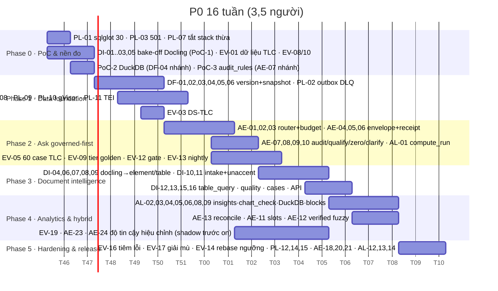
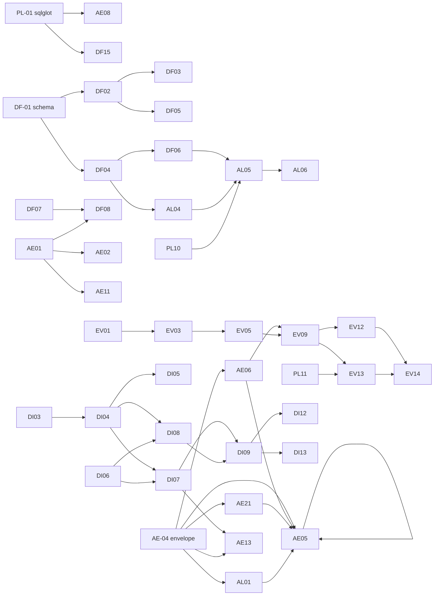

# IMPLEMENTATION_BACKLOG — WBS, thứ tự, phụ thuộc, công sức (Part 8)

> Ngày 12/11/2026. Mỗi task có **đủ 12 trường** (ID, ưu tiên, mô tả, thay đổi, công nghệ, phụ thuộc, vai, công sức,
> tiêu chí, test, deliverable, rollback) ở bảng "Danh sách task" cuối spec của nó; tài liệu này là **bảng tổng** (thứ
> tự, tuần, phụ thuộc đã hợp nhất) và là nơi ghi tiến độ (cột TT: `todo → doing → done <commit>`, `cut`). Khi cập nhật TT
> ở đây thì cũng cập nhật `docs/v3/04-backlog.md` cho ID cũ mà task đóng (ghi "đóng bởi DF-03").

## 0. Hợp nhất với backlog cũ và giữa các spec

| Quy tắc | Nội dung |
| --- | --- |
| Backlog cũ (`docs/v3/04-backlog.md`) | ID R0/R1/API/KB/TM/GEN đã `done` giữ nguyên. ID `todo/doing` còn lại được **ánh xạ** (bảng §5) vào task mới hoặc ghi `cut` với lý do STRATEGY §6. Không mở ID cũ nào không có trong ánh xạ |
| Trùng giữa spec | Một việc một chủ: nâng sqlglot = **PL-01** (DF-15 chỉ lineage, AE-08 chỉ static_check, cả hai phụ thuộc PL-01); cột outbox = **PL-02** (DF-01 không gồm outbox); gVisor = **PL-10** (AL-07 gộp); sửa cờ `halves` = **EV-10** (DI-14 gộp; phần "gate đọc truy hồi" vào EV-12); TEI eval = **PL-11** (EV-11 gộp); `qa.compute_run` = **AL-01** (AE-05 chỉ `receipts.py` + `answer.sealed` + nới `answer_receipt.data_product_id` nullable); kho bake-off = **DI-01** (EV-15 gộp); If-Match bắt buộc = **DF-18** (PL-13 gộp); metrics lõi = **PL-05** (DF-14, AL-15 thêm series, phụ thuộc PL-05); DF-08 phụ thuộc **AE-01** (router), không phải AE-03 |
| ID bị gộp | AL-07, DI-14, EV-11, EV-15, PL-13 — không dùng; để trống trong spec gốc là cố ý |
| Ưu tiên khi phải cắt | Theo 00-ASSESSMENT §10.4; trong một phase theo thứ tự dòng của §2 |

## 1. Nhân lực và giả định

Đội 3 kỹ sư toàn thời gian (BE1 data/platform, BE2 ask/analytics, DE/DOC tài liệu + ingest) + 1 người AI/eval bán thời gian
(người dùng hiện tại) + DevOps 20 %. Tổng công sức ước: ~60 tuần-người P0, ~35 tuần-người P1 (S = 0,5, M = 2, L = 4 tuần-người).
Với 3,5 người: **P0 trong 14–16 tuần**, P1 nối tiếp 8–10 tuần. Nếu chỉ 2 người: P0 ≈ 24 tuần, cắt theo §10.4 còn ≈ 16.
Cần thêm nguồn lực ở: (a) gán nhãn bake-off 30 tài liệu và giải mù 150 case (2 người ngoài đội, ~2 tuần-người); (b) GPU
thứ hai hoặc endpoint model đối chứng cho thí nghiệm D1 (tuần 8).

## 2. Lộ trình theo tuần (thứ tự đã đổi so với master prompt vì phụ thuộc)

Thay đổi so với Phase 0–5 gợi ý: **eval và dữ liệu thật bắt đầu từ tuần 1** (không đợi Phase 5); **Data versioning đi
trước Ask** vì receipt cần version; **Tài liệu (bảng) đi trước Analytics/hybrid** vì `reconcile` cần `table_cell`;
Monitor và SEC EDGAR lùi P1.

| Phase | Tuần | Mục tiêu ra | Cổng ra (đo được) |
| --- | --- | --- | --- |
| 0 PoC & nền đo | 1–2 | Quyết Docling/DuckDB/audit_rules bằng số; snapshot TLC-2024Q1 ghim sha256; eval tier offline chạy với halves thật | PoC-1/2/3/5 có báo cáo trong `model/eval/`; `make eval-retrieval` ghi `dense_ok_rate` |
| 1 Data foundation | 3–5 | Không còn `DROP`; snapshot Parquet; DQ gate; backup đủ; outbox DLQ; gVisor; TEI eval | replay 100 % receipt DS-AW sau nạp lại; restore drill ≤ 60 phút; cross-org sweep 0 rò |
| 2 Ask | 5–8 | Governed-first; AnswerEnvelope + receipt mọi đường; audit_rules; clarify policy; 60 case TLC chạy nightly | 20/20 DS-AW governed giữ; ≥ 85 % giá trị đúng trên 40 case TLC structured (đề xuất); `unsupported_number_rate` 0 |
| 3 Document | 8–11 | Bảng là cấu trúc; số từ bảng có trích dẫn ô; không dấu ≥ 0,7 | cell F1 ≥ 0,85/0,70; khong-dau recall@1 ≥ 0,7; recall@10 full-stack ≥ 0,85 |
| 4 Analytics & hybrid | 10–13 | insights tool, chart_check, DuckDB sandbox, hypothesis block; reconcile nguồn chéo | `causal_claim_rate` thật = 0; 40 bẫy chart bị chặn; 25 case hybrid ≥ 70 % |
| 5 Hardening & release | 13–16 | Tiêm lỗi, giải mù, rebase ngưỡng, HA tối thiểu, notices | thresholds.json không `provisional`; gate P0 (STRATEGY §5) xanh trên lượt chạy có SHA |

## 3. Bảng tổng task (P0 và P1)

Cột: **Tuần** (bắt đầu), **Phụ thuộc** (đã hợp nhất), **Vai**, **CS** (S/M/L), **Tiêu chí** (rút gọn; đầy đủ ở spec), **Spec**.

### 3.1 Platform (PL) — chi tiết 12 trường ở §4

| ID | Ưu tiên | Tuần | Việc | Phụ thuộc | Vai | CS | Tiêu chí | TT |
| --- | --- | --- | --- | --- | --- | --- | --- | --- |
| PL-01 | P0 | 1 | Nâng `sqlglot` → 30.x (PoC-5) | — | BE | S | 3 suite guard/sqlgen/compiler xanh | done c77fd7be |
| PL-03 | P0 | 1 | 3 sự kiện mồ côi → 501 `UNSUPPORTED`; ẩn vault/knowledge-compile/`Fuel*` | — | BE/FE | S | không còn 202 im | done 3dd8795d (backend 501 `not_available` theo quy ước kernel; FE: VAULT, FUEL_FORECAST ra khỏi route, nút biên soạn/rà soát tri thức khoá kèm lý do, bỏ “Lưu vào tri thức”; xoá hẳn `Fuel*` theo STRATEGY §6 vẫn là commit riêng) |
| PL-07 | P0 | 1 | Tắt Kafka/ClickHouse/Langfuse ở local; pin tag image | — | DevOps | S | `make e2e` xanh, 3 pod biến mất | done 6be2676c, 534b9728 (cờ `enable_kafka`/`enable_langfuse`, deploy 17/11: 3 workload gỡ, volume giữ, request bộ nhớ node 98 % → 68 %; pgbouncer/litellm/clickhouse ghim digest). `make e2e` chưa chạy (cần mật khẩu E2E) |
| PL-02 | P0 | 3 | Outbox `attempts/last_error/dead_at`; savepoint mỗi sự kiện; dead-letter + notify | — | BE/DB | M | handler lỗi không chặn lô; 5 lần → dead | done (v3_0038; `libs/dataagent_db/outbox_relay.py` cho 4 relay; backoff 5/15/60/180 phút; dead → `outbox.dead_letter` → thông báo admin; `integration.v_outbox_dead`; RUNBOOK §10b). Mỗi sự kiện được ghi nhận riêng thay cho savepoint: handler chạy trong giao dịch của chính nó |
| PL-04 | P0 | 3 | Backup đủ 6 kho + restore drill | — | DevOps | M | drill ≤ 60 phút, e2e xanh sau khôi phục | doing: Postgres đủ 5 DB + roles, bỏ `\|\| true`; MinIO mirror; Qdrant snapshot; chạy thật trên cụm 17/11 (RUNBOOK §9a); MinIO đọc bằng user chỉ đọc; `make restore-drill` khôi phục vào pod tạm, 68,8 s, mọi bảng có mặt, MinIO khớp. Còn OpenBao (cần chuyển raft), cảnh báo job lỗi, drill khôi phục đè cụm thật |
| PL-05 | P0 | 4 | `/metrics` Prometheus api + 3 worker; dashboard | — | BE/DevOps | M | p50/p95 câu hỏi trên dashboard | doing: `libs/metrics`, `/metrics` ở api + 3 worker, Service + NetworkPolicy, scrape + recording rules p50/p95 câu hỏi (RUNBOOK §4); chờ deploy để đo trên cụm |
| PL-08 | P0 | 4 | Idempotency/rate-limit fail-closed khi mất Redis; pin redis | — | BE | S | không Redis → 503 | done 19/11: 503 `source_unavailable` trước khi ghi (ghi bị chặn, đọc đi qua); khoá giữ khi Redis mất sau khi chạy; `API_REDIS_FAIL_OPEN`; `redis==8.1.0`, image 7.4.11 theo digest |
| PL-09 | P0 | 4 | Cross-org sweep tự sinh theo schema/vai | — | QA/DB | M | 184 bảng × role, 0 rò | done 19/11: `tests/integration/migrate/test_cross_org_sweep.py`, 208 bảng có `org_id` (2 CSDL) × mọi `svc_*`, 1 335 phép đọc/sửa/xoá chéo, 0 rò; ngoại lệ duy nhất là relay đọc outbox (ADR-06); 12 bảng theo chủ sở hữu kiểm bằng cấu trúc policy |
| PL-10 | P0 | 4 | gVisor RuntimeClass cho sandbox (gộp AL-07) | — | DevOps | M | 10 escape test chặn; `analyze` e2e xanh | todo |
| PL-11 | P0 | 4 | TEI embed+rerank ở cụm eval (gộp EV-11) | — | DevOps | S | `dense_ok_rate ≥ 0,95` khi bật | done 19/11: TEI GPU trên LAN (bge-m3 :8003, bge-reranker-v2-m3 :8004) phục vụ cụm, không dựng TEI CPU trong cụm (node arm64 ~6 GiB, image CPU của TEI là amd64); `k8s_verify` kiểm `/health` mỗi lần deploy và cảnh báo; `make eval-retrieval` dense 1,0, rerank 1,0, r@10 0,91 |
| PL-12 | P1 | 13 | `LLM_PRICES` local > 0; `max_cost_per_run` nổ; ngân sách theo org | AE-02 | BE | S | lượt vượt → `BUDGET_EXCEEDED` | todo |
| PL-06 | P1 | 13 | OTel → collector → Tempo; cờ `enable_observability_stack` | PL-05 | DevOps/BE | M | 1 câu = 1 trace xuyên | todo |
| PL-14 | P1 | 14 | HA tối thiểu: api ×2, worker-agent ×2, PDB, probes | PL-02 | DevOps | S | giết 1 pod không hỏng câu đang chạy | todo |
| PL-15 | P1 | 14 | `THIRD-PARTY-NOTICES.md` + CI chặn giấy phép cấm | — | DevOps | S | CI đỏ khi thêm AGPL/ELv2 | done (`make licenses`, `tools/licenses.py`, bước Licences trong CI; 17/11: 543 gói, 0 cấm, 0 cần xem, 0 không khai) |
| PL-16 | P2 | — | Thực thi theo danh tính người hỏi (gộp với AE-17) | AE-17 | BE | M | — | todo |

### 3.2 Data Foundation (DF) — [DATA_PIPELINE_SPEC.md](DATA_PIPELINE_SPEC.md) §9

| ID | Ưu tiên | Tuần | Việc | Phụ thuộc | Vai | CS | Tiêu chí | TT |
| --- | --- | --- | --- | --- | --- | --- | --- | --- |
| DF-01 | P0 | 3 | Migration `v3_0040`: `dataset_snapshot`, `dataset_version.physical_table/retained_until`, `dataset_contract` (không gồm outbox) | — | DB | M | up/down xanh; ORM khớp | done (thiết kế tab 3b, DDL/ORM sinh lại, v3_0040; snapshot chỉ ghi thêm, có `status ok/skipped` theo §8 DATA_PIPELINE_SPEC; contract có `id` + UNIQUE (dataset_id) theo quy ước sinh bảng thay vì khoá chính dataset_id) |
| DF-02 | P0 | 3 | `versioning.py`: staging `__v<n+1>`, swap view, retention | DF-01 | DE | M | lỗi giữa lô → view không đổi | done (`worker_ingest/versioning.py`, `da_swap_version`, v3_0041; full ×2 → `__v1`, `__v2`, view v2, v1 đọc được; lỗi giữa lượt → view và version không đổi; bảng cũ đổi tên thành phiên bản, không DROP; retention chỉ đánh dấu `retained_until`, xoá bảng chờ DF-04; `change_kind` thêm `reload`; cờ `INGEST_VERSIONED`) |
| DF-04 | P0 | 3 | `libs/snapshot` writer/reader + bucket `da-snapshots` lock (PoC-2 nhánh ở tuần 2) | DF-01 | BE | M | sha256 ổn định; PoC-2 đạt | done (`libs/snapshot`: writer COPY CSV → pyarrow → Parquet zstd + page checksum + provenance, key theo sha256, put If-None-Match, `skipped` khi quá `SNAPSHOT_MAX_ROWS`/store lỗi/`SNAPSHOT_ENABLED=0`; reader kiểm sha256, chép sang DuckDB tạm với cột ẩn/che như `query/scope`, chạy SQL read-only, external access tắt, cấu hình khoá; bucket `da-snapshots` `--with-lock` 90 ngày, policy worker-agent; PoC-2 `model/eval/snapshot-poc2.md`: 2 053 532 dòng 7,8 s, 179 MiB, 41 MB; row group 131 072 thay 1 048 576. `libs/code_sandbox/duck.py` không có: reader tự mở DuckDB có khoá) |
| DF-03 | P0 | 4 | Upload commit + pipeline materialize tạo version (bỏ `DROP`) | DF-02 | BE | S | grep DROP = 0 | done (`versioning.py` chuyển sang `libs/dataagent_db`; upload vào bảng có sẵn: `replace` ghi `__v<n+1>` giữ v1, `keep` nối vào version hiện tại (trước đây ghi bảng mồ côi); pipeline lưu lại → version mới, v1 giữ; derived dựng v1 sau view; số version tính cả bảng `__v` đang có (catalog ghi trong giao dịch khác); `schema_hash` sha256 thay `hash()` muối theo tiến trình. Không đường ghi nào DROP khi cờ bật; `DROP TABLE` trong `da_materialize_upload` chỉ còn cho `INGEST_VERSIONED=0`, bỏ cùng cờ) |
| DF-05 | P0 | 4 | Snapshot cuối lượt + `dataset.snapshot_created` + API versions/snapshot | DF-02, DF-04 | BE | S | 2 endpoint trong A2 | done (writer ghi version nguyên vẹn (nạp full, upload thay, pipeline, derived) phát `dataset.version_created` trong giao dịch catalog; `worker_agent/snapshots.py` chụp bằng `svc_query`, ghi `dataset_snapshot` ok/skipped, phát `dataset.snapshot_created`, idempotent theo `(dataset_id, version)`; chụp ở worker-agent vì worker-ingest không có MinIO/`svc_query`, giới hạn worker-agent 512Mi → 768Mi; `GET /v1/datasets/{id}/versions` thêm `physical_table`, `retained_until`, `snapshot`; `GET /v1/datasets/{id}/versions/{version}/snapshot` 302 tới URL ký 10 phút, 404 khi skipped/chưa có; A2, A3, `make api-types`. Lượt nối thêm (incremental, upload `keep`) không chụp lại: snapshot là của lúc version được ghi) |
| DF-06 | P0 | 5 | Replay đọc version cũ hoặc Parquet | DF-04 | BE | M | 100 % receipt DS-AW replay sau nạp lại | done (replay đọc lại số của bảng workspace ở đúng version receipt ghi khi dataset đã sang version khác: bảng `__v<n>` nếu còn, không thì Parquet snapshot trong DuckDB; đổi tên bảng sau khi đã viết chính sách của người hỏi vào SQL (`query/executor.at_versions`), nên che/ẩn/lọc dòng như đường live; query_run `route=history`; thiếu cả bảng lẫn snapshot → `not_reproducible` nói rõ; nguồn workspace nội bộ (id cố định, không có dòng `catalog.source`) trước đây luôn ra `not_reproducible`, nay map đúng. Tiêu chí "100 % receipt DS-AW" chưa đo được: DS-AW (và DS-TLC) đọc tại chỗ từ nguồn ngoài, không qua version workspace, và receipt trên cluster chưa ghi `dataset_versions`; kiểm bằng `test_replay_versions.py`) |
| DF-07 | P0 | 4 | Từ vựng expectation GX + `mostly` + `row_condition`; map 7 kind | — | BE | M | 7 kind cũ không đổi kết quả | done (`libs/quality_vocab`: 9 kind ↔ expectation GX; kind mới `compound_unique`, `match_regex` (v3_0044 sửa CHECK); `mostly` (đạt khi tỷ lệ vi phạm ≤ 1 - mostly, câu kiểm đếm thêm `total`) và `row_condition` (chỉ cột so hằng nối AND, sqlglot dựng lại) cho mọi luật đếm dòng; `quality_result.result` jsonb dạng GX; luật không có tham số mới sinh đúng SQL cũ (`test_quality_sql.py` không đổi), 7 kind cũ nhận đúng những gì trước đây nhận; api trả 422 `params` cho luật không thành phép kiểm) |
| DF-08 | P0 | 5 | `quality_gate.py` ở router/report/product/tile | DF-01, DF-07, AE-01 | BE | M | blocked ⇒ `QUALITY_BLOCKED`, 0 figure | done (`worker_agent/quality_gate.py`: `blocked` khi luật `high` fail chưa xác nhận hoặc contract `broken`, xác nhận trong 24 h → caveat, `warning` → caveat không hạ nhãn, `QUALITY_GATE=warn` biến mọi chặn thành caveat; mã `QUALITY_BLOCKED` (contact_steward); governed: kiểm sau compile, trước chạy → từ chối, 0 figure; tile và báo cáo định kỳ: `run_query(quality_gate=True)` chặn trước khi hỏi nguồn; agentic: bảng bị chặn chuyển sang governed (đường `out_of_time`), cảnh báo thành caveat; product không lên `active` khi member bị chặn. DS-AW trên cluster: 0 bảng bị chặn (55 unknown, 1 warning), 0 contract hỏng) |
| DF-09 | P0 | 5 | API + màn `dataset_contract` (If-Match, maker≠checker) | DF-01 | BE/FE | M | product active cần contract active | done (`GET/PUT /v1/datasets/{id}/contract`: GET luôn 200 (`none`, version 0 khi chưa có), ETag `W/"contract-<version>"`; PUT thiếu If-Match → 428 `precondition_required`, phiên bản đã đổi → 412 (khoá dòng + so version), người viết tự kích hoạt → 403 `policy_denied` trừ khi tổ chức cho tự duyệt (ghi audit), quy tắc kiểm theo từ vựng GX; sự kiện `dataset.contract_changed`; product chỉ lên `active` khi mọi dataset member có contract `active`; FE: tab "Hợp đồng dữ liệu" ở Hồ sơ bảng (`features/data/ContractPanel.tsx`). Chuyển `active → broken` tự động (schema lệch, luật high fail hai lượt) chưa làm) |
| DF-17 | P0 | 4 | Prep steps qua proposal khi pipeline active | — | BE | S | AUD-04 đóng | done (pipeline `active`: bước agent đề xuất (đã qua `check_steps` và dry run LIMIT 0) mở proposal `pipeline_steps` cho chủ pipeline thay vì ghi thẳng; chấp nhận → áp nếu các bước vẫn như lúc đề xuất (OCC), không thì `apply_failed`; pipeline nháp vẫn ghi thẳng; v3_0046 thêm kind) |
| DF-18 | P0 | 5 | If-Match bắt buộc (428/412) cho PATCH tài sản ngữ cảnh + FE (gộp PL-13) | — | BE/FE | M | AUD-09 đóng | done (`kernel/etag.py` REQUIRED: PATCH pipelines, data-products, datasets, metrics, workspaces thiếu If-Match → 428 `precondition_required` khi người gọi đọc được tài nguyên (không thì 404/403 của route); FE `lib/v1/client.ts` nhớ ETag của GET và gửi khi PATCH, chưa đọc thì đọc trước; ETag của data product tính từ phần ổn định (trước đây đổi theo giây vì freshness theo now()). Monitor chưa: không có `GET /v1/monitors/{id}` để so phiên bản) |
| DF-19 | P0 | 4 | Object lock `da-ingest/da-raw-docs/da-snapshots`; upload xoá mềm | DF-01 | DevOps/BE | S | AUD-08 đóng | done (`DELETE /v1/uploads/{id}` xoá mềm (`file_upload.deleted_at`, v3_0047), tệp giữ lại; dataset do upload tạo → `enabled=false` (worker-agent, `file_upload.deleted`); `minio-init` tạo `da-ingest`, `da-raw-docs` có lock + retention 90 ngày; bucket đã có từ trước vẫn chưa lock (MinIO chỉ bật lock lúc tạo): cảnh báo trong job, cách chuyển ở RUNBOOK §9b) |
| DF-12 | P1 | 9 | Registry driver + cards từ registry | — | BE | M | grep `kind ==` = 0 | done (`libs/source_drivers/registry.py`: postgresql, mysql, sqlserver, clickhouse với thẻ, khả năng (federated, ingest, dialect, scan, profile, cursor, stream, quoting); api lấy thẻ connector, kind truy vấn tại chỗ và kind nạp được từ registry, từ chối tạo nguồn kind không có driver (422, trừ `rest_api`); thẻ Snowflake bỏ (không có driver), MySQL và SQL Server có thẻ; worker-ingest và schema scan không còn rẽ nhánh `source.kind ==`) |
| DF-13 | P1 | 10 | `discover()` + `type_map` mọi driver; drift theo kiểu | DF-12 | DE | M | retype → `schema_drift` | done (kiểu cột lấy từ catalog của nguồn qua registry (`columns_sql`, `type_map`/`normalized_type`, một bảng kiểu cho cả schema scan và nạp): timestamp → `timestamptz`, JSON → `jsonb`, MySQL BOOLEAN → boolean; v3_0050 cho `da_materialize_upload/upsert` nhận `timestamptz`, `jsonb`; cột bảng cũ đang là `text` giữ `text` khi nối thêm (không thành drift), đổi kiểu thật vẫn `schema_drift`. Discovery qua schema scan (spec §3: mở rộng `scan_run kind=schema`, không thêm endpoint): PK đã có (`column_meta.is_key`); `can_select` mỗi bảng (PostgreSQL `has_table_privilege`, SQL Server `HAS_PERMS_BY_NAME`, MySQL quyền SELECT toàn cục/schema/bảng — không thấy thì null vì quyền qua role không hiện; ClickHouse null) vào `catalog.dataset.can_select` (v3_0055); `registry.cursor_candidates` xếp hạng tất định (thời điểm sửa → timestamp → ngày → khoá số nguyên), `DatasetDetail.cursor_candidates` kèm gợi ý; màn tạo job chỉ chọn cursor từ đó và ẩn bảng `can_select=false`) |
| DF-10 | P1 | 11 | Profiling sâu + freshness + pattern_hint | DF-01 | DE | M | cột số có quantiles | done (v3_0051: `column_profile.quantiles/histogram/length_stats/value_patterns`, `pattern_hint` khi một mẫu phủ ≥ 80 %; `dataset.source_activity` từ `pg_stat_user_tables`; chỉ PostgreSQL, nguồn khác null; cột cá nhân không giữ phân phối) |
| DF-11 | P1 | 12 | Luật DQ đề xuất từ profile; PII evidence | DF-10, DF-07 | DE | S | ≥ 1 đề xuất/bảng DS-AW | done (`worker_agent/rule_proposals.py`: not_null, unique, in_list ≤ 20, match_regex ≥ 99 %, range {min: 0} cho số không âm, từ profile, tất định; DS-AW 27/28 bảng (bảng còn lại chỉ có khoá, cột tên bị GEN-14 chặn và mô tả tự do); `origin=agent_suggested, status=draft` — bảng không có `proposed`, draft là đề xuất chờ steward bật; không đề xuất lại luật cùng cột và kind ở mọi trạng thái; v3_0052 `column_meta.pii_evidence`) |
| DF-15 | P1 | 12 | `libs/sql_guard/lineage.py` (sqlglot 30) | PL-01 | BE | M | lineage CTE/UNION/subquery | done (`libs/sql_guard/lineage.py` `column_lineage(sql, schema, dialect)`: guard trước, `qualify` theo schema catalogue, sqlglot 30 `lineage` qua CTE/subquery/mọi nhánh UNION; `*` không schema và cột không lần được vào `unresolved`; quá 2 s hoặc sqlglot không theo được thì chỉ còn bảng (`complete=False`); hằng số không có edge; test `tests/unit/worker_agent/test_sql_lineage.py` cạnh `test_guard.py`. Chưa nối vào ghi edge: DF-16) |
| DF-16 | P1 | 13 | Ghi edge cột + edge source→dataset ở job nạp | DF-15 | BE | S | 100 % pipeline DS-AW có edge | done (`worker_agent/column_edges.py`: pipeline và derived ghi `column_meta` của bảng đích và edge cột→cột qua `column_lineage`, đóng edge cũ không còn; edge `source→dataset` via ingest ghi từ `dataset.version_created` của job_run (worker-ingest không có kết nối svc_pipeline); api đặt tên nút cột theo bảng. Edge đọc từ catalogue vẫn giữ cho bảng truy vấn tại chỗ — không ai ghi chúng — và nhường edge ingest khi có) |
| DF-14 | P1 | 13 | `rows_written` trừ DLQ; metrics ingest | PL-05 | DE | S | 3 series | done (`job_run.rows_written` = đọc − DLQ (trước đây bằng số đọc); `/metrics` của worker-ingest: `dataagent_ingest_rows_total{outcome=written|dlq}`, `dataagent_ingest_run_seconds{mode,status}`) |
| DF-20 | P2 | — | Ẩn entity-link; xoá seed reference_entity ngân hàng | — | FE/DB | S | — | todo |

### 3.3 Ask Engine (AE) — [ASK_ENGINE_SPEC.md](ASK_ENGINE_SPEC.md) §15

| ID | Ưu tiên | Tuần | Việc | Phụ thuộc | Vai | CS | Tiêu chí | TT |
| --- | --- | --- | --- | --- | --- | --- | --- | --- |
| AE-07 | P0 | 2 (PoC-3) → 6 | `sqlgen/audit_rules.py` R1–R5 cả hai đường | — | AI/BE | S | PoC-3: sai bảng 2/20 → 0; từ chối sai ≤ +5 | done 8cb8670e: offline 0/48 từ chối sai, 4/4 lỗi đã ghi bị chặn; 16/11 chạy thật: không câu sai nào đi qua explore_sql (ds-aw-agent-eval.md) |
| AE-01 | P0 | 5 | `router.py` governed-first + classify tất định | — | BE/AI | M | 20 câu DS-AW đầu → governed | done 19/11: `ASK_ENGINE=router` mặc định; DS-AW 61/61 → governed, `agent-eval --engines router` 49/61 (= governed), 853 token, 2,6 s/câu; agent nhận WHY/MULTI_METRIC (có từ nối)/HYBRID/DOC_ONLY/DEEP |
| AE-03 | P0 | 5 | `audience` từ api theo vai | — | BE | S | 422 khi client gửi | done 19/11: `question.received.audience` từ quyền của người hỏi (AC01/AC02 → executive; AC03/04/08/09 → analyst); body có `audience` → 422, không ghi |
| AE-02 | P0 | 6 | `agentic/budget.py`; partial compose | AE-01 | BE | S | agentic p95 ≤ 60 s; `used_tokens` ghi | done 19/11: ngân sách theo audience/deep, dừng thì compose; `agent_run.stop_reason` budget_*; DS-AW 20 câu agentic: analyst p95 50,7 s, executive p95 29,6 s, cả hai 19/20 như không ngân sách |
| AE-04 | P0 | 6 | `answer/envelope.py` + `TrustCode` + overall | — | BE | M | mọi đường trả envelope | done 20/11: v3_0045 `qa.answer.trust_code` + `envelope`; năm đường ghi mã server đặt (nhãn yếu nhất); SSE `answer.trust_code` |
| AE-05 | P0 | 7 | `receipts.py` chung; `answer.sealed`; nới `answer_receipt.data_product_id` nullable | AE-04, AL-01 | BE/DB | M | 61/61 câu có receipt | done 57bf9ec3: 23/11 chạy thật `make agent-eval` (router) trên 61 câu DS-AW: 50/50 câu trả lời có số có biên nhận đã khoá và `answer.sealed`; 10 câu hỏi lại và 1 từ chối không có số nên không có biên nhận (theo thiết kế). Đường agentic chỉ có test unit: bộ eval không có câu nào agent tự trả lời |
| AE-06 | P0 | 7 | `GET /v1/answers/{id}` envelope; SSE; A2; `make api-types`; FE `trust.ts` | AE-04 | BE/FE | M | FE không map chuỗi tiếng Việt | done 21/11: `AnswerView.trust_code` + `trust` (bản đồ tin cậy; câu trả lời trước v3_0045 tính lúc đọc bằng cùng quy tắc, nay ở `libs/contracts/v1/trust.py`); FE `trustOfCode`, bỏ bảng nhãn tiếng Việt |
| AE-08 | P0 | 7 | `static_check` + `qualify(on_qualify)` + EXPLAIN dry-run | PL-01 | BE | S | `TABLE_OUT_OF_SCOPE` bắt được | done 23/11 (đã có: `sqlgen/check.py` `problems()` — parse, chỉ đọc, catalog khác, bảng ngoài phạm vi liên kết, `qualify(validate_qualify_columns)`, `SELECT *`/đọc cả dòng, `audit_rules`; `libs/sql_guard` chặn hàm; test `test_sqlgen.py`, `test_guard.py`. Không thêm EXPLAIN dry-run: explore đã chạy từng ứng viên chỉ-đọc có timeout và sửa một lần, EXPLAIN chỉ thêm một vòng tới nguồn; lỗi là câu cho prompt sửa, chưa có nơi đọc mã ổn định) |
| AE-09 | P0 | 7 | NULL/0 theo coverage ở `present_gate` + `_no_value` | — | AI | S | 2 câu tồn kho DS-AW xanh | done 0ad096a8, 33cb5869: nguyên nhân thật là "cuối" bị RES-04 coi là đại lượng và tham số "none"; số đã đúng, còn trượt vì agent trả thừa (chuyển sang AE-01) |
| AE-10 | P0 | 8 | `clarify_policy.py` chung; mọi đường ra Clarify qua `apply` | AE-03 | AI | S | executive ≤ 1 vòng/3 lựa chọn | done 23/11: `worker_agent/clarify_policy.py` `apply` + `gate` cho `ask_user`, hỏi chỉ số không tên và governed; governed hết vòng thì giả định và ghi rõ (test `test_ae_10_*`: executive vòng 2 trả lời, analyst hỏi tiếp; ≤ 3/5 lựa chọn) |
| AE-11 | P1 | 11 | `ConversationSlots` cả hai đường + `rewrite_for_retrieval` | AE-01 | AI/BE | M | 30 case multi-turn kế thừa ≥ 90 % | todo |
| AE-12 | P1 | 12 | Verified fuzzy + tile reuse | — | BE | S | ≥ 18/20 khớp, 0 khớp sai | todo |
| AE-13 | P1 | 11 | `reconcile.py` + VALIDATE + `ReconciliationNote` + `SOURCE_CONFLICT` | DI-07, AE-04 | AI/BE | M | 25 case hybrid ≥ 70 % | todo |
| AE-14 | P1 | 12 | Semantic rules + dbt-semantic-interfaces YAML | — | AI/DB | M | AGC-12 case xanh; round-trip | todo |
| AE-15 | P1 | 12 | Metric–measure linking + reverse linking | AE-08 | AI | S | câu không nối ≤ 10/31 kiểu DS-BH | todo |
| AE-16 | P1 | 14 | Message catalog vi/en; cấm chuỗi có dấu trong harness | — | BE | M | `test_no_hardcoded_vi` = 0 | todo |
| AE-17 | P1 | 15 | `SET LOCAL ROLE` theo `role_mapping`; `executed_as` | — | BE/DB | M | query_run ghi role | todo |
| AE-18 | P1 | 13 | Trace theo bước (AGC-05) | — | BE | S | `/steps` sống | todo |
| AE-19 | P1 | 14 | Plan reuse + `consistency_rate` | AE-01 | AI | S | consistency ≥ 0,9 | todo |
| AE-20 | P1 | 13 | `plan.validate` bắt buộc trước `act` (AUD-11) | AE-02 | AI | S | plan lỗi không chạy | todo |
| AE-21 | P1 | 13 | Signals hạ nhãn | AE-04, DF-08 | AI | S | warning → ≤ EXPLORATORY | todo |
| AE-22 | P2 | — | Correction memory consolidation (RES-10) | — | AI/FE | M | — | todo |
| AE-23 | P1 | 10 | Vote SQL theo cách viết, trọng số `logit(a_m)` từ ablation; `margin` ([CONFIDENCE_SPEC.md](CONFIDENCE_SPEC.md) §4) | EV-19 | AI | S | chấm lại offline cùng ablation DS-AW: AURC ≤ vote k/6 | todo |
| AE-24 | P1 | 12 | `CalibratedConfidence` + map + ngưỡng từ rủi ro cho resolver, vote, Workspace, present_gate, router; cờ `off\|shadow\|on` (CONFIDENCE_SPEC §5) | EV-19, AE-23, EV-09, AE-01 | AI/BE | M | ECE ≤ 0,05 cross-fit (provisional); 20/20 governed giữ; ≥ 7 đêm `shadow` trước `on` | todo |

### 3.4 Analytics (AL) — [ANALYTICS_SPEC.md](ANALYTICS_SPEC.md) §9

| ID | Ưu tiên | Tuần | Việc | Phụ thuộc | Vai | CS | Tiêu chí | TT |
| --- | --- | --- | --- | --- | --- | --- | --- | --- |
| AL-01 | P0 | 7 | `qa.compute_run` + ORM + migration; `replay.py` runtime insights/decomposition | AE-04 | BE/DB | M | replay DERIVED tái tạo output sha | done 23/11: v3_0048 `qa.compute_run` (chỉ ghi thêm); đường governed ghi một lần tính `insights` với mỗi câu trả lời có số dẫn xuất; replay nói "mã tính đã đổi" khi code_sha256 khác; decomposition/sandbox ghi ở AL-02/AL-05 |
| AL-04 | P0 | 10 | `libs/snapshot` Arrow reader; `tools/analyze.py` gửi Arrow | DF-04 | BE | M | payload giảm ≥ 5× | todo |
| AL-05 | P0 | 10 | `duck.py` khoá cấu hình; duckdb 2.0 trong image sandbox | AL-04, PoC-2 | BE | M | escape 0/10; ≥ 2× nhanh | todo |
| AL-02 | P0 | 11 | Insights tool cho agentic (bọc `insights.py` + `anomaly.py`) | AL-01 | AI | M | figure có `expr`; replay được | todo |
| AL-03 | P0 | 11 | `chart_check.py` + nối materialize/chart_spec/tile; proposal Review Inbox | — | BE | M | 40 bẫy chart chặn 100 % | done (`answer/chart_check.py` 10 mã, tất định; agentic `blocks.materialize`: block → bảng + callout lý do, warn → chart + callout; governed `chart_spec_of`: block → không vẽ, lý do vào bước `chart_check` của trace; `CONSTANT_MEASURE` cần ≥ 3 điểm (hai nhóm bằng nhau là so sánh); cộng được hay không đọc từ `analysis.additivity_of` qua reading/plan; đề xuất `measure_additivity` (v3_0057) khi measure khai `full`/`semi` mà SQL không cộng được, chấp nhận → `none` (OCC); cờ `CHART_CHECK=off`; `dataagent_chart_check_issues_total{code,severity}`. Kiểm tile khi thêm vào dashboard để ở AL-12) |
| AL-06 | P0 | 12 | Kiểm nghĩa output sandbox: pandera, đơn vị, additivity; `inference` block | AL-05 | AI/BE | M | share trên non-additive bị chặn | todo |
| AL-08 | P0 | 12 | Block `hypothesis` (+verification_query) và `recommendation`; causal regex trước persist | AL-02 | AI/FE | M | `causal_claim_rate` thật = 0 | todo |
| AL-09 | P0 | 12 | `charts.jsonl` ≥ 40 + `scorers/chart.py`; export text → scorer causal | AL-03 | QA/AI | M | gate đọc 2 metric mới | todo |
| AL-12 | P1 | 14 | Tile snapshot lưu giá trị + versions + sha; qua chart_check | AL-03, DF-05 | BE | S | tile replay được | todo |
| AL-13 | P1 | 14 | Report mặc định html (+xlsx); bỏ `_pdf()` default | — | BE | S | không còn `not_supported` im | todo |
| AL-14 | P1 | 14 | Nối `anomaly` vào `skill_runs`; xoá/đánh dấu `funnel`, `report_outline` | AL-02 | BE | S | không mã chết | todo |
| AL-10 | P1 | 15 | Monitor runtime trên Temporal kind `monitor`; dedup/cooldown; quality_gate | DF-08 | BE | M | alert sinh từ runtime, không seed | done 23/11 (v3_0056 `monitor.alert.figures`; `worker_agent/monitor_runs.py`: kind `monitor` theo giờ tổ chức, judge chung với backtest, cổng chất lượng trước truy vấn → `skipped QUALITY_BLOCKED`, 1 alert/monitor/kỳ, thành viên mới gộp vào alert mở, cooldown `cooldown_hours` mặc định 24 giờ, sự kiện `alert.fired`). Còn: `mad_outlier` (CHECK `rule_kind` chưa có), đoạn giải thích bằng LLM, 3 monitor seed trên DS-AW |
| AL-11 | P1 | 16 | Alert → workspace `created_from=alert` + PlanIR seed | AL-10 | BE/FE | S | — | todo |
| AL-15 | P1 | 13 | Metrics compute/chart/causal | PL-05 | BE | S | — | todo |
| AL-16 | P2 | — | Forecast luôn EXPLORATORY + experimental | — | AI | S | — | todo |

### 3.5 Document Intelligence (DI) — [DOCUMENT_INTELLIGENCE_SPEC.md](DOCUMENT_INTELLIGENCE_SPEC.md) §13

| ID | Ưu tiên | Tuần | Việc | Phụ thuộc | Vai | CS | Tiêu chí | TT |
| --- | --- | --- | --- | --- | --- | --- | --- | --- |
| DI-01 | P0 | 1 | Kho bake-off 30 tài liệu + ground truth (gộp EV-15) | — | DE + 2 người gán nhãn | M | 30 doc đủ 5 loại GT | doing: công cụ xong (Label Studio 1.23.2 ghim digest, `page.xml`, sheet bảng, `make bakeoff-render/-gold/-agree`, chạy thử trên export thật 16/11); còn chọn 30 tài liệu và hai người gán |
| DI-02 | P0 | 1 | Vendor evaluator TEDS/ED/CER (OmniDocBench code, Apache) | — | DE | S | chạy trên GT mẫu | done 23/11: `model/eval/docs/{teds,order,cer}.py` từ OmniDocBench 7ddb8df4 (Apache-2.0, `NOTICE` + `LICENSE-OmniDocBench`); khoảng cách Levenshtein lấy từ rapidfuzz (MIT) thay gói `Levenshtein` (GPL, bị cấm); `apted` trong image dev-tools; `test_docs_evaluators.py`: gold với chính nó = 1,0, sai ô/thiếu hàng/mất span, thứ tự đọc, CER/WER có dấu và bỏ dấu |
| DI-03 | P0 | 1 | Image worker-document + Docling + model offline (PVC) | — | DevOps/DE | S | build ≤ 15 phút; pod 4 Gi | done 23/11: Docling 2.150.0 + torch 2.15.0+cpu, model trong image (không PVC, lý do ở DOCUMENT_INTELLIGENCE_SPEC §3.2); build ~3 phút có cache, ~9 phút lạnh; pod 4 CPU/4Gi + `/tmp` emptyDir; offline (`--network none`) dựng đúng bảng scan 4×4; httpx 0.28.1, pydantic 2.13.5 cho worker-document; licence 0 cấm |
| DI-04 | P0 | 2 → 8 | `docling_adapter.py` + ánh xạ element | DI-03 | DE | M | adapter test trên 30 doc | done 23/11: `worker_document/docling_adapter.py` (`converter_for`, `convert`, `elements_of`: kind, thứ tự, level, trang, bbox, caption → bảng/hình, bỏ header/footer/mục lục và đếm); `DOC_EXTRACTOR` mặc định `legacy` (§11); `test_docling_adapter.py` trên output thật của Docling (DOCX + PDF scan) và một DOCX chạy đủ đường. Lần chạy trên 30 tài liệu đi cùng DI-05 (kho DI-01 chờ người gán nhãn) |
| DI-05 | P0 | 2 | `make docling-bakeoff` + báo cáo (PoC-1) | DI-01, 02, 04 | DE | S | báo cáo trong `model/eval/` | todo |
| DI-06 | P0 | 8 | Migration `element`, `table`, `table_cell`, cột chunk | — | DB | S | up/down xanh | done 23/11: v3_0054 `document.element`, `document.doc_table` (generator không quote tên, `table` là từ khoá), `document.table_cell`; chunk thêm `kind` (section/table), `element_ids`, `parent_chunk_id`, `table_id`; trang null với DOCX/HTML; downgrade thật; `test_a_migrated_cluster_holds_a_documents_elements_tables_and_cells` lên → xuống → lên |
| DI-07 | P0 | 9 | `tables.py`: ô, span, continuation, scale/đơn vị | DI-04, DI-06 | DE | M | cell F1 ≥ 0,85/0,70 | done 23/11: `worker_document/tables.py` `tables_of(doc, elements, decimal_mark=)`: ô, span, ô tiêu đề (TableFormer gắn row_header lỏng → chỉ cột đầu; không có column_header → hàng đầu không có số), số đọc bằng `libs.tabular`, scale/đơn vị từ chú thích, ô tiêu đề hoặc ghi chú ngay trước bảng (vi/en), hai scale mâu thuẫn → không nhân + `field_mismatch`, hàng tổng lệch tổng các hàng → `field_mismatch`, bảng nối trang §4.3.1; `test_tables.py` 29 ca. XLSX (§4.5) để DI-10 |
| DI-08 | P0 | 9 | `legal_headings.py` + chunker theo tiêu đề, parent/child, bỏ header/footer/TOC | DI-04, DI-06 | DE | M | heading F1 ≥ 0,9 trên pháp quy | done 23/11: `legal_headings.py` (`relevel` vi/en Phần 1…Điểm 6, chỉ khi có Điều/Article; `drop_furniture`: khối lặp ≥ 60 % trang ở dải 8 % trên/dưới, mục lục chấm dẫn ở 5 trang đầu) + `chunker.py` (section theo tiêu đề tới cấp Điều, Khoản/Điểm là điểm cắt bên trong; Điều > 1 600 ký tự → cha chỉ FTS + con nhúng vector với path `… > Khoản 1-2`; tiêu đề lá không thân vẫn là chunk; bảng → chunk tóm tắt chú thích/tiêu đề cột/nhãn hàng, không số). `test_legal_headings.py`, `test_chunker_headings.py` |
| DI-09 | P0 | 10 | Handler nối stage 3–10, fallback, `document.indexed` mở rộng | DI-04…08 | DE | M | e2e upload → ready có table | done 23/11: `docling_path.extract` (Docling → relevel → bỏ furniture → bảng → che PII ở element và ô → chunk, trong thread) + `handler.py`: element/doc_table/table_cell ghi lại mỗi lần, chunk giữ theo text (bảng thì không), `element_ids`/`parent_chunk_id`/`table_id` nối lại, chunk cha không vector, issue bảng, Docling lỗi → đường cũ + `garbled_text`, `document.indexed` mở rộng §10. Sau cờ `DOC_EXTRACTOR=docling` (mặc định `legacy` tới DI-05). `test_handler_tables.py` chạy Docling thật: DOCX pháp quy có bảng, PDF scan, fallback, lần chạy thứ hai |
| DI-10 | P0 | 8 | `intake.py` magic sniff, XLSX, UNSUPPORTED rõ, bucket lock, xoá mềm | — | BE | S | `.msg` → UNSUPPORTED | done 23/11: `libs/document_intake.detect` (magic, thư mục zip, HTML, rồi đuôi) ở upload api và đồng bộ nguồn; PPTX/.msg/ghi âm/.doc/.xls/không rõ → 415 `unsupported_media_type`; đuôi khác nội dung → đọc theo nội dung + `field_mismatch` (worker, một lần); v3_0058 `media` thêm xlsx/text, `element.extractor` thêm openpyxl; `xlsx_path.py` (mỗi sheet một bảng, số theo kiểu ô, ô gộp, ≤ 50 MB / 300 MB giải nén / 200 000 ô một sheet / 1 000 000 ô cả tệp); TXT/MD → trang 80 dòng; `DELETE /v1/documents/{id}` xoá mềm (admin_data). Khoá bucket đã có từ DF-19 |
| DI-11 | P0 | 8 | `text_folded` + GIN + hai nhánh FTS + synonym (PoC-4) | — | BE | S | khong-dau recall@1 ≥ 0,7 | todo |
| DI-12 | P0 | 10 | `table_query.py` + citation ô + FE highlight bbox | DI-07, DI-09 | AI/FE | M | mọi số từ bảng cite ô | todo |
| DI-13 | P0 | 10 | 5 loại quality issue + gate `needs_review` | DI-09 | DE | S | mỗi loại có test | todo |
| DI-15 | P0 | 10 | `tables.jsonl` ≥ 40; 10 scan vào `retrieval.jsonl` | DI-01 | QA | S | case fail đúng lý do trước khi pass | todo |
| DI-16 | P0 | 11 | API `/elements`, `/tables`, `/cells` + A2 + JSON Schema export | DI-06 | BE | S | export validate schema | todo |
| DI-17 | P1 | 13 | Trích có cấu trúc từ element/ô; nạp `target_dataset_id`; coverage RG-08 | DI-09, DF-05 | AI/BE | M | `loaded_at` ≠ null | todo |
| DI-18 | P1 | 12 | Ngưỡng truy hồi theo Data Space + follow-up rewrite | EV-10, AE-11 | AI | S | — | todo |
| DI-19 | P1 | 14 | Diff phiên bản element/ô + gói ngôn ngữ thay thế | DI-09 | DE | M | — | todo |
| DI-20 | P1 | 14 | `claim.metric_id` + link tài liệu ↔ metric | DI-09 | AI | S | câu "định nghĩa ở đâu" trả link | todo |
| DI-21 | P1 | 15 | Màn sức khoẻ kho tài liệu (RG-09) | DI-13 | FE | S | — | todo |
| DI-22 | P2 | — | RapidOCR v6 mặc định nếu thắng; fine-tune Tesseract | DI-05 | AI | M | — | todo |

### 3.6 Dataset & Evaluation (EV) — [DATASET_AND_EVALUATION.md](DATASET_AND_EVALUATION.md) §7

| ID | Ưu tiên | Tuần | Việc | Phụ thuộc | Vai | CS | Tiêu chí | TT |
| --- | --- | --- | --- | --- | --- | --- | --- | --- |
| EV-01 | P0 | 1 | Snapshot dữ liệu thật ghim sha256, nạp nguyên trạng (16/11: TLC Trip Records thay NYC 311, cổng 311 trả 403; bộ thu 311 `make nyc311-snapshot` giữ làm dự phòng) | — | DE | M | file sai hash bị từ chối; số dòng mỗi file tái lập | done fa9ccce9 (`make tlc`, `TLC-2024Q1` trong `tlc_trips` của cụm: 9 554 778 chuyến vàng, 372 649 xanh) |
| EV-08 | P0 | 1 | Cột mới `eval.eval_item` + loader YAML | — | DB | S | — | done (v3_0037; `make eval-cases-import`; API nhận và trả 5 trường, A3 cập nhật) |
| EV-10 | P0 | 1 | Sửa `halves` thật + `dense_ok_rate`/`rerank_ok_rate` (gộp DI-14) | — | AI | S | báo cáo keyword-only không ghi `dense: true` | done (phần halves; gate đọc truy hồi ở EV-12) |
| EV-03 | P0 | 5 | Data Space DS-TLC (truy vấn tại chỗ, `ds-tlc.yaml` 13 metric, value_index) | EV-01, AE-14 (hoặc metric đơn giản trước) | DE/AI | M | 13 metric reconcile với SQL tay | doing: seed + model + test xong, scan và import trên cụm 16/11; còn duyệt 9 quan hệ và 13 metric (admin) |
| EV-05 | P0 | 6 | 60 case TLC (24/16/15/5) + SQL vàng | EV-03 | QA/AI | M | mỗi case fail đúng lý do trước | todo |
| EV-09 | P0 | 7 | Tier `golden` qua `POST /v1/questions` thật; chấm theo rubric | AE-06, EV-05 | AI | M | report có `answer_id` mỗi case | todo |
| EV-12 | P0 | 8 | `gate.py` đọc retrieval + agent-eval + golden + causal thật; metric vắng = fail | EV-09 | AI | S | — | todo |
| EV-13 | P0 | 8 | Nightly: target Temporal `nightly-evals` chạy golden + retrieval + agent-eval; artifact | EV-09, PL-11 | BE | S | 7 đêm liên tiếp có report | todo |
| EV-16 | P1 | 13 | Case tiêm lỗi (file hỏng, trùng khoá, drift, injection, tenant chéo) | EV-05 | QA | S | — | todo |
| EV-17 | P1 | 14 | Giải mù hai người 150 case; `human_verified` | EV-05, EV-06 | QA + 2 người | M | ≥ 95 % case `human_verified` | todo |
| EV-14 | P0 | 15 | Rebase ngưỡng từ lượt chạy thật; bỏ `provisional`; `source_run` | EV-13, EV-17 | AI | S | unit test provisional đổi | todo |
| EV-02 | P1 | 9 | CLI thu SEC (submissions, iXBRL, companyfacts, FSDS 20 CIK) | — | DE | M | ≤ 10 req/s; User-Agent | todo |
| EV-04 | P1 | 11 | Data Space DS-SEC + iXBRL vào worker_document với `supersedes_id` | EV-02, DI-09 | DE/AI | M | — | todo |
| EV-06 | P1 | 12 | 82 case SEC (16/14/22/10/20) + fact id | EV-04 | QA/AI | M | — | todo |
| EV-07 | P1 | 12 | 8 case tiếng Việt vbpl.vn (nếu giấy phép) | quyết định giấy phép | QA | S | — | todo |
| EV-18 | P1 | 16 | Scorecard tự sinh từ `eval.eval_run` | EV-13 | FE/BE | S | — | todo |
| EV-19 | P1 | 9 | Đo hiệu chỉnh độ tin cậy: `libs/calibration`, `make calibrate`, ECE/Brier/AURC cross-fit; baseline điểm thô DS-AW ([CONFIDENCE_SPEC.md](CONFIDENCE_SPEC.md) §2–3, §6) | — | AI/QA | S | báo cáo hai bộ sinh có `snapshot`/`commit`; baseline ghi vào DATASET §6.2 | done 19/11: `docs/v3/eval/2026-11-19-calibration-baseline.md`; vote 4/6 sai 56 %, AE-23 nên đo lại trên TLC trước |

## 4. Platform tasks — 12 trường đầy đủ

| ID | Ưu tiên | Mô tả | Thay đổi cần làm | Công nghệ | Phụ thuộc | Vai | Công sức | Tiêu chí chấp nhận | Test | Deliverable | Rollback |
| --- | --- | --- | --- | --- | --- | --- | --- | --- | --- | --- | --- |
| PL-01 | P0 | Nâng `sqlglot` 25.24.5 → 30.x (PoC-5) | `backend/services/{api,worker_agent}/requirements.txt`, `tests/dev-tools.Dockerfile`; sửa API đổi tên trong `libs/sql_guard`, `sqlgen/check.py`, `semantic/compiler.py`, `periods.py` | sqlglot 30 (MIT) | — | BE | S | 3 suite `test_guard.py`, `test_sqlgen.py`, `test_compiler*.py` xanh; không findings mới | unit worker_agent, api | PR + ghi chú thay đổi API | pin lại 25.24.5 |
| PL-02 | P0 | Outbox `attempts/last_error/dead_at`; relay cô lập savepoint mỗi sự kiện; backoff 5/15/60; `attempts ≥ 5` → `dead_at` + `outbox.dead_letter` + notify admin | `backend/schema/csdl/source/tab3*.md` (22 outbox) + `gen_ddl.outbox()`, migration `v3_0037`, `worker_agent/events.py`, `main.py:273-278`, handler notify | — | — | BE/DB | M | Handler ném lỗi không chặn sự kiện khác; sự kiện lỗi 5 lần có `dead_at` và thông báo | integration worker_agent `test_outbox_dead_letter.py`; migrate suite | migration + relay | downgrade bỏ cột; relay cũ |
| PL-03 | P0 | Ba sự kiện mồ côi → 501 `UNSUPPORTED`; ẩn route FE vault, knowledge compile, `Fuel*` | `api/modules/exec/routes.py:1065`, `context/routes_knowledge.py:934,995`, `monitor/calendars.py:548`; FE `features/vault`, `knowledge`, `forecast/Fuel*`; `docs/v3/05-ui-v3.md:295` | — | — | BE/FE | S | Endpoint trả problem+json `UNSUPPORTED`; không còn 202 im | unit api; vitest | PR | bỏ guard |
| PL-04 | P0 | Backup đủ: `dataagent` + `dataagent_audit`, keycloak, temporal; MinIO mirror; Qdrant snapshot; OpenBao raft; bỏ `\|\| true`; alert; restore drill | `deploy/k8s/*/job/backup.yaml`, Ansible role `k8s_backup`, RUNBOOK §backup, `tests/ops/restore_drill.sh` (ngoại lệ bash: bootstrap vận hành) | mc, pg_dump, qdrant snapshot API | — | DevOps | M | Drill: khôi phục cụm dev ≤ 60 phút, `make e2e` xanh; job thất bại tạo notify | script drill | manifest + RUNBOOK | job cũ |
| PL-05 | P0 | `/metrics` Prometheus ở api + 3 worker; Prometheus scrape; dashboard tối thiểu | `kernel/metrics.py`, `worker_*/metrics.py`, `deploy/docker/monitoring/prometheus.yml` | prometheus_client (Apache-2.0) | — | BE/DevOps | M | `/metrics` ≥ 8 series; p50/p95 câu hỏi hiện | unit api `test_metrics.py` | manifest + dashboard | tắt endpoint |
| PL-06 | P1 | OTel span → otel-collector → Tempo; thay Langfuse+ClickHouse; cờ Ansible | `kernel/tracing.py`, `libs/shared/otel.py`, manifests, Ansible vars | opentelemetry-sdk (Apache-2.0) | PL-05 | DevOps/BE | M | Một câu hỏi = một trace xuyên api→worker→LLM | integration smoke | manifests | cờ tắt |
| PL-07 | P0 | Tắt Kafka/ClickHouse/Langfuse khỏi `make deploy-local`; production có cờ; pin `litellm`, `pgbouncer` | `deploy/ansible/inventories/k8s-local/*.yml`, manifests | — | — | DevOps | S | local không còn 3 pod; `make e2e` xanh | e2e | PR | cờ bật |
| PL-08 | P0 | Idempotency/rate-limit fail-closed khi mất Redis (503); pin `redis` | `kernel/idempotency.py`, `kernel/ratelimit.py`, requirements | — | — | BE | S | Không Redis → POST /v1/questions 503, không ghi | unit api | PR | env dev cho phép fail-open |
| PL-09 | P0 | Cross-org sweep tự sinh: org A/B, mọi bảng có `org_id`, mọi `svc_*` → 0 dòng chéo | `tests/integration/migrate/test_cross_org_sweep.py` | — | — | QA/DB | M | 184 bảng × role; 0 rò | migrate suite | test | — |
| PL-10 | P0 | gVisor: role Ansible `k8s_gvisor`; `RuntimeClass gvisor`; `python-sandbox` `runtimeClassName`; escape tests (gộp AL-07) | `deploy/ansible/roles/k8s_gvisor/`, `deploy/k8s/*/runtimeclass-gvisor.yaml`, `python-sandbox.yaml`, `tests/integration/sandbox/test_escape.py` | gVisor (Apache-2.0) | — | DevOps | M | 10 escape test bị chặn; `analyze` e2e xanh; pyarrow/duckdb chạy trong runsc | integration | role + manifest | bỏ runtimeClassName |
| PL-11 | P0 | TEI embed + rerank ở cụm eval; cờ `enable_tei`; worker đọc URL env; health check (gộp EV-11) | `deploy/k8s/dev/service/tei.yaml`, Ansible var, `documents/search.py` | TEI (Apache-2.0) | — | DevOps | S | `make eval-retrieval` ghi `dense_ok_rate ≥ 0,95` khi bật | eval run | manifest | cờ tắt |
| PL-12 | P1 | `LLM_PRICES` local = giây GPU × đơn giá; `max_cost_per_run` nổ; ngân sách theo org | `turn_trace.py:154-156`, `runs.py:115`, `agentic/budget.py`, `org.data_space.agent_policy` | — | AE-02 | BE | S | Vượt ngân sách → `BUDGET_EXCEEDED`; cost > 0 | unit | PR | giá = 0 |
| PL-14 | P1 | HA tối thiểu: api ×2, worker-agent ×2, PDB, readiness; tài liệu unseal | manifests production | — | PL-02 | DevOps | S | Giết 1 pod không hỏng câu đang chạy | e2e chaos nhẹ | manifests | replicas=1 |
| PL-15 | P1 | `THIRD-PARTY-NOTICES.md` sinh từ requirements/lock + CI chặn giấy phép cấm | `tools/licenses.py` (Python CLI), `ci.yml` | pip-licenses | — | DevOps | S | CI đỏ khi thêm AGPL/ELv2/Collate/NC | repo test | file + CI | — |
| PL-16 | P2 | Thực thi theo danh tính người hỏi (gộp AE-17) | — | — | AE-17 | BE | M | — | — | — | — |

## 5. Ánh xạ backlog cũ → mới

| ID cũ (04-backlog) | Trạng thái cũ | Quyết định | Task mới |
| --- | --- | --- | --- |
| R0-13 | todo | cut (R0 đã nghiệm thu qua eval thật thay biên bản) | EV-13 |
| R1-02 | khi khách cần | giữ todo; chỉ khi có design partner | DF-12/13 |
| R1-12 | doing | tiếp | EV-08/09/12/13/14 |
| R1-16 | doing | cut (DS-BH đã bỏ; AW + TLC thay) | EV-03 |
| KB-01, KB-03, KB-05, KB-07 | doing | KB-01 tiếp (FE nhỏ, gắn AE-06); KB-03/05/07 giữ, KB-07 → DI-17 | AE-06, DI-17 |
| KB-04, KB-06 | todo | KB-06 defer (STRATEGY §6); KB-04 P2 | — |
| AN-01, AN-02, AN-09, AN-10, AN-11, AN-12 | todo R2 | AN-10 → AE-12; AN-01/02/09/11/12 lùi sau P0 (Workspace) | AE-12 |
| AN-03 | todo | → AL-03 | AL-03 |
| AN-05 | doing | → AE-14 | AE-14 |
| AN-06, AN-07, AN-08 | todo | AN-06 → AL-08; AN-07 P1 sau AE-14; AN-08 → DF-11 | AL-08, DF-11 |
| AN-13 | todo | → AL-09 | AL-09 |
| RG-01, RG-02 | doing | → EV-10, DI-15, EV-13 | EV-10, DI-15 |
| RG-03, RG-04, RG-05, RG-06, RG-07, RG-08, RG-09 | todo | RG-04 → DI-11; RG-05 → DI-07/12; RG-06 → DI-08; RG-03/07 → DI-18; RG-08 → DI-17; RG-09 → DI-21 | như cột trước |
| GEN-43 | todo | → AE-16 | AE-16 |
| AUD-01 | todo | → AE-04 (compose_general qua envelope/number check) | AE-04 |
| AUD-02, AUD-03 | todo | → AE-01 (loader lọc blocked) và DF-08 (digest qua quality_gate + quyền) | AE-01, DF-08 |
| AUD-04 | todo | → DF-17 | DF-17 |
| AUD-05 | todo | → AE-04/06 | AE-04 |
| AUD-06 | todo | → AE-05 (receipt mọi dataset) | AE-05 |
| AUD-07 | done | tiếp phần `DROP` → DF-03 | DF-03 |
| AUD-08 | todo | → DF-19 | DF-19 |
| AUD-09 | todo | → DF-18 | DF-18 |
| AUD-10 | todo | → DI-17 | DI-17 |
| AUD-11 | todo | → AE-20 | AE-20 |
| AUD-12 | todo | → AE-08 (sqlglot theo dialect) | AE-08 |
| AUD-13, AUD-14, AUD-16 | todo | → AE-16 (catalog) + P1 FE Intl | AE-16 |
| AUD-15 | todo | `Fuel*` → PL-03; pháp quy → DI-08 packs | PL-03, DI-08 |
| RES-05 | todo | → AE-01/02 | AE-01 |
| RES-06 | todo | P1 sau AE-20 (duyệt plan) | — |
| RES-07 | doing | → AE-21 | AE-21 |
| RES-08 | todo | P2 | — |
| RES-09, RES-10 | todo | RES-10 → AE-22; RES-09 → AE-02 | AE-22 |
| RES-13, RES-14, RES-15 | todo | RES-13 → DI-08; RES-15 → DI-08; RES-14 P2 | DI-08 |
| RES-18, RES-23, RES-24 | doing | → DF-13, DF-10, DF-11 | DF-13, DF-10, DF-11 |
| RES-20, RES-21 | todo | P2 (dlt rest_api) | — |
| RES-25, RES-26, RES-27, RES-28 | todo | RES-27 → DF-15/16; RES-28 → DF-07/09; RES-25/26 P1 sau | DF-15, DF-07 |
| RES-29…32 | todo | P2 | — |
| RES-34, RES-35 | todo | RES-34 → PL-15; RES-35 hỏi pháp chế | PL-15 |
| AGC-04, AGC-05, AGC-06, AGC-07, AGC-08 | todo | AGC-04 → AE-02; AGC-05 → AE-18; AGC-07 → AE-20; AGC-06/08 P1 sau | AE-02, AE-18, AE-20 |
| AGC-12, AGC-13 | todo | AGC-12 → AE-14; AGC-13 → AE-11 | AE-14 |
| AGC-14…21 | "doing — code sẵn, chờ commit" | **đã commit** (ab51e4cd/0ce8e6df) → sửa TT thành done | — |
| IA-02 | todo R2 | sau P0 | — |

## 6. Đồ thị phụ thuộc rút gọn (đường găng)

Đường găng: **DF-01 → DF-02 → DF-04 → DF-06 → AE-04 → AE-05 → AE-06 → EV-09 → EV-13 → EV-14** (≈ 11 tuần-người
nối tiếp). Rút ngắn bằng cách cho BE2 làm AE-04/05/06 song song với DF-02/04 trên cột nullable (CONTRACTS §8).
